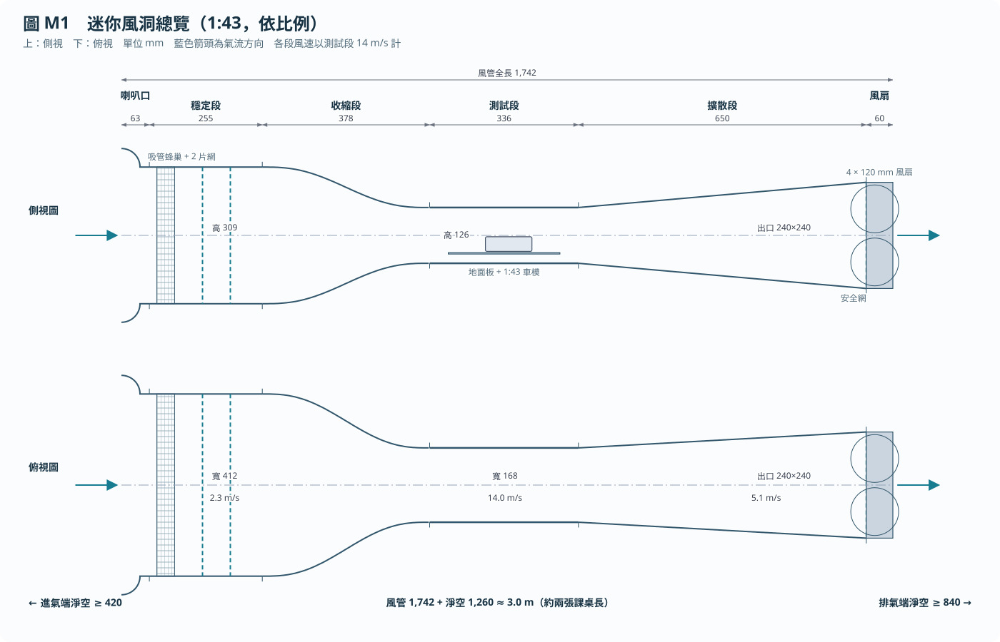

# Mini Wind Tunnel (1:43, Arduino Uno)

A desk-sized, open-return suction wind tunnel for measuring the drag and downforce of 1:43 die-cast car models. It is a general-education course final project: an Arduino Uno does all the control and data logging, and the material budget is capped at NT$5,000.



**Status (November 2026): design stage.** Nothing is built yet. The fan model is still being chosen, and the car dimensions are estimates until the model car is bought and measured. Every number below is a design target, not a measured result.

## At a glance

| | |
| --- | --- |
| Duct length | about 1.7 m (fits on two classroom desks; needs about 3 m of straight floor space including inlet and exhaust clearance) |
| Test section | 168 × 126 × 336 mm, 3 mm clear polycarbonate |
| Contraction | 6:1 |
| Air speed | 5–14 m/s (class demo at 10 m/s; coefficient-grade data from 12 m/s up) |
| Drive | 2 × 2 array of 120 mm 12 V fans, closed-loop speed control on measured dynamic pressure |
| Force balance | 100 g load cell for drag, 1 kg load cell for vertical force, about 1 mN (0.1 gf) resolution |
| Speed sensing | Home-made: (A) a bell manometer on a load cell, primary; (B) a pair of BMP280 barometers, backup |
| Controller | Arduino Uno + 3 × HX711 |
| Budget | ≤ NT$5,000 (current estimate NT$3,910–7,750; see the shopping list for the low-cost route) |

The geometry is the earlier 1:18 design scaled by 0.42, with three changes: computer fans in place of an industrial fan, fixed V-shaped wheel saddles in place of rollers, and 3 mm panels.

## Documents

Most of the documents for people are in Traditional Chinese (Taiwan).

| File | What it is |
| --- | --- |
| [build_plan_mini.zh-TW.md](build_plan_mini.zh-TW.md) | **Start here.** Build plan: components, balance, Arduino control, speed sensors, calibration, safety, budget, acceptance tests, build order, open questions |
| [shopping_list.zh-TW.md](shopping_list.zh-TW.md) | Parts list with Shopee search terms, prices, and how to stay under NT$5,000 |
| [model.md](model.md) | Research methodology written as a paper (English): theory, facility, calibration, test program, uncertainty, limitations, references |
| [spec/mini.json](spec/mini.json) | Single source of every dimension, pin assignment, and budget line |
| [spec/README.md](spec/README.md) | Spec conventions and design rules, written for coding and CAD agents |
| [figures/](figures/) | Figures M1–M8 (Chinese labels), generated from the spec |

## Tools

The Python tools use only the standard library (tested with Python 3.11). Run them from the repository root.

```sh
python3 tools/test_mini.py          # consistency checks on spec/mini.json (23 tests plus WATCH warnings)
python3 tools/mini_calc.py          # fan operating points, forces, sensor resolution, panel deflection, budget
python3 tools/make_mini_figures.py  # regenerate figures/M1–M8 from the spec
```

After changing `spec/mini.json` (for example, after measuring the car), run the tests and regenerate the figures. The two WATCH items, the budget upper bound and the reduced ride height on the V-saddles, are known and accepted. They are not errors.

| Tool | Role |
| --- | --- |
| [tools/airflow_calc.py](tools/airflow_calc.py) | Generic duct calculations: losses, pressures, boundary layers, deflection |
| [tools/mini_calc.py](tools/mini_calc.py) | Mini-tunnel report built on `airflow_calc.py` |
| [tools/test_mini.py](tools/test_mini.py) | Consistency tests (also runs under `pytest`) |
| [tools/make_mini_figures.py](tools/make_mini_figures.py) | Figure generator |
| [tools/svg_kit.py](tools/svg_kit.py) | Shared SVG drawing helpers |

## Arduino

[arduino/fan_pwm_test/fan_pwm_test.ino](arduino/fan_pwm_test/fan_pwm_test.ino) is a one-fan go/no-go test for the fan decision. It checks whether a cheap 2-wire fan (Delta QFR1212GHE), switched by a MOSFET from the Uno, can be speed-controlled smoothly from 30 % to 100 %. Wiring, Serial Monitor commands (115200 baud), and pass criteria are in the comment at the top of the sketch. If the test fails, the plan falls back to the 4-wire PFC1212DE.

The main control sketch (speed PID, automatic zero/ramp/settle/capture/re-zero sequence, CSV logging over USB, hatch interlock) is not written yet. The pin map is in `spec/mini.json` and figure M5.

## Safety notes

- Four fans at full speed draw up to about 19 A at 12 V. Use the wire gauges and the 25 A fuse given in the build plan.
- Setting PWM to 0 % does **not** stop 4-wire fans, and a disconnected PWM line makes them run at full speed. Stopping must cut the fans' 12 V. A hardware E-stop does this independently of the sketch.
- Fit a metal guard on the fan outlet, and do not point the exhaust at people.

## Repository layout

```
.
├── build_plan_mini.zh-TW.md    build plan (start here)
├── shopping_list.zh-TW.md      parts and budget
├── model.md                    research methodology (paper format)
├── spec/                       mini.json + agent-facing spec notes
├── tools/                      calculations, tests, figure generator
├── figures/                    M1–M8 SVG figures
├── arduino/fan_pwm_test/       fan go/no-go sketch
└── archive/full_1to18/         earlier 1:18 design (reference only, not built)
```

The [archive/full_1to18/](archive/full_1to18/) folder holds the original 1:18 design that the mini tunnel was scaled from. It is self-contained: its tools run from inside that folder. It is kept for reference and will not be built.
