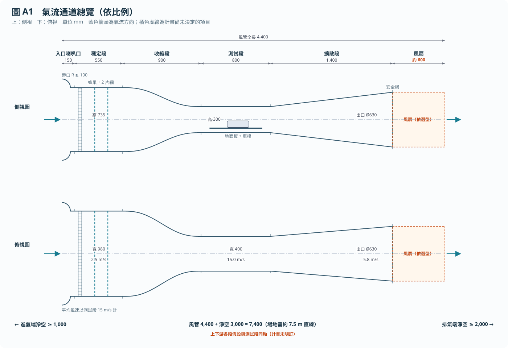
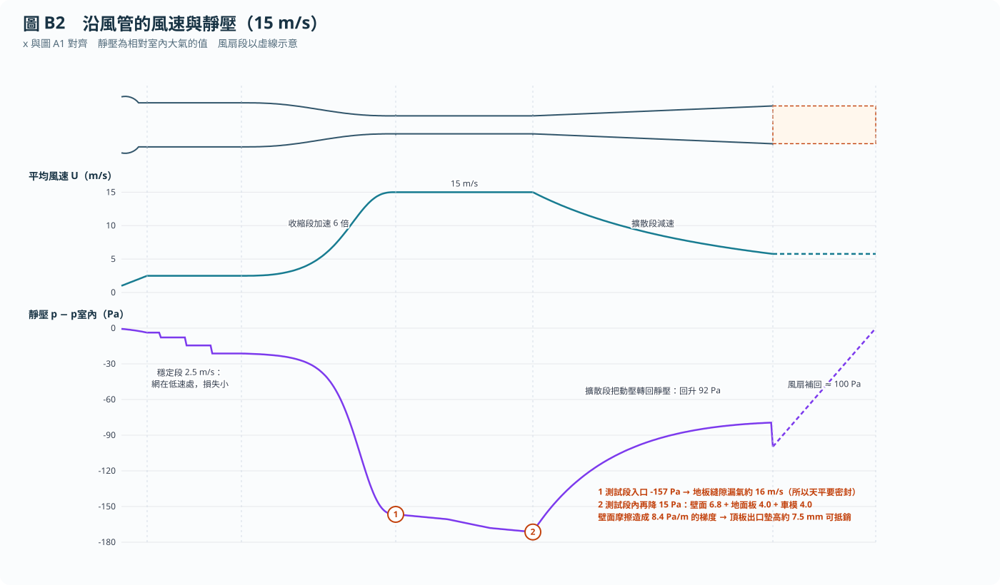
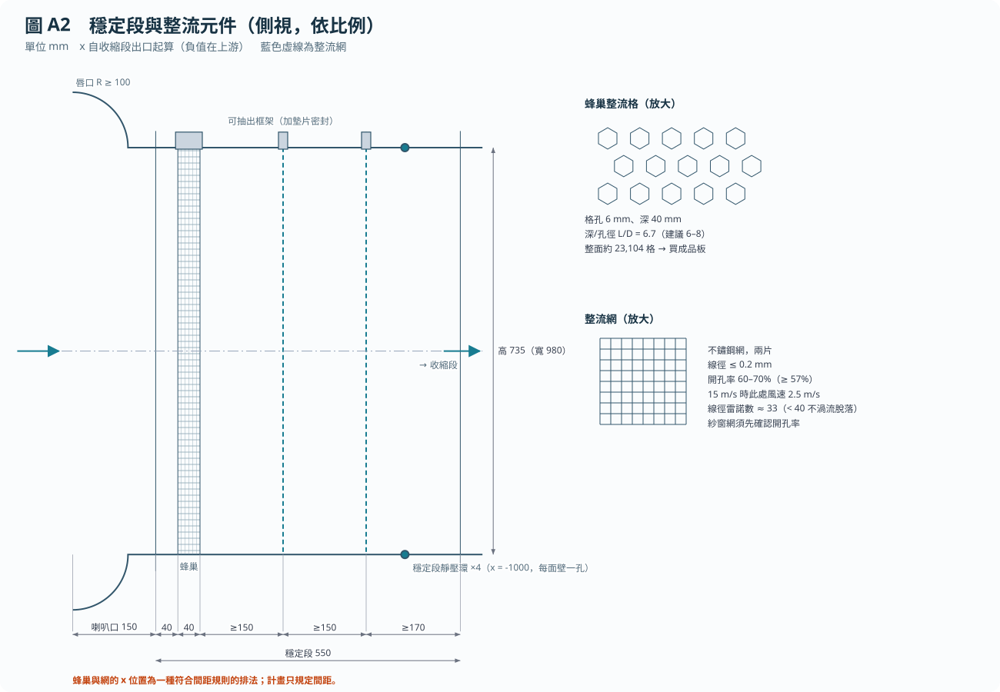
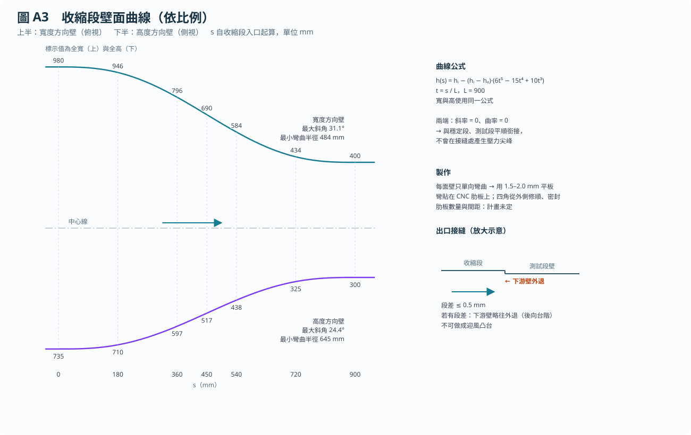
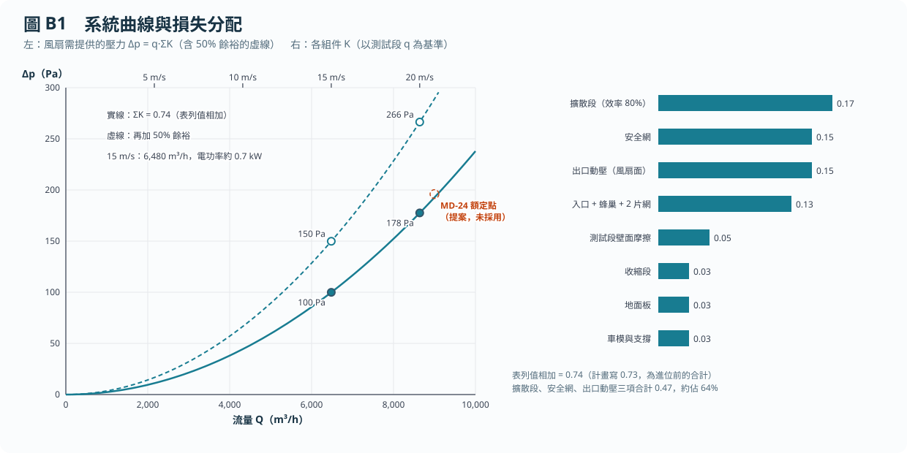
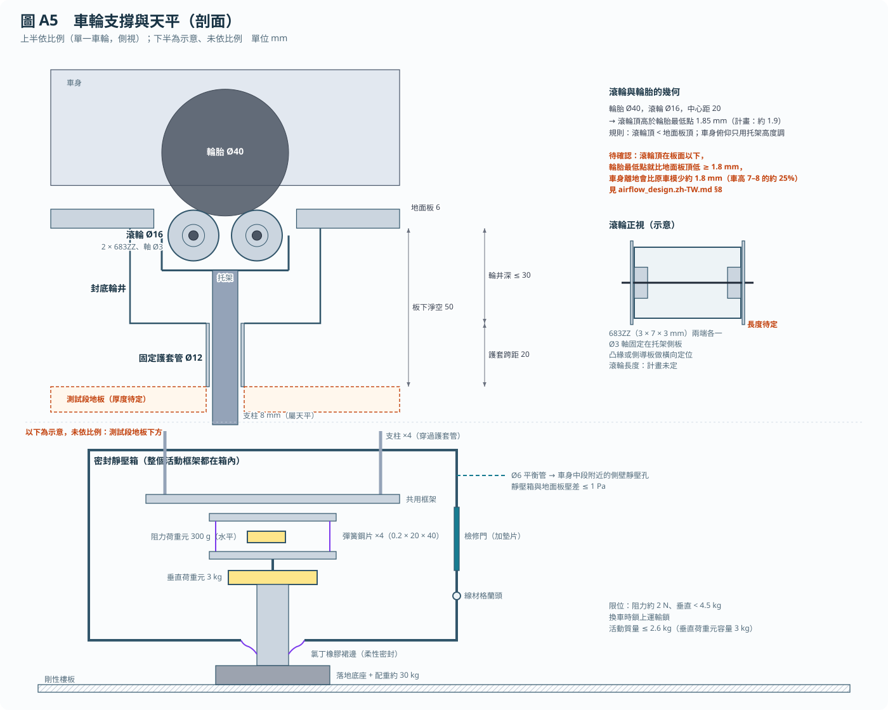

# 氣流通道設計說明與計算

本文說明氣流通道為什麼長這樣，並逐步列出每個尺寸的計算。內容不改變計畫，數值都取自 [build_plan.md](build_plan.md)。

- 所有數字都可以重算：`python3 tools/airflow_calc.py`
- 尺寸彼此是否一致，由 `python3 tools/test_geometry.py` 檢查（23 項全部通過，另有 5 項自動標出的觀察項目，見 §8）
- 圖由 `python3 tools/make_figures.py` 依 [spec/geometry.json](spec/geometry.json) 產生，因此圖與數字一定一致

空氣性質：$\rho = 1.20\ \mathrm{kg/m^3}$，運動黏度 $\nu = 1.5\times10^{-5}\ \mathrm{m^2/s}$。除非另外說明，以 15 m/s 計算。

## 0. 設計順序：從車模倒推到風扇

氣流通道的每一段，都由前一段的結果決定：

1. **車模大小** → 決定測試段截面與長度（§1）
2. **要量到的力** → 決定風速與流量（§2）
3. **氣流要多均勻** → 決定收縮比，進而決定穩定段尺寸（§3）
4. **收縮比與穩定段** → 決定收縮段的長度與曲線（§4）
5. **吸氣造成的負壓** → 決定壁板厚度、密封與頂板墊片（§5）
6. **出口要回收多少能量** → 決定擴散段（§6）
7. **以上各段的損失加總** → 決定風扇（§7）

圖 B2 是整條通道的「說明書」：空氣在穩定段走得慢（2.5 m/s），在收縮段加速 6 倍，在測試段維持 15 m/s，再由擴散段減速、把動能轉回壓力，最後由風扇補足一路上的損失。

## 1. 測試段：400 × 300 mm、長 800 mm

### 1.1 截面：阻塞比

車模擋住的面積佔截面的比例稱為**阻塞比**。阻塞比越大，車模周圍的氣流被牆壁「擠」得越快，量到的力就越偏大。常用準則是 5% 以下修正量小，7.5% 以下仍可用但須修正。

$$
\text{阻塞比} = \frac{A_m}{A_{ts}}
$$

| 車模 | $A_m$ (m²) | 佔全截面 0.120 m² | 佔地面板以上 400 × 244 = 0.0976 m² |
| --- | --- | --- | --- |
| 計畫假設 | 0.0065 | 5.4% | **6.7%** |
| 提案 FL5 | 0.0070 | 5.8% | **7.2%** |

地面板下方仍有氣流，所以真實值介於兩欄之間。**這超過 5% 準則（觀察項目 1）**，因此係數需要阻塞修正，或至少在報告中註明。

### 1.2 長度：每一段都有用途

| x (mm) | 長度 | 用途 |
| --- | --- | --- |
| 0–100 | 100 | 收縮段出口後讓氣流穩定；放入口靜壓環（x = 30） |
| 100–300 | 200 | 地面板前緣到車頭：讓新的邊界層從這裡開始，越短越薄 |
| 300–550 | 250 | 車模 |
| 550–800 | 250 | 近尾流：1 個車長，讓尾流在進入擴散段前離開車模 |

### 1.3 為什麼要地面板

邊界層是貼著地面、速度被拖慢的一層空氣。如果直接用風洞地板，邊界層從收縮段入口就開始長，到車頭已經跑了約 1.2 m：

$$
\delta_{\text{紊流}} \approx \frac{0.37\,x}{Re_x^{0.2}},\qquad Re_x = \frac{Ux}{\nu}
$$

| 位置 | 起算距離 | 15 m/s 邊界層厚度 |
| --- | --- | --- |
| 風洞地板，車頭處 | 約 1,200 mm | **約 27 mm**，遠大於 7–8 mm 的車高 |
| 地面板，車頭處 | 200 mm | 層流 2.2 mm／紊流 6.4 mm |
| 地面板，車尾處 | 450 mm | 層流 3.4 mm／紊流 12.3 mm |

層流用 $\delta \approx 5x/\sqrt{Re_x}$。地面板讓邊界層在車頭前 200 mm 才重新開始，厚度降到約 1/4 至 1/10。在車尾附近它仍與車高同一數量級，這就是計畫中失效模式 8 列為「限制」的原因。

## 2. 風速與流量

$$
q = \tfrac12 \rho U^2,\qquad Q = U\,A_{ts}
$$

| $U$ (m/s) | $q$ (Pa) | $Q$ (m³/h) |
| --- | --- | --- |
| 5 | 15 | 2,160 |
| 10 | 60 | 4,320 |
| 15 | 135 | 6,480 |
| 20 | 240 | 8,640 |

例：$Q = 15 \times 0.4 \times 0.3 \times 3600 = 6{,}480\ \mathrm{m^3/h}$。力與 $q$ 成正比，所以 5 mN 的解析度在 15 m/s 才只佔阻力的 1.6%（計畫表 1）。

## 3. 收縮比 6:1 與穩定段 980 × 735

### 3.1 為什麼要收縮

收縮段入口的風速若有 $\Delta u$ 的不均勻，對應一個壓力差 $\Delta p \approx \rho U_1 \Delta u$。這個壓力差通過收縮段時大致不變，但動壓放大了 $c^2$ 倍（$c$ 為收縮比），所以相對不均勻度縮小為：

$$
\frac{\Delta u_2}{U_2} \approx \frac{1}{c^2}\,\frac{\Delta u_1}{U_1} = \frac{1}{36}\,\frac{\Delta u_1}{U_1}\quad (c = 6)
$$

Mehta 與 Bradshaw（1979）建議小型風洞的收縮比為 6–9。取 6 是範圍內最小、最省空間的值。若取 9，穩定段會變成 1,200 × 900，更難搬進門。

### 3.2 穩定段尺寸

保持與測試段相同的長寬比，兩邊都乘 $\sqrt{6}$：

$$
400\sqrt6 = 980,\qquad 300\sqrt6 = 735,\qquad \frac{0.980 \times 0.735}{0.400 \times 0.300} = 6.00
$$

### 3.3 整流元件放在低速處

15 m/s 時穩定段風速只有 $15/6 = 2.5$ m/s。網的損失與當地動壓成正比，換算到測試段要除以 $c^2 = 36$，所以把整流元件放在這裡幾乎不花能量（§7）。

| 元件 | 規則 | 本設計 |
| --- | --- | --- |
| 蜂巢 | 深/孔徑 L/D 約 6–8 | 40/6 = 6.7；整面約 23,000 格 |
| 整流網開孔率 | ≥ 57%（太低會不穩定） | 60–70% |
| 網線徑雷諾數 $Re_w = U_1 d/\nu$ | 約 < 40，線後不會有渦流脫落 | 2.5 × 0.0002 / 1.5×10⁻⁵ = **33**；20 m/s 時 **44**（觀察項目 3） |
| 元件間距 | 讓前一元件的小渦流衰減 | ≥ 150；最後一片網到收縮段 ≥ 170 |

間距加總：40（入口到蜂巢）+ 40（蜂巢）+ 150 + 150 + 170 = 550 mm，正好是穩定段長度。

## 4. 收縮段：長 900 mm、五次多項式

### 4.1 曲線

$$
h(s) = h_i - (h_i - h_e)\,(6t^5 - 15t^4 + 10t^3),\qquad t = s/L
$$

對 $t$ 微分：

$$
\frac{dh}{dt} \propto 30t^2(1-t)^2,\qquad \frac{d^2h}{dt^2} \propto 60t - 180t^2 + 120t^3
$$

在 $t=0$ 與 $t=1$ 兩者都等於 0。也就是說，曲線與前後的直段**斜率相同、曲率也相同**，接縫處沒有轉折，氣流不會在那裡突然加速或減速。若用圓弧或直線斜面，接縫處的曲率會突然改變，在入口角落產生逆壓梯度，可能讓氣流分離。

以公式重算計畫表中的 7 個站位，誤差都小於 0.5 mm（測試 `test_contraction_table_matches_formula`）。

### 4.2 長度與板材

| 項目 | 寬度方向壁 | 高度方向壁 |
| --- | --- | --- |
| 每面壁內移 | (980 − 400)/2 = 290 mm | (735 − 300)/2 = 217.5 mm |
| 最大斜角（在中點） | 31.1° | 24.4° |
| 最小彎曲半徑 | 484 mm | 645 mm |

最大斜率發生在 $t = 0.5$：$\frac{290}{900} \times \frac{30}{16} = 0.604$，即 31.1°。最小半徑約 480 mm，因此 1.5–2 mm 的平板可以冷彎貼在肋板上。

長度比：$L/H_i = 900/735 = 1.22$；$L$ 除以入口水力直徑（840 mm）= 1.07。太短，入口角落容易分離；太長，則邊界層變厚、佔用房間。約 1 倍入口尺寸是常用的折衷。

## 5. 負壓：壁板、密封與頂板墊片

### 5.1 測試段比室內低多少

吸氣式風洞的空氣從室內（靜止、壓力 = 0）出發。到測試段入口時，一部分壓力變成動壓 $q$，一部分在入口、整流元件與收縮段損失掉：

$$
p_{ts} - p_{\text{室內}} = -q\,(1 + K_{\text{入口+整流}} + K_{\text{收縮段}}) = -135 \times (1 + 0.13 + 0.03) = -157\ \mathrm{Pa}
$$

任何縫隙都會以這個壓差把室內空氣吸進來：

$$
u_{\text{漏}} = \sqrt{2\,\Delta p/\rho} = \sqrt{2 \times 157 / 1.2} = 16\ \mathrm{m/s}
$$

這和主流速度差不多，而且就發生在車輪旁，所以天平必須放在密封靜壓箱內（計畫 C5）。

### 5.2 壁板撓度

把 400 mm 寬的頂板視為兩邊簡支的長條板：

$$
w = \frac{5\,p\,b^4}{384\,D},\qquad D = \frac{E\,t^3}{12(1-\nu^2)},\quad E_{PC} = 2.35\ \mathrm{GPa},\ \nu = 0.37
$$

| 板 | 15 m/s（157 Pa） | 20 m/s（278 Pa） | 計畫值 |
| --- | --- | --- | --- |
| 側壁 6 mm，跨距 300 | 0.34 mm | 0.60 mm | 0.3 |
| 頂板 8 mm，跨距 400 | 0.45 mm | 0.80 mm | 0.4 |
| 頂板 6 mm，跨距 400 | 1.07 mm | 1.89 mm | 0.9（觀察項目 4） |

撓度與厚度的三次方成反比，所以頂板用 8 mm。

### 5.3 頂板墊片為什麼是 0–10 mm

截面不變時，壁面摩擦會讓靜壓沿流向一路下降：

$$
\frac{\Delta p}{L} = \frac{K_{\text{壁面}}\,q}{L} = \frac{0.05 \times 135}{0.8} = 8.4\ \mathrm{Pa/m}
$$

這比驗收標準 2 Pa/m 大 4 倍，而且這個梯度會在車模前後產生假阻力（計畫失效模式 9）。解法是讓截面沿流向稍微變大，使動壓下降的量剛好抵銷摩擦損失。由 $q \propto 1/A^2$ 可得：

$$
\frac{dA}{A} = \frac{K}{2} \;\Rightarrow\; \Delta H = 300 \times \frac{0.05}{2} = 7.5\ \mathrm{mm}
$$

7.5 mm 落在計畫的 0–10 mm 內。若把地面板的損失（0.03）也算進去，需要 12 mm，超過範圍（觀察項目 2）。

## 6. 擴散段：400 × 300 → Ø630、長 1,400 mm

### 6.1 幾何

$$
d_{eq} = \sqrt{4A/\pi} = \sqrt{4 \times 0.12/\pi} = 391\ \mathrm{mm},\qquad
AR = \frac{\pi \times 0.63^2/4}{0.12} = 2.60
$$

$$
\theta = \arctan\frac{(630 - 391)/2}{1400} = 4.88^\circ
$$

等效圓錐半角超過約 5° 時，擴散段壁面容易分離。分離會讓擴散段幾乎不回收壓力，還會把不穩定傳回測試段。

### 6.2 為什麼一定要擴散段

離開風洞的空氣帶走的動壓直接算損失。擴散段把出口速度降為 $1/AR$，出口動壓降為 $1/AR^2$：

$$
K_{\text{出口}} = \frac{1}{AR^2} = 0.148,\qquad K_{\text{擴散段}} = (1-\eta)\left(1 - \frac{1}{AR^2}\right) = 0.2 \times 0.852 = 0.17
$$

| 配置 | 出口相關損失 | 安全網（K_local ≈ 1.0） | 系統 ΣK |
| --- | --- | --- | --- |
| 有擴散段 | 0.17 + 0.148 | 1.0/2.6² = 0.15 | **0.74** |
| 沒有擴散段 | 1.00 | 1.0（在全速處） | **2.27** |

沒有擴散段，風扇壓力與功率都要約 3 倍。安全網也因此放在擴散段出口：同一片網在這裡的損失只有全速處的 1/6.8。

## 7. 損失加總與風扇

### 7.1 各項損失（以測試段 q 為基準）

| 組件 | 計畫 $K$ | 獨立估算 | 說明 |
| --- | --- | --- | --- |
| 入口 + 蜂巢 + 2 片網 | 0.13 | 0.11 | 網 $K_{local}$ = 1.67（Wieghardt 公式，開孔率 0.65、$Re_w$ 33），蜂巢約 0.63，皆除以 36 |
| 收縮段 | 0.03 | — | 經驗值 |
| 測試段壁面 | 0.05 | 0.033 | $f L/D_h$：$D_h$ = 343 mm，$Re$ = 3.4×10⁵，$f$ = 0.014 |
| 地面板 | 0.03 | — | 經驗值 |
| 車模與支撐 | 0.03 | — | 經驗值 |
| 擴散段 | 0.17 | 0.17 | §6.2 |
| 安全網 | 0.15 | — | 等於 $K_{local}$ ≈ 1.0 除以 $AR^2$ |
| 出口動壓 | 0.15 | 0.148 | §6.2 |
| **合計** | **0.74**（計畫寫 0.73，見觀察項目 6） | | |

能獨立估算的項目，計畫值都等於或略大於估算值，屬於保守估計。

### 7.2 風扇工況

$$
\Delta p = q\sum K,\qquad P_{\text{電}} = \frac{Q\,\Delta p_{\text{含餘裕}}}{\eta_{\text{風扇}}},\quad \eta = 0.40
$$

| $U$ (m/s) | $Q$ (m³/h) | $\Delta p$ 計算 (Pa) | 加 50% 餘裕 (Pa) | 電功率 |
| --- | --- | --- | --- | --- |
| 5 | 2,160 | 11 | 17 | 25 W |
| 10 | 4,320 | 44 | 67 | 0.2 kW |
| 15 | 6,480 | 100 | 150 | 0.67 kW |
| 20 | 8,640 | 178 | 266 | 1.6 kW |

例：$Q = 6480/3600 = 1.8\ \mathrm{m^3/s}$，$P = 1.8 \times 150 / 0.4 = 675\ \mathrm{W}$。

系統曲線是通過原點的拋物線（$\Delta p \propto Q^2$）。風扇的實際操作點是風扇曲線與這條拋物線的交點，所以選型時要拿廠商的完整風扇曲線來比對，不能只看單一額定點。

### 7.3 場地長度

風管 150 + 550 + 900 + 800 + 1,400 + 約 600 = 4,400 mm，加上進氣端 ≥ 1,000、排氣端 ≥ 2,000 的淨空，共 7,400 mm，因此計畫要求約 7.5 m 的直線空間。

## 8. 檢查發現（觀察項目）

以下項目**不違反計畫**，但計算顯示餘裕不足或有疏漏，需要決定是否處理。計畫內容尚未修改。

| # | 項目 | 計算結果 | 可能的處理 |
| --- | --- | --- | --- |
| 1 | 阻塞比 | 以地面板以上截面計為 6.7%（FL5 為 7.2%），超過 5% 準則 | 係數加阻塞修正，或在報告註明 |
| 2 | 頂板墊片範圍 | 只抵銷壁面摩擦需 7.5 mm；加上地面板需 12 mm | 墊片範圍改為 0–15 mm |
| 3 | 20 m/s 時網的線徑雷諾數 | 44，略高於約 40 | 升級 20 m/s 時改用更細的線，或接受 |
| 4 | 6 mm 頂板撓度 | 1.07 mm，計畫寫 0.9 | 不影響決定：計畫已選 8 mm |
| 5 | 滾輪托架使車身變低 | 滾輪頂高於輪胎最低點 1.85 mm，而滾輪頂必須低於地面板頂，所以輪胎最低點比板面低 ≥ 1.85 mm，車身離地少約 1.85 mm（約佔 7.5 mm 的 25%） | 改用較小滾輪：Ø10 滾輪、中心距 12 時只低 0.73 mm；或改為在量測時記錄實際車高 |
| 6 | ΣK 加總 | 表列值相加為 0.74，計畫寫 0.73（進位前的合計） | 不影響結論（差 1%） |

第 5 項的幾何見圖 A5：

$$
\text{輪胎下沉量} = R + r - \sqrt{(R+r)^2 - a^2} = 20 + 8 - \sqrt{28^2 - 10^2} = 1.85\ \mathrm{mm}
$$

其中 $R$ 為輪胎半徑，$r$ 為滾輪半徑，$a$ 為兩滾輪中心距的一半。

## 參考

- Mehta, R. D., & Bradshaw, P. (1979). Design rules for small low speed wind tunnels. *The Aeronautical Journal*, 83(827), 443–449. [doi:10.1017/S0001924000031985](https://doi.org/10.1017/S0001924000031985)
