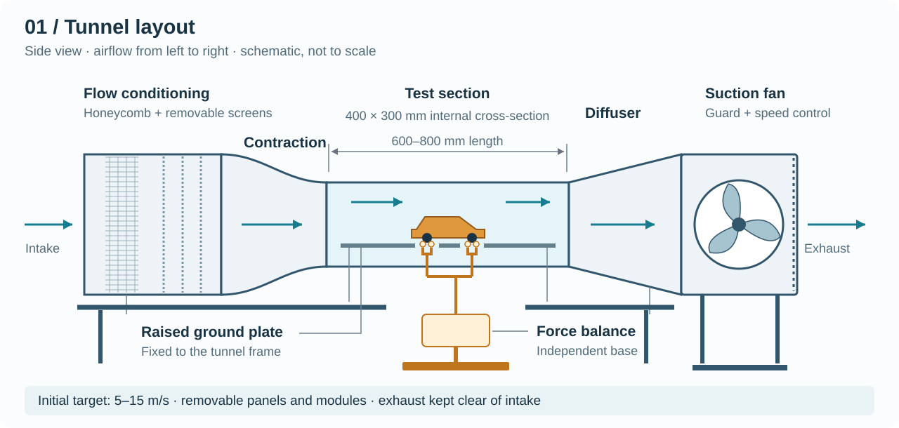
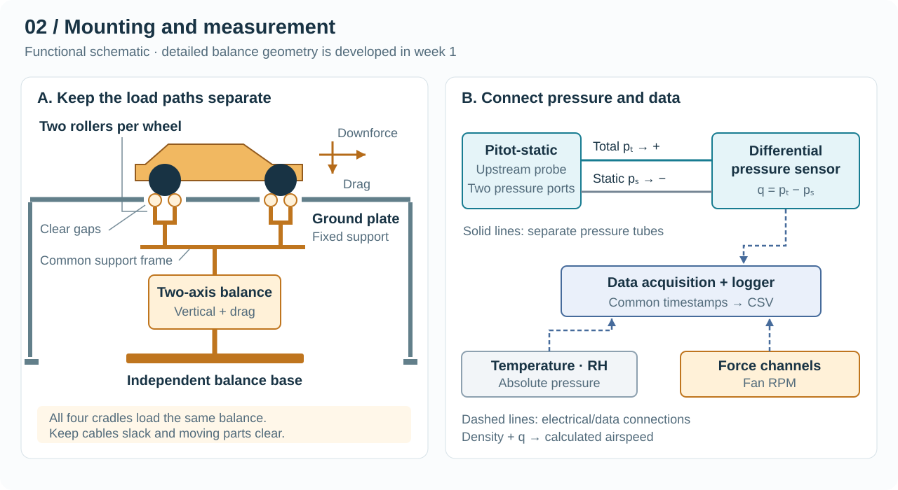
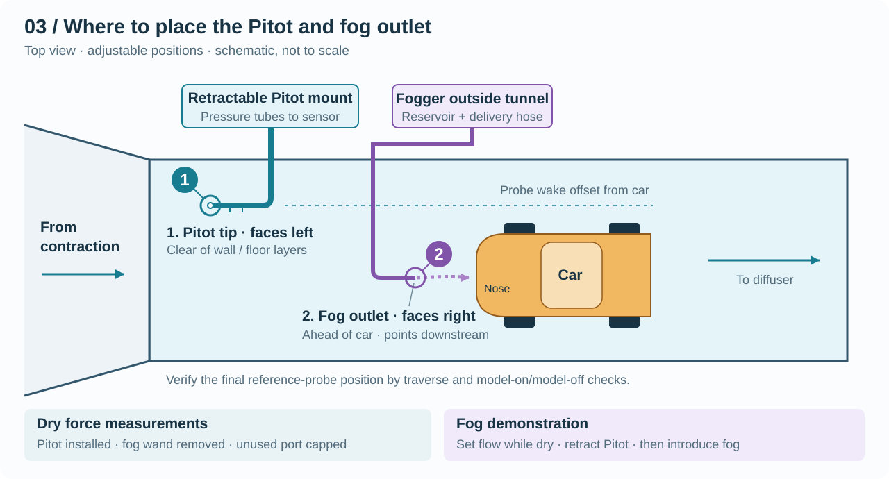

# Wind Tunnel Apparatus — Six-Week Build Plan

A ducted fan is enough for a hobby tunnel, but this tunnel must resolve about 0.3 N of drag under a car weighing about 12 N.

**Build an 800 mm long, 400 × 300 mm open-return suction tunnel that runs at 5–15 m/s and measures a 1:18 car's drag and downforce to about 5 mN, using a balance sealed from the airflow.**

This plan covers construction and equipment acceptance. Vehicle studies and the 20 m/s upgrade follow it. See [model.md](model.md) for the technical basis and [shopping_list.md](shopping_list.md) for parts and suppliers.

## What the design must achieve

The force signal sets every tolerance in this plan. Aerodynamic force follows

$$
F = C\,q\,A_m,\qquad q=\tfrac{1}{2}\rho U^2,
$$

where $C$ is the force coefficient, $q$ is dynamic pressure, $A_m$ is the car's frontal area, $\rho$ is air density, and $U$ is the mean test-section speed.

**Table 1. Planning estimates.** Inputs are $A_m=0.0065\ \mathrm{m^2}$, drag coefficient $C_D=0.35$, vertical-force coefficient magnitude $|C_L|=0.30$, $\rho=1.20\ \mathrm{kg/m^3}$, and a 250 mm car. $Re_L$ is Reynolds number based on car length. Replace these inputs with measured values in week 1.

| $U$ (m/s) | $q$ (Pa) | Flow (m³/h) | Drag (mN) | Vertical (mN) | $Re_L$ | 5 mN as % of drag |
| --- | --- | --- | --- | --- | --- | --- |
| 5 | 15 | 2,160 | 34 | 29 | 8.3 × 10⁴ | 15% |
| 7.5 | 34 | 3,240 | 77 | 66 | 1.3 × 10⁵ | 6.5% |
| 10 | 60 | 4,320 | 137 | 117 | 1.7 × 10⁵ | 3.7% |
| 12.5 | 94 | 5,400 | 213 | 183 | 2.1 × 10⁵ | 2.3% |
| 15 | 135 | 6,480 | 307 | 263 | 2.5 × 10⁵ | 1.6% |

**The 3% coefficient target is reachable only above about 11 m/s.** At that speed, 5 mN equals 3% of the estimated drag. Report absolute forces and trends from 5 to 11 m/s, and treat 11–15 m/s as coefficient-grade data.

Suction creates the second governing constraint. The test section runs about 157 Pa below room pressure at 15 m/s, so room air enters any floor gap at about 16 m/s. Those gaps sit beside the wheels and under the car, exactly where the measurement is most sensitive.

The hard part is therefore not moving air; it is isolating millinewton forces from gravity, leakage, vibration, and support drag.

## Apparatus layout

*Figure 1. Overall arrangement; schematic, not to scale. It predates the sealed balance plenum and wheel wells specified below.*

The baseline tunnel needs a straight run of about 7.5 m, including clear air at both ends. Table 2 gives the starting dimensions for the week 1 layout.

**Table 2. Baseline dimensions.**

| Module | Inlet → outlet (mm) | Length (mm) | Governing choice |
| --- | --- | --- | --- |
| Inlet bell | Rounded lip, radius ≥ 100 | 150 | Prevents separation at the intake |
| Settling chamber | 980 × 735 | 550 | Contraction ratio 6:1 |
| Contraction | 980 × 735 → 400 × 300 | 900 | Fifth-order wall profile |
| Test section | 400 × 300 | 800 | Fixed at the long end of the earlier 600–800 mm range |
| Diffuser | 400 × 300 → Ø630 | 1,400 | Area ratio 2.6; equivalent cone half-angle 5° |
| Fan | Depends on selection | About 600 | Verify against the quoted fan |
| Clear air | — | ≥ 1,000 intake; ≥ 2,000 exhaust | Duct the exhaust outside if the room is shorter |

Drop to a 4:1 contraction (800 × 600 mm inlet, about 700 mm long) only if the room or door cannot accept 6:1. A shorter contraction weakens flow uniformity, so survey it with the same acceptance limits.

## Components

### A. Airflow path

The airflow path must deliver uniform, steady air to the car with as little pressure loss as practical.

**A1. Inlet and flow conditioning.** Conditioning removes room-air swirl and large-scale unevenness before the contraction.

- **Honeycomb:** use a panel with about 6 mm cells and 40 mm depth. The face needs about 20,000 cells, so buy a panel rather than assemble straws.
- **Screens:** fit two slide-out stainless screens with 60–70% open area and wire no thicker than 0.2 mm. Do not substitute insect mesh without checking its open area.
- **Spacing:** leave at least 150 mm between conditioning elements and 170 mm from the last screen to the contraction.
- **Sealing:** gasket each slide-out frame so that suction cannot draw room air around it.

**A2. Contraction.** The contraction accelerates the flow sixfold while avoiding wall separation. Use the same profile for height and width:

$$
h(\xi)=h_i-(h_i-h_e)\left(6\xi^5-15\xi^4+10\xi^3\right),\qquad \xi=\frac{s}{L},
$$

where $h$ is the local dimension, $h_i$ and $h_e$ are its inlet and exit values, $s$ is the distance from the inlet, and $L$ is the contraction length.

| $s$ (mm) | 0 | 180 | 360 | 450 | 540 | 720 | 900 |
| --- | --- | --- | --- | --- | --- | --- | --- |
| Height (mm) | 735 | 710 | 597 | 517 | 438 | 325 | 300 |
| Width (mm) | 980 | 946 | 796 | 690 | 584 | 434 | 400 |

Each wall curves in one direction only, so bend it from flat 1.5–2 mm sheet over CNC-cut ribs. Fair and seal the corners from outside where possible. Limit the exit step to 0.5 mm, and make any remaining step face downstream.

**A3. Test section.** The test section holds the model and sets the reference flow.

- **Panels:** use 6 mm polycarbonate for the 300 mm side walls and at least 8 mm for the 400 mm roof. At 157 Pa, these estimate to about 0.3 mm and 0.4 mm of center deflection; 6 mm on the roof gives about 0.9 mm.
- **Roof shim:** hinge the roof at the entrance and shim its exit by 0–10 mm. This offsets boundary-layer growth and flattens the streamwise pressure gradient.
- **Static taps:** drill 1 mm side-wall taps at streamwise positions $x$ = 100, 300, 500, and 700 mm from the contraction exit. Deburr them flush and connect them through a manual selector.
- **Removable survey roof:** cut stem holes at lateral positions $y$ = −100, −50, 0, +50, and +100 mm from the centerline, at both survey stations, and plug unused holes.

**Table 3. Test-section positions, measured from the contraction exit.**

| Item | $x$ (mm) | Lateral and vertical position |
| --- | --- | --- |
| Wall static ring | 30 | Four taps, one per wall |
| Ground-plate leading edge | 100 | Spans the section; 50 mm above the floor |
| Pitot nose | 130 | $y$ = +130 mm from center; 150 mm above the plate |
| Fog outlet | About 220 | Adjustable; laterally separated from the Pitot |
| Car nose / tail | 300 / 550 | Centered on the plate |
| Plate trailing edge | 700 | Adjustable flap |
| Test-section exit | 800 | Leaves 250 mm for the near wake |

**A4. Diffuser and safety screen.** The diffuser recovers pressure, and the screen stops loose parts before they reach the fan. Build a rectangular-to-round transition with smooth flanges. Fit a removable 5–10 mm mesh at its exit, where air is slowest. Check for separation with wall tufts during commissioning.

**A5. Fan and drive.** Select the fan from a calculated system curve:

$$
\Delta p=q\sum K,
$$

where $\Delta p$ is the total-pressure loss and $K$ is each component's loss coefficient, referred to test-section $q$.

| Component | $K$ |
| --- | --- |
| Inlet, honeycomb, and two screens | 0.13 |
| Contraction | 0.03 |
| Test-section walls | 0.05 |
| Ground plate | 0.03 |
| Model and supports | 0.03 |
| Diffuser at 80% efficiency | 0.17 |
| Safety screen | 0.15 |
| Fan-plane dynamic pressure | 0.15 |
| **Total, before rounding** | **0.73** |

| Duty | Flow (m³/h) | Calculated (Pa) | With 50% margin (Pa) | Electrical at 40% efficiency |
| --- | --- | --- | --- | --- |
| 15 m/s | 6,480 | 99 | 150 | About 0.7 kW |
| 20 m/s option | 8,640 | 176 | 260 | About 1.6 kW |

- **Quotation:** request both duties. Sizing for 20 m/s now avoids a second fan purchase later, at the cost of running at lower speed for 5 m/s.
- **Fan type:** quote a stock 630 mm axial fan beside the Kruger centrifugal. The BSB range reaches 4,500 Pa, whereas this duty is high flow at only about 150 Pa. Swirl matters little because the fan is downstream of the model.
- **Acceptance:** require the fan curve, operating points, delivery date, motor mass, and mains requirements in writing.
- **Duct connection:** use a reinforced flexible connector that will not collapse inward under suction.

**A6. Structure and room.** The structure must hold the duct stiffly and let every module enter the room. Build the 4040 frame with diagonal bracing and flanged, gasketed modules. Measure the door first: a 735 mm settling chamber plus flanges and frame may not pass through a standard door without tilting.

### B. Ground and model support

The support must hold the car at a known attitude while carrying all of its load through the balance.

**B1. Ground plate.** The plate starts a new boundary layer closer to the car than the tunnel floor can.

- **Dimensions:** make it 600 mm long, 6 mm thick, and flat within 0.3 mm over the car area, with 50 mm of under-plate clearance.
- **Edges:** use a 4:1 elliptical leading edge and an adjustable trailing-edge flap. Set the flap so that tufts show attached flow on the top surface.
- **Inserts:** fit replaceable inserts around the wheels, and hold 1–2 mm clearance throughout balance movement.

**B2. Wheel wells and post shrouds.** Wells keep the under-plate wind off the moving parts. A bare 8 × 50 mm post carries about 65 mN at 15 m/s, so four total about 260 mN, or 84% of the car's drag. Hang one closed-floor well, at most 30 mm deep, beneath each plate opening. Run each post through a fixed 12 mm tubular shroud across the remaining under-plate gap.

**B3. Roller cradles.** Each two-roller cradle locates one wheel without any chassis fixing, as originally proposed.

- **Measure first:** record tire diameter and width, wheelbase, track, mass, ride height, and whether the suspension is sprung.
- **Starting geometry:** with a 40 mm tire, try 16 mm rollers at 20 mm centers. The roller tops then stand about 1.9 mm above the tire bottom, so set the car's height accordingly and keep the rollers below plate level.
- **Parts:** use two 683ZZ bearings per roller on 3 mm shafts, with flanges or side guides for lateral location.
- **Adjustment:** give each cradle independent wheelbase, track, and height adjustment. Set body pitch with cradle height, never by tilting the moving frame.
- **Wheel lock:** fit a removable lock to stop the rollers during force runs. Tire and suspension compliance still needs checking, and sprung models should be blocked or noted.

The rollers do not need to turn during a measurement, because nothing drives the wheels. **Test locked rollers against a fixed V-saddle on the week 2 prototype.** If results match within repeatability, build the other three cradles as fixed saddles unless wheel drive is planned. Escape is not a load-case concern: at this geometry, lift-off needs horizontal force near 0.38 of the car's weight, about 4.5 N.

**B4. Ahmed-body adapter.** The reference body has no wheels, yet [model.md](model.md) tests it first. Provide four stilt sockets that fasten to the cradle brackets in place of the rollers. Size them from the selected reference dataset, with the balance frame unchanged.

**B5. Attitude gauging.** Ride height and pitch are controlled variables, so they need instruments. A 0.1° pitch change moves one axle only 0.26 mm over a 150 mm wheelbase. Use a depth gauge or pin set from the plate datum at both axles, with 0.1 mm or better resolution. Photograph the frontal silhouette against a scale to measure $A_m$.

### C. Force balance

The balance converts millinewton loads into calibrated signals and rejects everything else.

*Figure 2. Side view of two of the four cradles. It predates the plenum and wells, and does not show them.*

**C1. Moving assembly.** Weigh every part against the 3 kg capacity of the vertical cell, because taring does not remove dead load.

| Item | Mass estimate (kg) |
| --- | --- |
| 1:18 model | 1.0–1.6 |
| Four cradles | 0.2 |
| Common frame and posts | 0.3 |
| Drag stage, drag cell, and upper plate | 0.3–0.5 |
| **Total** | **1.8–2.6** |

Reject any design above 2.6 kg until the margin is reviewed. Options include lighter hardware, a lightened model, or a counterweight. Check the cell's rated platform size against the 150 mm wheelbase before fixing the layout.

**C2. Drag stage.** The drag stage isolates streamwise load from the car's weight.

- **Guidance:** start with four spring-steel blades, each 0.2 × 20 × 40 mm, clamped at both ends. They estimate to about 2,000 N/m in the drag direction, and they carry the dead load well below their buckling limit.
- **Sensor:** fit the 300 g cell between the stage and its base, with its sensing axis horizontal.
- **Stacking:** mount the drag stage on the vertical cell's top plate, so the vertical cell carries everything.
- **Cables:** cross any moving interface with a slack, ultra-flexible 30–32 AWG loop. Prove its effect by moving the loop during a logged zero.

**C3. Vertical stage.** The vertical stage measures total aerodynamic load through one single-point cell. Datasheet repeatability is ±2.9 mN, which uses most of the 5 mN allowance, so it is the tightest channel. Pre-load a newly mounted model for at least 30 minutes, because the cell's full-load creep can reach 11.8 mN/h.

**C4. Protection and damping.** Stops and damping protect the small cells and control resonance.

- **Stops:** set the drag stop near 2 N and the vertical stop below the cell's 4.5 kg overload. Add a transit lock for model changes.
- **Damping:** assuming 0.3 mm of cell deflection at rated load, natural frequencies are about 11 Hz in drag and 30 Hz vertically. A four-pole 60 Hz motor rotates at about 10–29 Hz across the speed range, so the two overlap. Measure the spectrum at 80 samples/s, and add non-contact eddy-current damping if a peak appears.
- **Leveling:** provide level adjustment on the pedestal, and verify drag-to-vertical cross-talk in calibration.

**C5. Sealed plenum and pedestal.** The plenum keeps room air from entering beside the wheels while keeping the balance independent of the tunnel.

- **Enclosure:** seal a box beneath the test-section floor, with a gasketed hatch and glands for cables. The entire moving frame sits inside it, so pressure acts on all sides and largely cancels.
- **Pedestal:** stand the balance on a floor-mounted pedestal with about 30 kg of added mass. Join the plenum to the pedestal with a flexible neoprene skirt, so tunnel vibration has no stiff path.
- **Pressure balance:** connect the plenum to a side-wall tap near mid-car with a 6 mm line. Hold the plenum-to-plate difference to 1 Pa or better; across four roughly 45 × 20 mm openings, 1 Pa is about 3.6 mN.
- **Floor:** place the pedestal on a stiff slab. With 2.5 kg moving, a tilt of 0.012° produces 5 mN of false drag:

$$
F_\alpha=mg\sin\alpha,
$$

where $F_\alpha$ is the false drag, $m$ is the moving mass, $g$ is gravitational acceleration, and $\alpha$ is the tilt.

### D. Measurement and logging

The measurement chain must supply a usable reference $q$ for every run, not only dry runs.

**D1. Reference dynamic pressure.** Use a wall-pressure reference for all runs and the Pitot to calibrate it. The ring leaves nothing in the airstream and stays available during fog runs:

$$
q=k\,(p_{s}-p_{e}),
$$

where $k$ is the calibration constant, about 1.03 by ideal 6:1 continuity, $p_s$ is settling-chamber static pressure, and $p_e$ is test-section entrance static pressure.

- **Rings:** fit four taps at the settling-chamber end, 100 mm before the contraction, and four at $x$ = 30 mm. Manifold each ring with equal-length tubing.
- **Sensors:** use one SDP810-500Pa on the ring and one on the Pitot. Both have the same fixed I²C address, so place them on separate multiplexer branches.
- **Pitot:** connect total pressure to **+** and static pressure to **−**, using equal, leak-free lines no longer than 1 m. The SDP8xx is a flow-through sensor, so test the effect of tube length in place.
- **Calibration:** establish $k$ with the car out, then repeat it with the car in, and record the blockage effect.
- **Conditions:** the SDP8xx specification applies at 966 mbar, about 4–5% below sea-level pressure. Check Sensirion's compensation guide, log absolute pressure, and calibrate in place.

**D2. Flow survey.** The survey needs its own simple hardware. Move the Pitot through the survey-roof holes on a graduated clamp. With the car removed, measure at heights $z$ = 15, 40, 70, 100, and 130 mm above the plate, at stations $x$ = 300 and 550 mm. The 50 points take about 40 minutes per speed at 50 s each.

**D3. Environment sensors.** Density matters only for calculating $U$ and Reynolds number, because coefficients use measured $q$ directly. Use room pressure from the BME280 and correct $U$ if needed: the 157 Pa tunnel depression changes density by only 0.15%. Add one temperature sensor inside the plenum for load-cell drift.

**D4. Electronics and noise control.** Load-cell signals are extremely small, so the variable-speed drive is the main electrical threat. At about 3.3 V excitation, 5 mN is 5.6 µV on drag and 1.1 µV on vertical. Published NAU7802 noise of 50 nV at 10 samples/s is therefore adequate, unless the drive adds interference.

- **Separation:** run the shielded motor cable away from sensor cable, and cross them only at right angles.
- **Grounding:** ground load-cell shields at the ADC end only, and fit the drive's EMC filter. Test with the laptop on battery and on mains.
- **Sampling:** log at 10 samples/s for measurements and 80 samples/s for vibration checks. Timestamp each channel; both force boards read sequentially.

**D5. Logger.** The logger must make every processed result traceable to raw data. Save raw counts, timestamps, units, calibration version, run ID, configuration, pre- and post-run zeros, and fan RPM to CSV. Display force, $q$, and calculated $U$ live, and start a new file for each run.

### E. Flow visualization

Visualization shows the flow qualitatively and stays out of the force data.

**E1. Fog delivery.** The fog line can use tunnel suction instead of a blower. A room-pressure reservoir feeds the wand at nearly freestream speed, because room air and the test stream share similar total pressure. Outlet speed reaches about 5 m/s when the tunnel runs at 5 m/s, less hose losses, and the valve trims it.

- **Hardware:** use a removable metal wand of about 6 mm bore, a hose no longer than 0.5 m, a flow valve, and a condensate trap outside the tunnel.
- **Mounting:** fix the hose and wand to the tunnel frame, never the balance. Cap the port whenever the wand is removed.
- **Evaporation:** a 5 µm droplet at 70% RH lasts an estimated 33 ms, or 165 mm at 5 m/s, against a 250 mm car. Test streak length in week 2, before relying on it.
- **Hygiene:** use fresh distilled water and drain and dry the reservoir daily, since ultrasonic foggers aerosolize anything growing in stagnant water.

**E2. Lighting and tufts.** Tufts are the low-risk fallback if fog fades too quickly. Mount a white LED bar outside the transparent panel, and prepare light thread tufts on a removable sample model or panel. Tufts remain separate from quantitative force runs.

*Figure 3. Proposed adjustable locations, not simultaneous operating requirements. Table 3 gives starting positions. The wall rings are not drawn.*

Upstream wand placement follows [wind-tunnel smoke-wand practice](https://sites.google.com/view/usyd-amme-wind-tunnels/resources/instructionals/wind-tunnel-testing/flow-visualisation/smoke); water-fog delivery still needs the practical check above.

### F. Calibration fixtures

Calibration equipment must be more trustworthy than the quantity it verifies.

**F1. Force calibration.** Apply known loads to the assembled balance through low-friction paths. Use certified masses from 5 g to 100 g. Pass drag loads over a low-friction pulley on a fine thread, loading from both directions so that averaging cancels pulley friction.

**F2. Pressure calibration.** The reference must beat the 0.15 Pa objective at 15 Pa. Rent or borrow a calibrated micromanometer from week 4, since an uncalibrated SDP810 carries about 3.7% uncertainty at 15 Pa (0.1 Pa zero plus 3% of reading). Record any shortfall instead of assuming 1%.

### G. Safety

The tunnel combines mains power, a large rotating fan, and water, so its protections need their own check.

- **Electrical:** have a qualified electrician install the drive, residual-current protection, and an emergency stop that the operator can reach from the test section.
- **Rotating parts:** guard the fan inlet and outlet, and lock out power before reaching into the duct.
- **Loose parts:** inspect for tools and model parts before every start. Remove or secure mirrors and antennas.
- **Noise:** measure dBA at the operator position in week 4, and require hearing protection at 85 dBA or above.
- **Water:** keep the fogger on a low-voltage supply, and keep the reservoir below and away from mains and sensor electronics.

## Operating procedures

### Force run

A force run brackets each wind-on measurement with wind-off zeros, so that drift is visible.

1. **Check** the loose-part list, plugged ports, roller lock, ride height, and pitch.
2. **Zero** for 30 s with the fan off.
3. **Stabilize** at target $q$ for at least 60 s, setting speed from $q$ rather than fan RPM.
4. **Acquire** for 30 s, and extend the interval if the running mean has not settled.
5. **Re-zero** within two minutes of shutdown, and reject the run if the zero shifted more than 5 mN.

### Fog run

A fog run produces images only, and its force data is never reported.

1. **Set** the airflow while dry, using the wall-ring $q$.
2. **Retract** the Pitot, cap its port, and close the balance transit lock.
3. **Fog** with the valve opened slowly, then record images.
4. **Dry** with clean air for at least 15 minutes, and open the plenum to inspect it.
5. **Verify** that the wind-off zero has returned within 5 mN before resuming force work.

### Acceptance tests

Acceptance tests convert each target into a defined measurement and a pass limit.

| Metric | Method | Pass limit |
| --- | --- | --- |
| Force drift | 30 min of logged 30 s block means, wind off, car installed | Consecutive blocks within 5 mN |
| Force repeatability | Ten load/unload cycles; five reseatings of the car | Within 5 mN, and reseating reported separately |
| Calibration residual | Independent validation loads not used in the fit | Within 5 mN, including cross-axis loads |
| Vibration and EMI | Guarded fan running with its duct connector detached and drive at full speed | Force noise unchanged from fan off |
| Tilt sensitivity | Log the zero while someone walks nearby and the door closes | Disturbance within 5 mN |
| Velocity uniformity | 50-point survey at 5, 10, and 15 m/s | Within ±2% of the survey mean |
| $q$ stability | 30 s means over 10 minutes at the same speeds | Within ±1% of the mean |
| Static gradient | Side-wall taps at 15 m/s, after roof shimming | Within 2 Pa/m, or about 2.6 mN of buoyancy |
| Pressure calibration | Sensor against reference across 15–135 Pa | Report achieved uncertainty against 0.15 Pa at 15 Pa |
| Support tare | Cradles only, wind on at each $q$ | Reported as a function of $q$, with its uncertainty |

## Why it works and how it could fail

The design works because a sealed, shielded, gravity-isolated balance leaves aerodynamic load as the main signal that changes between wind off and wind on. Datasheet repeatability of ±0.44 mN on drag and ±2.9 mN on vertical fits inside the 5 mN target. ADC noise at 10 samples/s adds only about 0.04 mN and 0.22 mN respectively. Bracketing zeros then remove slow drift. The remaining risk lies in the installed system, not in the sensors' published figures.

**Table 4. Failure modes, most serious first.** Values are estimates until measured.

| # | Failure mode | Size of the effect | Response | Detect it with |
| --- | --- | --- | --- | --- |
| 1 | Room air enters at the balance penetration | About 16 m/s beside the wheels at 15 m/s | C5 sealed plenum | Tufts at openings; plenum Δp |
| 2 | Wind load on the supports | About 260 mN from bare posts, near full car drag | B2 wells and shrouds | Support-only tare |
| 3 | Tilt couples weight into drag | 5 mN at 0.012° with 2.5 kg moving | C5 pedestal; pitch by cradle only | Tilt-sensitivity test |
| 4 | Balance resonance meets fan rotation | About 11 and 30 Hz against 10–29 Hz rotation | C4 spectrum check and damping | 80 samples/s spectrum at each speed |
| 5 | Drive interference reaches µV signals | 5 mN is 1.1 µV on the vertical channel | D4 separation and filter | Fan-on, air-off noise test |
| 6 | Low force at low speed | 5 mN is 15% of drag at 5 m/s | Coefficient-grade data at 11–15 m/s only | Run-to-run scatter |
| 7 | Vertical cell runs near capacity | 1.8–2.6 kg of 3 kg, before handling loads | C1 mass budget; C4 stops | Weigh the assembly in week 1 |
| 8 | Ground boundary layer swamps the underbody gap | About 2–8 mm at the nose and 3–15 mm at the tail, against a 7–8 mm ride height | B1 plate; report as a limitation | Near-plate survey |
| 9 | Streamwise pressure gradient adds false drag | About 10 mN, or 3% of drag, at 15 m/s | A3 roof shim | Static-gradient test |
| 10 | Cradles over-constrain the car | Eight contacts locate one rigid body, so seating and pitch can shift | B3 prototype; independent adjustment | Five-reseat test |
| 11 | Pressure sensor misses 1% | About 3.7% at 15 Pa before calibration | F2 in-place calibration | Reference comparison |
| 12 | Pitot wake or car influence corrupts $q$ | Stem and model share an 800 mm section | D1 wall ring | Model-on/off ring and Pitot comparison |
| 13 | Room heating drifts the zero | Up to 0.4 K/min in 60 m³ with about 500 W and no wall loss | Duct the exhaust; bracket zeros | Plenum temperature log |
| 14 | Ultrasonic fog evaporates before the tail | Lifetime near 165 mm at 5 m/s and 70% RH | Week 2 test; E2 tufts | Streak length on camera |
| 15 | Fan delivery slips | Week 4 onward depends on it | Stock axial option; gate at the end of week 1 | Written delivery date |

These assumptions must also hold. The room must have about 7.5 m of clear length or a ducted exhaust, and modules must fit through its door. The six-week schedule assumes about one person working full-time with workshop access and custom fabrication within ten working days. No result here predicts full-scale force, because Reynolds number and the stationary floor limit that transfer, as [model.md](model.md) explains.

The design rules for honeycomb, screens, and contraction ratio follow [Mehta and Bradshaw (1979)](https://doi.org/10.1017/S0001924000031985).

## Build map and schedule

Every part of this plan builds toward one acceptance question: can the installed apparatus repeat a known force and a known $q$, within stated limits, while the fan runs? The flow path supplies steady air, the support and plenum isolate the load path, and the instruments are proven progressively rather than only at the end. The build map assigns each component, and the schedule moves its first evidence as early as parts allow.

### Build map

| Leaf | How it gets built | Week |
| --- | --- | --- |
| A1 Inlet and conditioning | Fabricate bell and slide-out frames; buy honeycomb and mesh | 2–3 |
| A2 Contraction | CNC ribs and bent sheet, from the Table in A2 | 2–3 |
| A3 Test section | Cut polycarbonate panels; add roof hinge, taps, and survey roof | 2–3 |
| A4 Diffuser and screen | Fabricate transition; fit removable mesh | 3 |
| A5 Fan and drive | Quote in week 1; install with an electrician | 4 |
| A6 Structure and room | Cut 4040 set; assemble after the door and room check | 2 |
| B1 Ground plate | Machine plate, edges, inserts, and flap | 3 |
| B2 Wells and shrouds | Fabricate four wells; fit tubes across the gap | 3 |
| B3 Cradles | Prototype one in week 2; machine the rest in week 3 | 2–3 |
| B4 Ahmed adapter | Machine sockets after dataset selection | 5–6 |
| B5 Attitude gauging | Buy depth gauge and pin set; define the plate datum | 3 |
| C1 Moving assembly | Weigh parts and machine frame and posts | 1–3 |
| C2 Drag stage | Cut blades, machine clamps, and mount the 300 g cell | 2–3 |
| C3 Vertical stage | Mount the 3 kg cell on the pedestal | 3 |
| C4 Protection and damping | Fit stops and transit lock; add damper if measured need | 3–5 |
| C5 Plenum and pedestal | Fabricate box, hatch, skirt, and pedestal; run the balance line | 2–4 |
| D1 Reference pressure | Drill rings; plumb both sensors; calibrate $k$ | 3–5 |
| D2 Flow survey | Use the survey roof and a graduated clamp | 5 |
| D3 Environment sensors | Wire BME280 and plenum temperature sensor | 3 |
| D4 Electronics and noise | Assemble enclosure, shielding, grounding, and filter | 1–4 |
| D5 Logger | Write CSV logging and live display | 2–5 |
| E1 Fog delivery | Bench-test in week 2; install wand and trap | 2, 5 |
| E2 Lighting and tufts | Mount LED bar; prepare tufts | 5 |
| F1 Force calibration | Borrow masses; build the two-way pulley fixture | 3, 6 |
| F2 Pressure calibration | Rent reference; calibrate in place | 4–6 |
| G Safety | Electrician check, stop test, guards, loose-part list, noise reading | 4 |

### Schedule

| Week | Work | Depends on | Finish with |
| --- | --- | --- | --- |
| 1 | Measure car, room, door, and mains. Complete drawings, mass budget, and pressure-loss update. Order electronics; request fan and fabrication quotes; book calibration tools. | Car and room access | Dimensioned drawings, confirmed dates, and Gate 1 |
| 2 | Build frame, test section, settling chamber, plenum, and pedestal. Prototype one cradle and test locked rollers against a saddle. Run an overnight load-cell drift test and a fog-streak trial. | Week 1 drawings and electronics | Cradle decision and first drift data (Gate 2) |
| 3 | Finish contraction, diffuser, plate, wells, cradles, attitude gauges, and balance. Bench-calibrate force with a two-way pulley. Wire sensors and start logging. | Fabricated parts; prototype result | Balance repeats on the bench (Gate 3) |
| 4 | Install fan, drive, guards, and wiring. Test shutdown, then raise speed gradually. Check leakage, polarity, noise, EMI, and the vibration spectrum. Start the pressure comparison. | Fan delivered; electrician booked | Running tunnel with live logging and safety checks |
| 5 | Fix leaks and vibration. Set the flap and roof shim. Calibrate the ring, survey the flow, and record support tare. Install fog delivery and lighting. Machine the Ahmed sockets. | Week 4 run; pressure reference | Documented flow and complete hardware |
| 6 | Run the full installed force calibration and all acceptance tests. Verify the Ahmed adapter. Write up results. | Week 5 flow; certified masses | Calibration files, as-built drawings, and operating instructions |

**Gates decide whether to continue, change, or re-plan.**

- **Gate 1, end of week 1:** the room and door fit; moving mass is within 2.6 kg; the fan arrives by the end of week 3; fabrication returns within ten working days. If the fan fails this gate, switch to the stock axial option or move the schedule.
- **Gate 2, end of week 2:** the drag cell and vertical cell show drift compatible with 5 mN on the bench. Otherwise, redesign the load path before machining the other three cradles.
- **Gate 3, end of week 3:** the assembled balance repeats within 5 mN on the bench. Do not install the fan around a balance that already fails without wind.

**There is no schedule float, so protect the measurement first.** If time runs short, defer fog delivery first, then the Ahmed adapter. Do not defer force calibration, pressure calibration, or safety checks. Record achieved limits wherever a target is missed, because a documented shortfall is still an accepted result.

## Items to add to the shopping list

These items appear in this plan but not yet in [shopping_list.md](shopping_list.md).

- **Pressure:** a second SDP810-500Pa with cable, tubing, tees, static-tap fittings, and a manual selector.
- **Balance:** spring-steel blades, plenum box with hatch and glands, neoprene skirt, pedestal, added mass, and 30–32 AWG flexible wire.
- **Support:** four wheel wells, shroud tubes, roller locks, Ahmed stilt sockets, and optional fixed saddles.
- **Flow:** removable safety mesh, survey roof, graduated probe clamp, and a stock axial fan quotation.
- **Measurement:** depth gauge or pin set, plenum temperature sensor, machinist's level, and a rental micromanometer.
- **Electrical and fog:** drive EMC filter, shielded motor cable, flow valve, condensate trap, and distilled water.
- **Safety:** residual-current protection, a sound-level reading, and hearing protection if the reading requires it.
