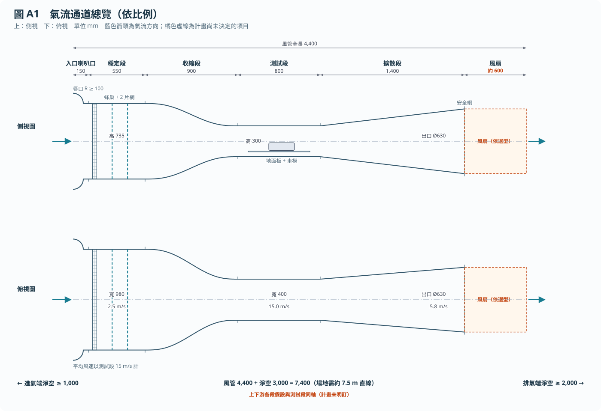
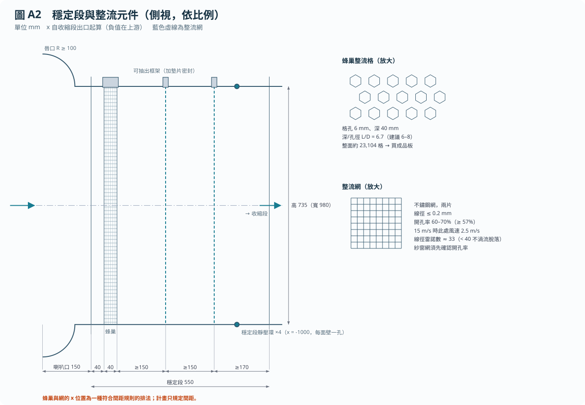
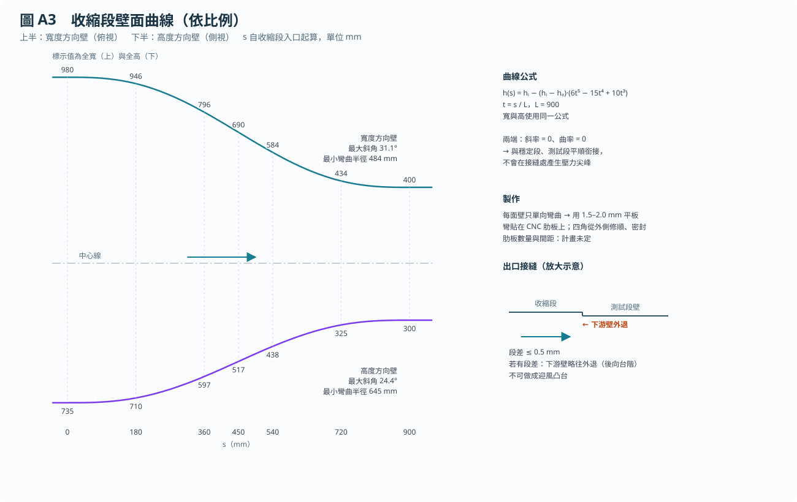
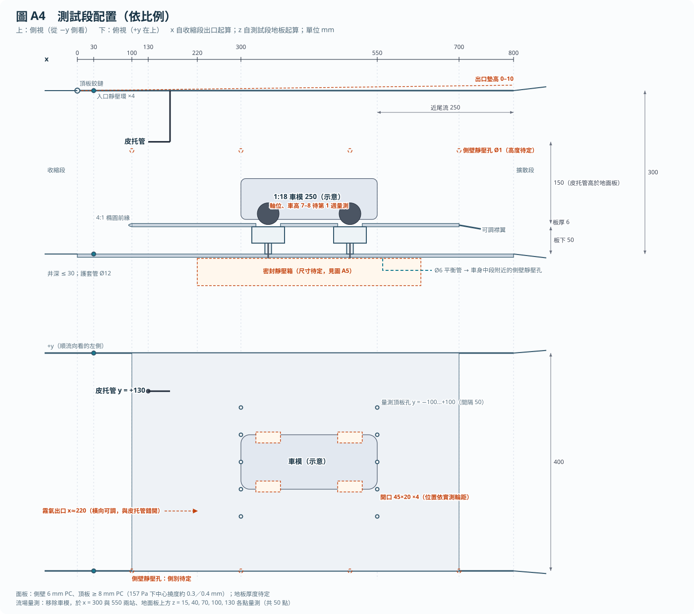
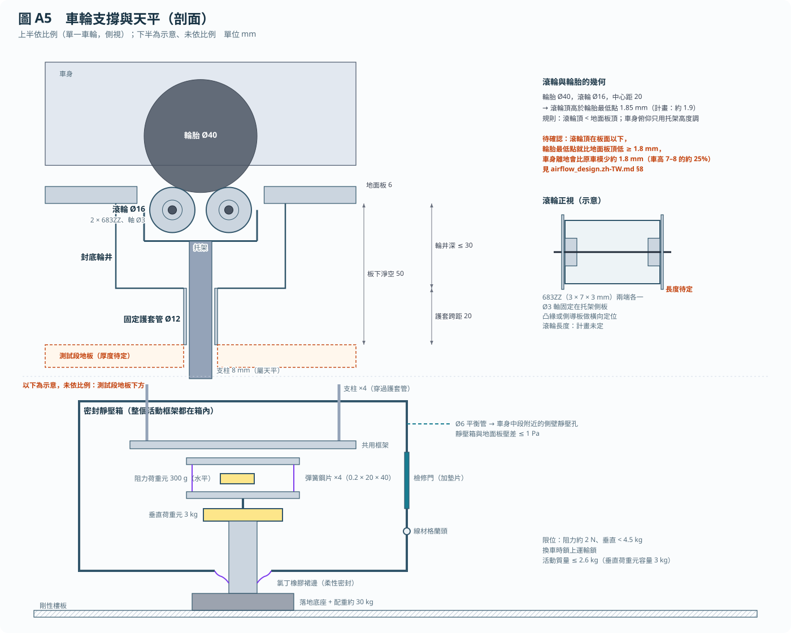
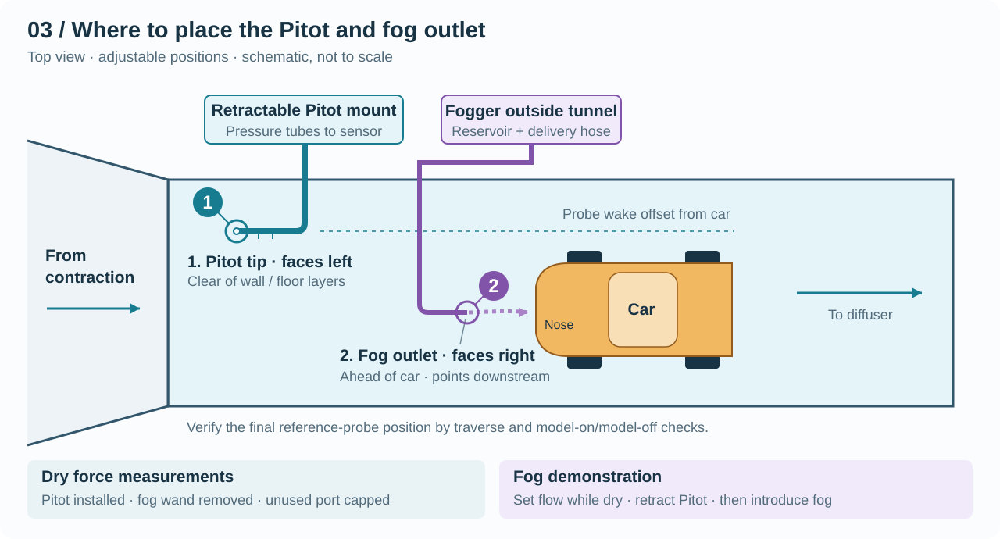

# 風洞設備——六週建造計畫

> **課程專題實際採用迷你版（1:43、Arduino Uno、NT$5,000）：見 [build_plan_mini.zh-TW.md](../../build_plan_mini.zh-TW.md)。本文件保留為完整版（1:18）參考設計。**
>
> 本文件為 [build_plan.md](build_plan.md) 的繁體中文版，內容與英文版一致。若兩者有出入，以英文版為準，並請回報差異。
>
> 幾何細節以圖表示（圖 A1–A5，依比例繪製）；精確數值與規則放在 [spec/](spec/README.md)，供 agent 與 CAD 使用。各尺寸的計算過程見 [airflow_design.zh-TW.md](airflow_design.zh-TW.md)。

對業餘風洞而言，一具管道風扇就足以產生氣流；但這座風洞必須在約 12 N 重的車模底下，解析約 0.3 N 的阻力。

**建造一座開路吸氣式（open-return suction）風洞，測試段長 800 mm、截面 400 × 300 mm，風速 5–15 m/s；以與氣流隔離密封的測力天平，量測 1:18 車模的阻力與下壓力，解析度約 5 mN。**

本計畫涵蓋建造與設備驗收。車輛研究與 20 m/s 升級在其後進行。技術依據見 [model.md](model.md)，零件與供應商見 [shopping_list.md](shopping_list.md)。

## 設計必須達成的目標

所有公差都由力訊號決定。氣動力遵循

$$
F = C\,q\,A_m,\qquad q=\tfrac{1}{2}\rho U^2,
$$

其中 $C$ 為力係數，$q$ 為動壓，$A_m$ 為車模迎風（正投影）面積，$\rho$ 為空氣密度，$U$ 為測試段平均風速。

**表 1. 規劃估算值。** 輸入值為 $A_m=0.0065\ \mathrm{m^2}$、阻力係數 $C_D=0.35$、垂直力係數絕對值 $|C_L|=0.30$、$\rho=1.20\ \mathrm{kg/m^3}$，以及 250 mm 長的車模。$Re_L$ 為以車長為特徵長度的雷諾數。第 1 週請以實測值取代這些輸入。

| $U$ (m/s) | $q$ (Pa) | 流量 (m³/h) | 阻力 (mN) | 垂直力 (mN) | $Re_L$ | 5 mN 佔阻力比例 |
| --- | --- | --- | --- | --- | --- | --- |
| 5 | 15 | 2,160 | 34 | 29 | 8.3 × 10⁴ | 15% |
| 7.5 | 34 | 3,240 | 77 | 66 | 1.3 × 10⁵ | 6.5% |
| 10 | 60 | 4,320 | 137 | 117 | 1.7 × 10⁵ | 3.7% |
| 12.5 | 94 | 5,400 | 213 | 183 | 2.1 × 10⁵ | 2.3% |
| 15 | 135 | 6,480 | 307 | 263 | 2.5 × 10⁵ | 1.6% |

**只有在約 11 m/s 以上，才能達到 3% 的係數目標。** 在此風速下，5 mN 等於估計阻力的 3%。5 至 11 m/s 只報告絕對力值與趨勢；11–15 m/s 的數據才視為係數等級的數據。

吸氣式設計帶來第二個主要限制。測試段在 15 m/s 時比室內壓力低約 157 Pa，因此室內空氣會以約 16 m/s 的速度從任何地板縫隙灌入。這些縫隙就位於車輪旁與車底，正是量測最敏感的位置。

因此，困難之處不在於推動空氣，而在於把毫牛頓等級的力，從重力、漏氣、振動與支撐件阻力中分離出來。

## 設備配置

基準風洞需要約 7.5 m 的直線空間，含兩端的淨空區；若房間長度不足，將排氣以風管導出室外。圖 A1 為第 1 週配置的起始尺寸。各模組的主要考量：

- **入口喇叭口（inlet bell）：** 圓弧唇口，防止進氣口氣流分離。
- **穩定段（settling chamber）：** 決定收縮比 6:1。
- **收縮段（contraction）：** 五次多項式壁面曲線（圖 A3）。
- **測試段（test section）：** 取先前 600–800 mm 範圍的上限。
- **擴散段（diffuser）：** 面積比 2.6，等效圓錐半角 5°。
- **風扇：** 尺寸依選型，以報價風扇的實際尺寸核對。

只有在房間或門口容納不了 6:1 時，才改用 4:1 收縮段（入口 800 × 600 mm，長約 700 mm）。較短的收縮段會降低流場均勻度，因此須以相同的驗收標準進行流場量測。

## 組件

### A. 氣流通道

氣流通道必須以盡可能低的壓損，將均勻、穩定的氣流送到車模處。

**A1. 入口與整流。** 整流裝置在收縮段之前，消除室內空氣的旋流與大尺度不均勻。

- **蜂巢整流格（honeycomb）：** 整個截面約需 20,000 格，因此請直接購買成品板，不要用吸管自行組裝。
- **整流網（screens）：** 兩片可抽出式不鏽鋼網。未確認開孔率前，不要用紗窗網代替。
- **密封：** 每個抽出式框架都要加墊片，避免吸力把室內空氣從框架周圍吸入。

**A2. 收縮段。** 收縮段將氣流加速六倍，同時避免壁面分離。高度與寬度採用相同曲線（圖 A3）。

每面壁只朝一個方向彎曲，因此可用平板彎貼在 CNC 切割的肋板上成形。盡量從外側修順並密封四個角。

**A3. 測試段。** 測試段放置車模，並決定參考氣流。

- **頂板墊片：** 出口端墊高可抵銷邊界層增厚，並使流向壓力梯度趨於平坦。
- **靜壓孔：** 孔口去毛邊並與壁面齊平，經手動切換閥連接。
- **可拆式量測頂板：** 未使用的孔要塞住。

**A4. 擴散段與安全網。** 擴散段回收壓力，安全網在鬆脫零件到達風扇前將其攔下（圖 A1）。製作方轉圓的過渡段，法蘭要平順。安全網裝在擴散段出口（風速最低處），可拆式。試車時以壁面絲線檢查是否有分離。

**A5. 風扇與驅動。** 依計算出的系統曲線選擇風扇：

$$
\Delta p=q\sum K,
$$

其中 $\Delta p$ 為總壓損失，$K$ 為各組件的損失係數，以測試段 $q$ 為基準。

| 組件 | $K$ |
| --- | --- |
| 入口、蜂巢與兩片網 | 0.13 |
| 收縮段 | 0.03 |
| 測試段壁面 | 0.05 |
| 地面板 | 0.03 |
| 車模與支撐 | 0.03 |
| 擴散段（效率 80%） | 0.17 |
| 安全網 | 0.15 |
| 風扇面動壓 | 0.15 |
| **合計（未進位）** | **0.73** |

| 工況 | 流量 (m³/h) | 計算值 (Pa) | 加 50% 餘裕 (Pa) | 電功率（效率 40%） |
| --- | --- | --- | --- | --- |
| 15 m/s | 6,480 | 99 | 150 | 約 0.7 kW |
| 20 m/s 選項 | 8,640 | 176 | 260 | 約 1.6 kW |

- **報價：** 兩種工況都要詢價。現在就以 20 m/s 選型，可避免日後再買第二台風扇，代價是在 5 m/s 時要以更低轉速運轉。
- **風扇類型：** 在 Kruger 離心風機之外，同時詢價一般現貨 630 mm 軸流風扇。BSB 系列可達 4,500 Pa，但本工況是大風量、僅約 150 Pa。由於風扇位於車模下游，旋流影響不大。
- **驗收條件：** 要求廠商以書面提供風扇曲線、操作點、交期、馬達重量與電源需求。
- **風管連接：** 使用有補強、受吸力時不會向內塌陷的軟接頭。

**A6. 結構與場地。** 結構必須穩固支撐風管，並讓每個模組都能搬進房間。以 4040 鋁擠型搭建框架並加斜撐，各模組以法蘭加墊片連接。先量門：735 mm 高的穩定段加上法蘭與框架，可能無法不傾斜就通過一般門框。

### B. 地面與車模支撐

支撐系統必須讓車模保持已知姿態，同時把全部載重經由測力天平傳遞。

**B1. 地面板。** 地面板讓邊界層在比測試段地板更靠近車模的位置重新開始發展（尺寸見圖 A4）。

- **平面度：** 車模區域 0.3 mm 以內。
- **襟翼：** 調整後緣襟翼，直到絲線顯示上表面氣流附著。
- **嵌件：** 車輪周圍裝可更換嵌件，在天平整個活動範圍內保持 1–2 mm 間隙。

**B2. 輪井與支柱護套。** 輪井讓板下的氣流吹不到活動件（圖 A5）。一根裸露的 8 × 50 mm 支柱在 15 m/s 時約受 65 mN，四根合計約 260 mN，相當於車模阻力的 84%。因此每個開口下方懸掛封底輪井，支柱再穿過固定在風洞上的護套管。

**B3. 滾輪托架。** 每個雙滾輪托架定位一個車輪，不需固定車身，與原始構想相同（幾何見圖 A5）。

- **先量測：** 記錄輪胎直徑與寬度、軸距、輪距、質量、車身離地高度，以及懸吊是否有彈簧。
- **起始幾何：** 依圖 A5 的滾輪尺寸與中心距開始試做，並據此設定車高；滾輪頂必須低於地面板面。
- **調整：** 每個托架可獨立調整軸距、輪距與高度。車身俯仰角只用托架高度設定，絕不傾斜活動框架。
- **車輪鎖：** 裝設可拆式鎖，在測力時鎖住滾輪。仍需檢查輪胎與懸吊的柔性；有彈簧懸吊的車模應墊死或記錄。

量測時滾輪不需轉動，因為沒有東西驅動車輪。**在第 2 週的原型上，比較鎖住的滾輪與固定 V 形托座。** 若結果在重複性範圍內一致，除非計畫做車輪驅動，否則其他三個托架做成固定托座。車輪脫出不是載重上的顧慮：在此幾何下，車輪要脫離需約車重 0.38 倍的水平力，約 4.5 N。

**B4. Ahmed 體轉接件。** 參考物體沒有車輪，但 [model.md](model.md) 要求先測它。提供四個支腳插座，取代滾輪鎖在托架支架上。尺寸依所選參考數據集決定，天平框架不變。

**B5. 姿態量測。** 車高與俯仰角是控制變數，因此需要量具。在 150 mm 軸距上，0.1° 的俯仰變化只讓一個車軸移動 0.26 mm。從地面板基準量測前後兩軸，使用解析度 0.1 mm 或更好的深度規或針規組。對著比例尺拍攝正面剪影，以量測 $A_m$。

### C. 測力天平

天平把毫牛頓等級的載重轉為已校正的訊號，並排除其他一切干擾。

天平的載重路徑（托架 → 共用框架 → 阻力平台 → 垂直荷重元 → 落地底座）見圖 A5 下半。

**C1. 活動組件。** 每個零件都要秤重，對照垂直荷重元 3 kg 的容量，因為歸零（扣皮重）並不會移除靜載重。

| 項目 | 質量估計 (kg) |
| --- | --- |
| 1:18 車模 | 1.0–1.6 |
| 四個托架 | 0.2 |
| 共用框架與支柱 | 0.3 |
| 阻力平台、阻力荷重元與上板 | 0.3–0.5 |
| **合計** | **1.8–2.6** |

超過 2.6 kg 的設計一律退回，待重新檢討餘裕。選項包括更輕的五金、減重車模或配重。在定案配置前，核對荷重元的額定秤盤尺寸是否容得下 150 mm 軸距。

**C2. 阻力平台。** 阻力平台將流向載重與車重分離。

- **導引：** 先用四片彈簧鋼片，每片 0.2 × 20 × 40 mm，兩端夾緊。估計阻力方向剛性約 2,000 N/m，承受靜載重時遠低於挫屈極限。
- **感測器：** 300 g 荷重元裝在平台與其底座之間，感測軸水平。
- **堆疊：** 阻力平台裝在垂直荷重元的上板上，讓垂直荷重元承受全部重量。
- **線材：** 跨越任何活動介面的線，都用鬆弛的超軟 30–32 AWG 線繞成線圈。在記錄歸零值時移動線圈，證明其影響可忽略。

**C3. 垂直平台。** 垂直平台以單一單點式荷重元量測總氣動載重。規格書重複性為 ±2.9 mN，已用掉 5 mN 容許值的大部分，因此是最嚴格的通道。新裝上車模後至少預載 30 分鐘，因為荷重元滿載潛變可達 11.8 mN/h。

**C4. 保護與阻尼。** 限位與阻尼保護小型荷重元，並控制共振。

- **限位：** 阻力限位設在約 2 N，垂直限位低於荷重元的 4.5 kg 過載值。加裝換車用的運輸鎖。
- **阻尼：** 假設荷重元在額定載重下變形 0.3 mm，阻力方向自然頻率約 11 Hz、垂直約 30 Hz。四極 60 Hz 馬達在整個轉速範圍內約 10–29 Hz，兩者重疊。以每秒 80 筆取樣量測頻譜；若出現峰值，加裝非接觸式渦電流阻尼。
- **調平：** 底座提供調平功能，並在校正時驗證阻力與垂直力之間的串擾。

**C5. 密封靜壓箱與底座。** 靜壓箱阻止室內空氣從車輪旁進入，同時讓天平保持與風洞獨立。

- **箱體：** 在測試段地板下方密封一個箱子，附加墊片的檢修門與線材格蘭頭。整個活動框架都在箱內，壓力作用在所有面上而大致抵消。
- **底座：** 天平立在落地底座上，底座加約 30 kg 配重。靜壓箱與底座之間以柔性氯丁橡膠（neoprene）裙邊連接，使風洞振動沒有剛性傳遞路徑。
- **壓力平衡：** 以 6 mm 管把靜壓箱連到車身中段附近的側壁靜壓孔。靜壓箱與地面板之間的壓差保持在 1 Pa 以內；在四個約 45 × 20 mm 的開口上，1 Pa 約等於 3.6 mN。
- **地面：** 底座放在剛性樓板上。活動質量 2.5 kg 時，0.012° 的傾斜就會產生 5 mN 的假阻力：

$$
F_\alpha=mg\sin\alpha,
$$

其中 $F_\alpha$ 為假阻力，$m$ 為活動質量，$g$ 為重力加速度，$\alpha$ 為傾角。

### D. 量測與記錄

量測鏈必須在每一次運轉都提供可用的參考 $q$，而不只是在無霧（乾式）運轉時。

**D1. 參考動壓。** 所有運轉都以壁面壓力作為參考，並用皮托管校正它。壁面靜壓環不伸入氣流，霧氣運轉時也能使用：

$$
q=k\,(p_{s}-p_{e}),
$$

其中 $k$ 為校正常數，依理想 6:1 連續方程式約為 1.03；$p_s$ 為穩定段靜壓，$p_e$ 為測試段入口靜壓。

- **靜壓環：** 在穩定段末端、收縮段前 100 mm 處開四個孔，並在 $x$ = 30 mm 處開四個孔。每個環以等長管路匯流。
- **感測器：** 一顆 SDP810-500Pa 接靜壓環，一顆接皮托管。兩者的 I²C 位址相同且固定，因此要接在多工器的不同分支上。
- **皮托管：** 總壓接 **+**、靜壓接 **−**，兩條管等長、不漏氣，長度不超過 1 m。SDP8xx 是流通式感測器，因此要在現場測試管長的影響。
- **校正：** 在無車模時建立 $k$，再於有車模時重做一次，並記錄阻塞效應。
- **環境條件：** SDP8xx 的規格以 966 mbar 為基準，約比海平面氣壓低 4–5%。查閱 Sensirion 的補償指南，記錄絕對氣壓，並在現場校正。

**D2. 流場量測。** 流場量測需要專用的簡單器材。以刻度夾具將皮托管穿過量測頂板的孔移動。移除車模後，在地面板上方 $z$ = 15、40、70、100、130 mm 處，於 $x$ = 300 與 550 mm 兩站量測。50 個點、每點 50 s，每個風速約需 40 分鐘。

**D3. 環境感測器。** 由於係數直接使用實測 $q$，密度只影響 $U$ 與雷諾數的計算。用 BME280 量室內氣壓，必要時修正 $U$：157 Pa 的風洞負壓只讓密度改變 0.15%。在靜壓箱內加一個溫度感測器，追蹤荷重元漂移。

**D4. 電子與雜訊控制。** 荷重元訊號極小，因此變頻器是主要的電氣威脅。在約 3.3 V 激勵下，5 mN 在阻力通道只有 5.6 µV，在垂直通道只有 1.1 µV。NAU7802 公布的雜訊在每秒 10 筆時為 50 nV，因此足夠，除非變頻器引入干擾。

- **隔離：** 有遮蔽的馬達電纜遠離感測器線，兩者只以直角交叉。
- **接地：** 荷重元遮蔽層只在 ADC 端接地，並為變頻器加裝 EMC 濾波器。分別在筆電用電池與插市電時測試。
- **取樣：** 量測以每秒 10 筆記錄，振動檢查以每秒 80 筆記錄。每個通道都加時間戳記，因為兩塊測力板是依序讀取的。

**D5. 記錄程式。** 記錄程式必須讓每個處理後的結果都能追溯到原始數據。將原始計數、時間戳記、單位、校正版本、運轉編號、配置、運轉前後的歸零值與風扇轉速存成 CSV。即時顯示力、$q$ 與計算出的 $U$，每次運轉開新檔。

### E. 流場可視化

可視化以定性方式呈現流場，且不混入測力數據。

**E1. 霧氣輸送。** 霧氣管路可以利用風洞吸力，不需另加鼓風機。室內常壓的儲槽能以接近主流的速度供氣給噴桿，因為室內空氣與測試氣流的總壓相近。風洞在 5 m/s 時，出口速度可達約 5 m/s（扣除軟管損失），並以閥門微調。

- **硬體：** 使用可拆式、內徑約 6 mm 的金屬噴桿、長度不超過 0.5 m 的軟管、流量閥，以及風洞外的冷凝水收集器。
- **安裝：** 軟管與噴桿固定在風洞框架上，絕不固定在天平上。拆下噴桿時要蓋上開口。
- **蒸發：** 5 µm 液滴在相對濕度 70% 時估計存在 33 ms，在 5 m/s 下約 165 mm，而車模長 250 mm。在依賴它之前，先於第 2 週測試霧線長度。
- **衛生：** 使用新鮮蒸餾水，每天排空並晾乾儲槽，因為超音波霧化器會把滯留水中滋生的任何東西一起霧化。

**E2. 照明與絲線。** 若霧氣消散太快，絲線是低風險的備案。在透明面板外裝白光 LED 燈條，並在可拆的樣品車模或面板上準備輕質絲線。絲線與定量測力運轉分開進行。

*圖 3. 可調整的建議位置，並非須同時運作的要求。起始位置見表 3。圖中未畫出壁面靜壓環。*

噴桿置於上游的做法，參照[風洞煙霧噴桿實務](https://sites.google.com/view/usyd-amme-wind-tunnels/resources/instructionals/wind-tunnel-testing/flow-visualisation/smoke)；以水霧輸送仍需上述實際測試。

### F. 校正治具

校正設備必須比其所驗證的量更可信。

**F1. 力校正。** 經由低摩擦路徑，對組裝好的天平施加已知載重。使用 5 g 至 100 g 的認證砝碼。阻力載重以細線繞過低摩擦滑輪施加，並從兩個方向加載，取平均以抵消滑輪摩擦。

**F2. 壓力校正。** 參考儀器在 15 Pa 時必須優於 0.15 Pa 的目標。從第 4 週起租借或借用已校正的微壓計，因為未校正的 SDP810 在 15 Pa 時約有 3.7% 的不確定度（0.1 Pa 零點加讀值的 3%）。若有不足，如實記錄，不要假設為 1%。

### G. 安全

風洞結合了市電、大型旋轉風扇與水，因此其防護措施需要獨立檢查。

- **電氣：** 由合格電工安裝變頻器、漏電斷路器，以及操作者在測試段旁伸手可及的緊急停止開關。
- **旋轉件：** 在風扇進出口加護網；伸手進入風管前先斷電上鎖。
- **鬆脫零件：** 每次啟動前檢查有無工具與車模零件遺留。拆下或固定後照鏡與天線。
- **噪音：** 第 4 週在操作位置量測 dBA；85 dBA 以上須配戴聽力防護。
- **水：** 霧化器使用低壓電源，儲槽放在市電與感測器電子元件的下方，並遠離它們。

## 操作程序

### 測力運轉

每次有風量測的前後都進行無風歸零，以便看出漂移。

1. **檢查**鬆脫零件清單、開口是否塞好、滾輪鎖、車高與俯仰角。
2. 風扇關閉，**歸零** 30 s。
3. 在目標 $q$ **穩定**至少 60 s；以 $q$ 而非風扇轉速設定風速。
4. **擷取** 30 s；若移動平均尚未穩定則延長。
5. 停機後兩分鐘內**重新歸零**；若零點偏移超過 5 mN，該次運轉作廢。

### 霧氣運轉

霧氣運轉只產生影像，其測力數據一律不報告。

1. 在無霧狀態下，以壁面靜壓環的 $q$ **設定**風速。
2. **收回**皮托管並蓋上開口，鎖上天平運輸鎖。
3. 緩慢打開閥門**放霧**，然後記錄影像。
4. 以乾淨空氣**吹乾**至少 15 分鐘，並打開靜壓箱檢查。
5. 恢復測力前，**確認**無風零點已回到 5 mN 以內。

### 驗收測試

驗收測試把每個目標轉成明確的量測方法與合格標準。

| 指標 | 方法 | 合格標準 |
| --- | --- | --- |
| 力漂移 | 無風、裝上車模，記錄 30 分鐘的 30 s 區塊平均 | 相鄰區塊差在 5 mN 以內 |
| 力重複性 | 加卸載十次；車模重新安裝五次 | 5 mN 以內，重新安裝的結果另行報告 |
| 校正殘差 | 使用未參與擬合的獨立驗證載重 | 5 mN 以內，含交叉軸載重 |
| 振動與電磁干擾 | 風扇加護網運轉、拆開風管軟接頭、變頻器全速 | 力雜訊與風扇關閉時相同 |
| 傾斜敏感度 | 有人在附近走動、關門時記錄零點 | 擾動在 5 mN 以內 |
| 風速均勻度 | 在 5、10、15 m/s 進行 50 點量測 | 在量測平均值的 ±2% 以內 |
| $q$ 穩定度 | 相同風速下，10 分鐘內的 30 s 平均 | 在平均值的 ±1% 以內 |
| 靜壓梯度 | 頂板墊片調好後，15 m/s 下讀側壁靜壓孔 | 2 Pa/m 以內，約 2.6 mN 浮力 |
| 壓力校正 | 感測器在 15–135 Pa 與參考儀器比對 | 報告實際不確定度，對照 15 Pa 時 0.15 Pa 的目標 |
| 支撐件皮重 | 只有托架、各 $q$ 下有風 | 以 $q$ 的函數報告，並附不確定度 |

## 為何可行，以及可能如何失敗

此設計之所以可行，是因為一個密封、有遮蔽、與重力隔離的天平，使氣動載重成為無風與有風之間主要變化的訊號。規格書上阻力 ±0.44 mN、垂直 ±2.9 mN 的重複性都在 5 mN 目標之內。每秒 10 筆時的 ADC 雜訊分別只增加約 0.04 mN 與 0.22 mN。前後歸零再消除緩慢漂移。剩餘的風險在於安裝後的整體系統，而不在感測器公布的規格。

**表 4. 失效模式，依嚴重程度排序。** 在實測前皆為估計值。

| # | 失效模式 | 影響大小 | 對策 | 偵測方式 |
| --- | --- | --- | --- | --- |
| 1 | 室內空氣從天平穿孔處進入 | 15 m/s 時車輪旁約 16 m/s | C5 密封靜壓箱 | 開口處絲線；靜壓箱壓差 |
| 2 | 支撐件受風載 | 裸支柱約 260 mN，接近整車阻力 | B2 輪井與護套 | 僅支撐件的皮重量測 |
| 3 | 傾斜使重量耦合到阻力 | 活動質量 2.5 kg 時，0.012° 即 5 mN | C5 底座；俯仰只用托架調整 | 傾斜敏感度測試 |
| 4 | 天平共振與風扇轉速重疊 | 約 11 與 30 Hz，對上 10–29 Hz 轉速 | C4 頻譜檢查與阻尼 | 各風速下每秒 80 筆的頻譜 |
| 5 | 變頻器干擾進入 µV 訊號 | 垂直通道上 5 mN 只有 1.1 µV | D4 隔離與濾波器 | 風扇運轉、無氣流的雜訊測試 |
| 6 | 低速時力太小 | 5 m/s 時 5 mN 佔阻力 15% | 只有 11–15 m/s 為係數等級數據 | 運轉間的離散度 |
| 7 | 垂直荷重元接近滿載 | 3 kg 中佔 1.8–2.6 kg，尚未計入搬動載重 | C1 質量預算；C4 限位 | 第 1 週秤重組件 |
| 8 | 地面邊界層淹沒車底間隙 | 車頭約 2–8 mm、車尾 3–15 mm，對比 7–8 mm 車高 | B1 地面板；列為限制報告 | 近板面流場量測 |
| 9 | 流向壓力梯度造成假阻力 | 15 m/s 時約 10 mN，即阻力的 3% | A3 頂板墊片 | 靜壓梯度測試 |
| 10 | 托架對車模過度拘束 | 八個接觸點定位一個剛體，安裝狀態與俯仰可能改變 | B3 原型；獨立調整 | 五次重新安裝測試 |
| 11 | 壓力感測器達不到 1% | 校正前 15 Pa 時約 3.7% | F2 現場校正 | 與參考儀器比對 |
| 12 | 皮托管尾流或車模影響使 $q$ 失真 | 探桿與車模共用 800 mm 測試段 | D1 壁面靜壓環 | 有/無車模時靜壓環與皮托管的比較 |
| 13 | 室溫上升使零點漂移 | 60 m³ 房間、約 500 W、不計牆面散熱，最多 0.4 K/min | 排氣導出室外；前後歸零 | 靜壓箱溫度記錄 |
| 14 | 超音波霧氣在到達車尾前蒸發 | 5 m/s、相對濕度 70% 時約 165 mm | 第 2 週測試；E2 絲線 | 攝影機觀察霧線長度 |
| 15 | 風扇交期延誤 | 第 4 週以後都依賴它 | 現貨軸流風扇選項；第 1 週結束時的關卡 | 書面交期 |

以下假設也必須成立。房間須有約 7.5 m 的直線淨長，或將排氣以風管導出，且各模組都能通過門口。六週時程假設約一人全職投入、有工作坊可用，且客製加工能在十個工作天內完成。這裡的任何結果都不能預測實車的力，因為雷諾數與靜止地板限制了這種換算，詳見 [model.md](model.md)。

蜂巢、整流網與收縮比的設計準則依據 [Mehta and Bradshaw (1979)](https://doi.org/10.1017/S0001924000031985)。

## 建造分解與時程

本計畫的每個部分都指向同一個驗收問題：安裝完成的設備能否在風扇運轉時，於所述範圍內重現已知的力與已知的 $q$？氣流通道提供穩定氣流，支撐與靜壓箱隔離載重路徑，儀器則逐步驗證，而不是到最後才一次驗證。建造分解表分配每個組件，時程則在零件許可下盡早取得其第一份驗證證據。

### 建造分解表

| 項目 | 建造方式 | 週次 |
| --- | --- | --- |
| A1 入口與整流 | 製作喇叭口與抽出式框架；購買蜂巢與網 | 2–3 |
| A2 收縮段 | CNC 肋板與彎板，依 A2 的表格 | 2–3 |
| A3 測試段 | 切割 PC 面板；加頂板鉸鏈、靜壓孔與量測頂板 | 2–3 |
| A4 擴散段與安全網 | 製作過渡段；裝可拆式網 | 3 |
| A5 風扇與驅動 | 第 1 週詢價；由電工安裝 | 4 |
| A6 結構與場地 | 裁切 4040 組件；量完門與房間後組裝 | 2 |
| B1 地面板 | 加工板、邊緣、嵌件與襟翼 | 3 |
| B2 輪井與護套 | 製作四個輪井；裝設橫越間隙的護管 | 3 |
| B3 托架 | 第 2 週做一個原型；第 3 週加工其餘 | 2–3 |
| B4 Ahmed 轉接件 | 選定數據集後加工插座 | 5–6 |
| B5 姿態量測 | 購買深度規與針規組；定義地面板基準 | 3 |
| C1 活動組件 | 秤重零件，加工框架與支柱 | 1–3 |
| C2 阻力平台 | 裁切鋼片、加工夾具、安裝 300 g 荷重元 | 2–3 |
| C3 垂直平台 | 將 3 kg 荷重元裝在底座上 | 3 |
| C4 保護與阻尼 | 裝限位與運輸鎖；實測需要時加阻尼 | 3–5 |
| C5 靜壓箱與底座 | 製作箱體、檢修門、裙邊與底座；接上平衡管 | 2–4 |
| D1 參考壓力 | 鑽靜壓環孔；接兩顆感測器的管路；校正 $k$ | 3–5 |
| D2 流場量測 | 使用量測頂板與刻度夾具 | 5 |
| D3 環境感測器 | 接 BME280 與靜壓箱溫度感測器 | 3 |
| D4 電子與雜訊 | 組裝機箱、遮蔽、接地與濾波器 | 1–4 |
| D5 記錄程式 | 撰寫 CSV 記錄與即時顯示 | 2–5 |
| E1 霧氣輸送 | 第 2 週桌上測試；安裝噴桿與收集器 | 2、5 |
| E2 照明與絲線 | 裝 LED 燈條；準備絲線 | 5 |
| F1 力校正 | 借砝碼；製作雙向滑輪治具 | 3、6 |
| F2 壓力校正 | 租參考儀器；現場校正 | 4–6 |
| G 安全 | 電工檢查、急停測試、護網、鬆脫零件清單、噪音量測 | 4 |

### 時程

| 週 | 工作 | 前置條件 | 完成標誌 |
| --- | --- | --- | --- |
| 1 | 量測車模、房間、門與市電。完成圖面、質量預算與壓損更新。訂購電子零件；索取風扇與加工報價；預約校正工具。 | 可取得車模與房間 | 標註尺寸的圖面、確認的日期，以及關卡 1 |
| 2 | 搭建框架、測試段、穩定段、靜壓箱與底座。做一個托架原型，比較鎖住的滾輪與托座。進行荷重元整夜漂移測試與霧線試驗。 | 第 1 週圖面與電子零件 | 托架決定與第一份漂移數據（關卡 2） |
| 3 | 完成收縮段、擴散段、地面板、輪井、托架、姿態量具與天平。以雙向滑輪在桌上校正力。接感測器並開始記錄。 | 加工件；原型結果 | 天平在桌上可重複（關卡 3） |
| 4 | 安裝風扇、變頻器、護網與配線。測試停機，再逐步提高風速。檢查漏氣、極性、噪音、電磁干擾與振動頻譜。開始壓力比對。 | 風扇到貨；已約電工 | 可運轉的風洞，含即時記錄與安全檢查 |
| 5 | 修正漏氣與振動。調整襟翼與頂板墊片。校正靜壓環、量測流場並記錄支撐件皮重。安裝霧氣輸送與照明。加工 Ahmed 插座。 | 第 4 週運轉；壓力參考儀器 | 流場有文件記錄、硬體齊全 |
| 6 | 進行完整的安裝狀態力校正與所有驗收測試。驗證 Ahmed 轉接件。撰寫結果。 | 第 5 週流場；認證砝碼 | 校正檔、竣工圖與操作說明 |

**關卡決定繼續、修改或重新規劃。**

- **關卡 1，第 1 週結束：** 房間與門口容納得下；活動質量在 2.6 kg 以內；風扇在第 3 週結束前到貨；加工在十個工作天內完成。若風扇未通過此關卡，改用現貨軸流風扇或調整時程。
- **關卡 2，第 2 週結束：** 阻力與垂直荷重元在桌上的漂移與 5 mN 目標相容。否則在加工其餘三個托架前，重新設計載重路徑。
- **關卡 3，第 3 週結束：** 組裝好的天平在桌上的重複性在 5 mN 以內。不要在無風時就已失敗的天平周圍安裝風扇。

**時程沒有緩衝，因此優先保護量測。** 若時間不足，先延後霧氣輸送，再延後 Ahmed 轉接件。不要延後力校正、壓力校正或安全檢查。凡未達目標之處，記錄實際達成的極限，因為有文件記錄的不足，仍是被接受的結果。

## 需加入購物清單的項目

這些項目出現在本計畫中，但尚未列入 [shopping_list.md](shopping_list.md)。

- **壓力：** 第二顆 SDP810-500Pa，含線材、管路、三通、靜壓孔接頭與手動切換閥。
- **天平：** 彈簧鋼片、附檢修門與格蘭頭的靜壓箱、氯丁橡膠裙邊、底座、配重，以及 30–32 AWG 軟線。
- **支撐：** 四個輪井、護套管、滾輪鎖、Ahmed 支腳插座，以及選用的固定托座。
- **氣流：** 可拆式安全網、量測頂板、刻度探桿夾具，以及現貨軸流風扇的報價。
- **量測：** 深度規或針規組、靜壓箱溫度感測器、機械水平儀，以及租用的微壓計。
- **電氣與霧氣：** 變頻器 EMC 濾波器、有遮蔽的馬達電纜、流量閥、冷凝水收集器與蒸餾水。
- **安全：** 漏電斷路器、一次噪音量測，以及讀值需要時的聽力防護。
