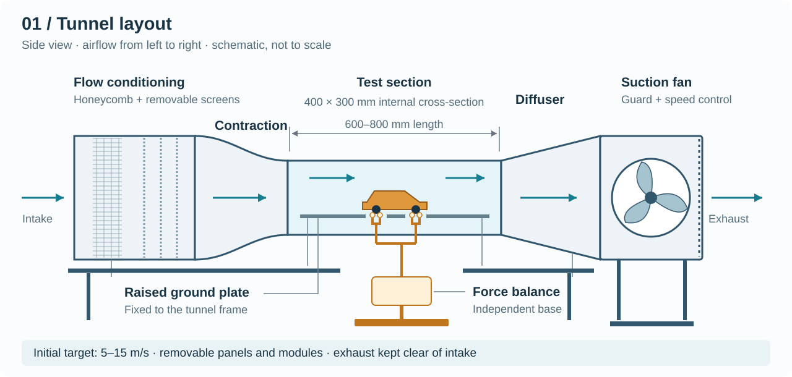
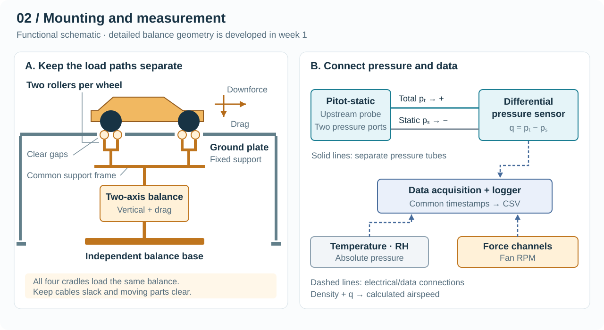
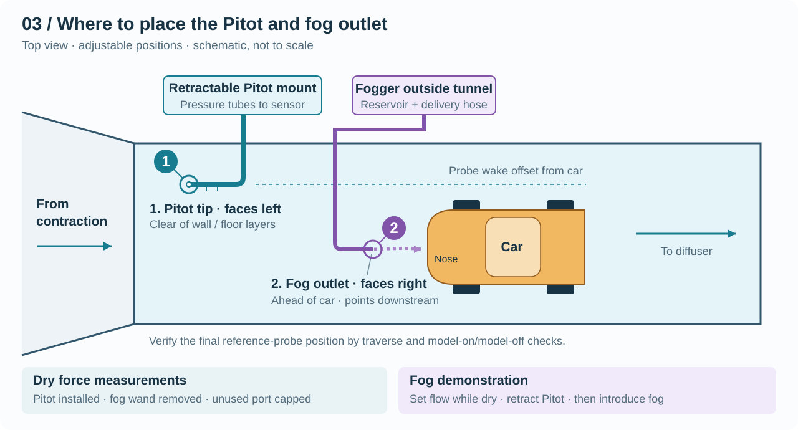

# Wind Tunnel Apparatus — Six-Week Build Plan

Build a 400 × 300 mm test section, 600–800 mm long, targeting 5–15 m/s. Use a stationary ground plate, a roller-supported vehicle, a drag/downforce balance, and synchronized pressure/force logging. Technical basis: [model.md](model.md). This plan covers construction and equipment acceptance.

For product models, quantities, supplier links, and ordering dependencies, see the [shopping list](shopping_list.md).

## Apparatus layout

*Figure 1. Overall arrangement; schematic, not to scale. Figure 3 shows the fog and Pitot locations.*

## Vehicle support: two rollers per wheel

The car does not need to be suspended from its chassis. It can rest on **four cradles, each containing two rollers**, as originally proposed. All four cradles connect to the instrumented support frame, which measures total drag and vertical load.

The important clearance is between the **wheels/cradles and the fixed ground plate**. Contact with that plate would carry part of the load around the sensors. Keep the tire-to-plate gap as small as practical without contact throughout balance movement, and set the intended body ride height separately. A large artificial gap would change the underbody flow.

The roller design needs checks for seating, friction, tire deformation, and aerodynamic loading on exposed rollers/supports. Calibrate the complete assembly and characterize support loading; a single pressure tap cannot provide an exact correction. Free-spinning rollers also do not reproduce a moving road or controlled wheel speed.

*Figure 2. Side view shows two of the four cradles. The balance is a functional block; detailed flexures and sensor placement are designed in week 1.*

## Component requirements and construction

### Frame, test section, and ground plate — weeks 1–3

Build a braced frame with sealed, removable duct modules and smooth internal joints. Use transparent removable panels around the specified test section. Select panel thickness for stiffness and pressure loading.

Attach the flat raised ground plate to the tunnel frame, with adjustable height/leading-edge position and replaceable inserts around the four cradles. Maintain clearance around moving parts. Support the balance and fan independently to reduce vibration transmission.

### Flow conditioning and transitions — weeks 1–3

Provide slide-out honeycomb and screen holders in the settling chamber. Design the contraction contour, diffuser expansion, chamber size, and component spacing in week 1 using the available footprint and pressure-loss estimate. Fabricate aligned modules with smooth skins and accessible joints.

### Roller cradles and force balance — weeks 1–4

Measure wheel diameter, tire width, wheelbase, track, and model mass before selecting roller dimensions. Use bearing-supported rollers on adjustable cradle brackets; connect the cradles to a common instrumented frame. Provide leveling/pitch adjustment, lateral location, and an anti-escape catch that stays clear during normal measurement.

Measure total vertical force and drag with a calibrated two-axis assembly. Select capacity for model/fixture weight, aerodynamic loads, and overload allowance. Add overload stops and slack cable routing. Initial installed drift/repeatability target: approximately **0.005 N** over the intended acquisition interval. Prototype one cradle in week 2 before making all four.

### Fan and controls — select week 1; install week 4

The nominal section requires approximately **0.6–1.8 m³/s** at 5–15 m/s. Select a variable-speed fan from its pressure–flow curve at the calculated tunnel resistance. Include guards, compatible control electronics, qualified electrical wiring, and accessible shutdown. Direct exhaust away from the intake.

### Pitot-static probe and pressure sensor — weeks 1–4

Specify a differential sensor that can resolve **15–135 Pa**, with suitable range and overload margin. An initial uncertainty objective of 1% of reading corresponds to 0.15 Pa at the low end; assess the complete sensor specification against this.

Connect total pressure to **+** and static pressure to **−**, using separate leak-free tubes. Provide an adjustable, retractable probe mount; see Figure 3. Obtain a suitable calibrated low-pressure reference for week 6.

### Environment sensors and logger — weeks 3–5

Record incoming-air temperature, RH, local absolute pressure, fan RPM, force, and differential pressure. Assess whether room pressure adequately represents tunnel static pressure. No dedicated humidity-calibration campaign is planned.

Match amplifiers/ADCs to the force sensors. Save raw readings, timestamps, units, and calibration versions to CSV. Display force, dynamic pressure, and calculated airspeed. Check noise, bandwidth, and timing before fixing the sampling rate.

### Fogger, delivery wand, and lighting — week 5

Keep the fogger/reservoir outside the tunnel. Feed a removable slender wand through a sealed access port near the test-section entrance, **after the contraction and ahead of the car**. Point the outlet downstream and make its height/lateral position adjustable. Use gentle delivery so the nozzle does not create a strong jet of its own.

Provide external side lighting, a capped port for wand removal, and access for drying. Fix the hose/wand to the tunnel frame, never to the balance. Check delivery with the actual water fogger: droplets can settle or condense in the hose.

## Where the Pitot and fog outlet go

*Figure 3. Proposed adjustable locations, not fixed distances or simultaneous operating requirements.*

- **Pitot:** place in the upstream part of the test section, with its nose facing the incoming air. Keep it outside wall/floor boundary layers and away from the car's disturbance. Offset it so its wake does not impinge on the model. Verify the location by traversing and checking model-on/model-off readings.
- **Fog outlet:** place ahead of the car, downstream of the reference-probe location, with lateral separation from the probe. Adjust the outlet to reveal the desired flow region. An adjustable upstream outlet follows [wind-tunnel smoke-wand practice](https://sites.google.com/view/usyd-amme-wind-tunnels/resources/instructionals/wind-tunnel-testing/flow-visualisation/smoke); water-fog delivery still needs a practical check.
- **Operating arrangement:** remove the fog wand and cap its port for force measurements. Establish the demonstration airflow while dry, then retract the Pitot and cap its access port before introducing fog. Do not treat the earlier dry reading as a simultaneous fog-run measurement. Dry and recheck the apparatus before returning to force measurement.

## Six-week schedule

Weeks start at project kickoff. Confirm workshop access and delivery of the fan, sensors, and controller by week 3.

### Week 1 — Design and order

Measure the vehicle and room; settle the roller geometry, model fit, ground clearance, balance load cases, duct geometry, and fan operating point. Complete drawings and a priced parts list. Order long-lead components and arrange calibration tools.

**Finish with:** dimensioned assembly drawings and confirmed deliveries.

### Week 2 — Structure and one-cradle prototype

Build the frame, test section, settling chamber, and balance base. Start the transitions. Trial one two-roller cradle using the actual wheel; check seating, clearance, stiffness, and adjustability before duplication.

**Finish with:** a fitted structure and a workable cradle design.

### Week 3 — Complete mechanics and bench logging

Finish the contraction/diffuser, ground plate, four cradles, support frame, and screen holders. Connect sensors and prepare pressure tubing, known-load fixtures, and probe positioning hardware.

**Finish with:** complete mechanics and readable, unsaturated sensor channels.

### Week 4 — Integrate and start at low speed

Install fan controls, guards, wiring, balance, probe, and sensors. Check shutdown, leakage, vibration, force/pressure polarity, and moving clearances. Increase speed gradually.

**Finish with:** an assembled tunnel with working controls and live logging.

### Week 5 — Tune airflow and fit visualization hardware

Correct leaks and vibration; adjust flow conditioning and probe position. Map airflow over the usable region. Complete synchronized logging, retractable probe access, fog delivery, and lighting.

**Finish with:** documented airflow performance and complete hardware installation.

### Week 6 — Calibrate and hand over

Calibrate the installed roller/balance assembly using known vertical, horizontal, and combined loads at different positions. Check seating and repeated placement. Calibrate pressure across 15–135 Pa and record support-only wind loading. Verify approximately 0.005 N force drift/repeatability, ±2% mean-velocity uniformity, and ±1% stability of mean dynamic pressure, with stated measurement intervals.

**Finish with:** calibration files, as-built drawings, wiring/parts list, and operating/cleaning instructions. Record achieved limits wherever a target is missed. Vehicle aerodynamic studies and 20 m/s upgrades follow this build.
