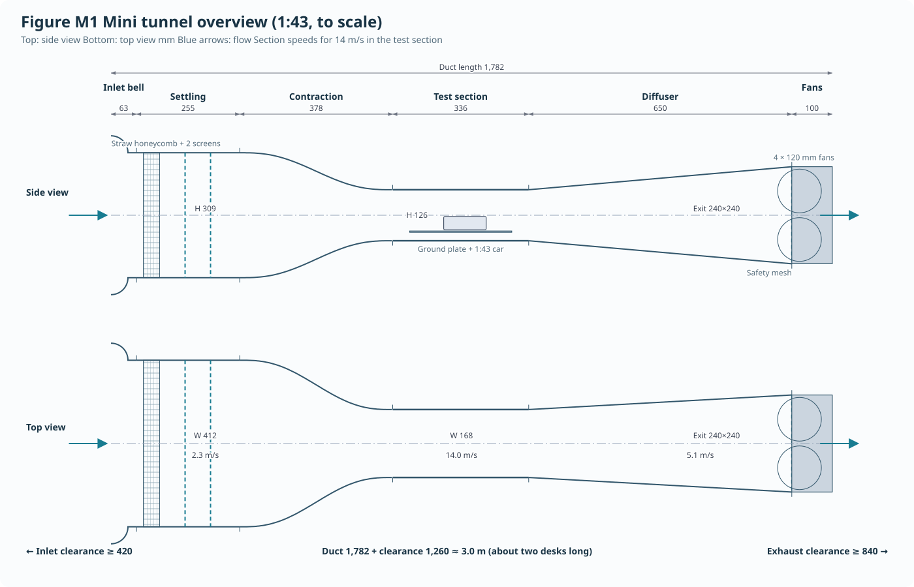
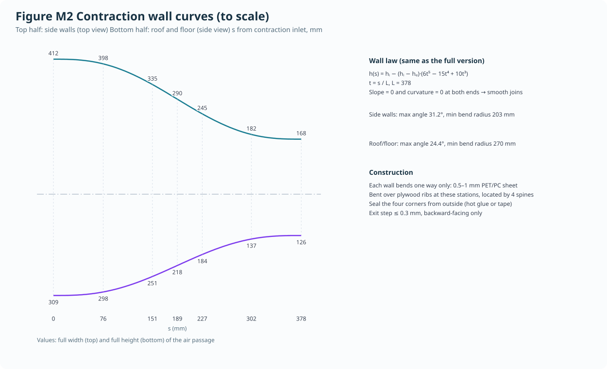
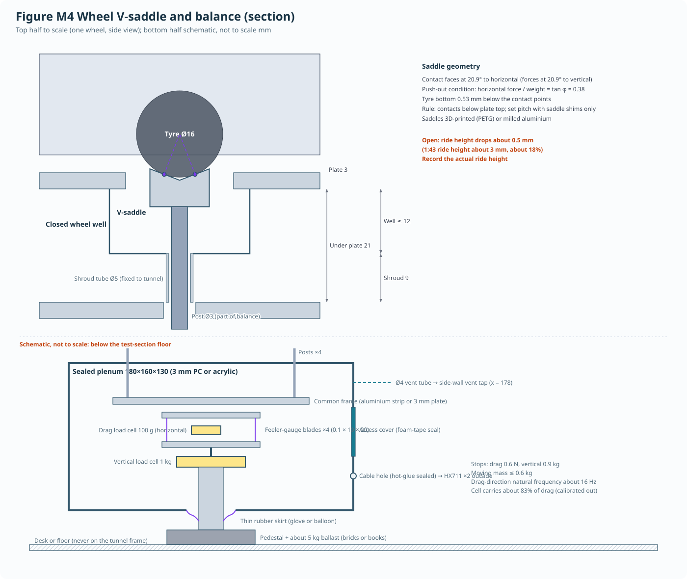
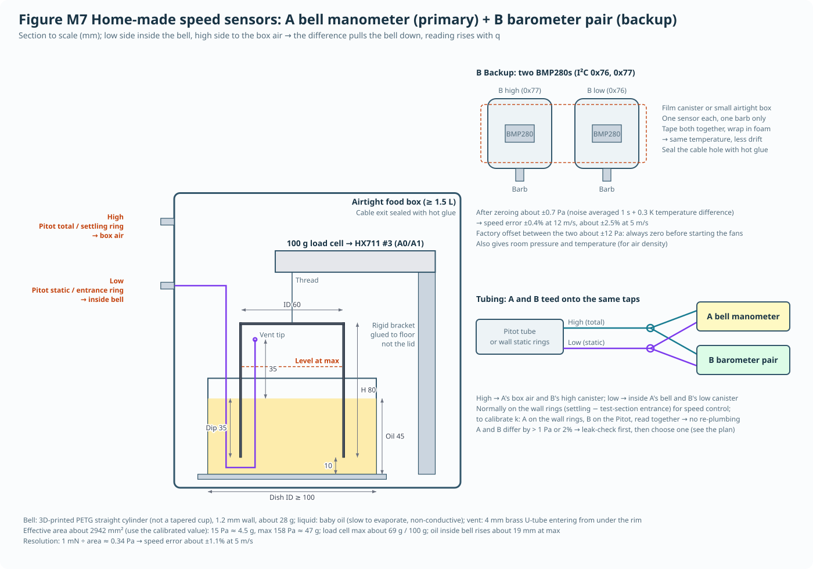
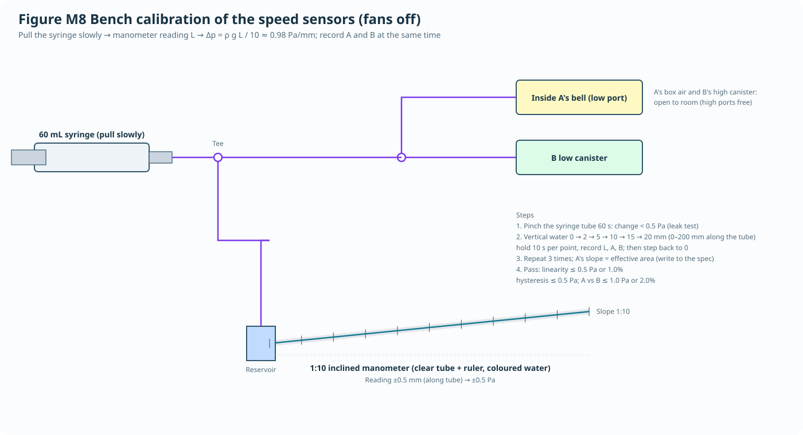

# Mini Wind Tunnel — Class Project Version (1:43, Arduino Uno, budget NT$5,000)

> This is the version used for the general-education class final project. It scales the full design ([archive/full_1to18/build_plan.md](archive/full_1to18/build_plan.md), 1:18, reference only) down by 0.42 and uses 12 V computer fans controlled by an Arduino Uno. The design principles are unchanged: suction (open-return, fan downstream) tunnel, 6:1 contraction, sealed balance, drag stage, and zeroing before and after every measurement.
>
> Research method (paper format): [model.md](model.md). Parts list: [shopping_list.md](shopping_list.md). The earlier Traditional Chinese version of this plan is kept at [build_plan_mini.zh-TW.md](build_plan_mini.zh-TW.md).
>
> Geometry is shown in figures M1–M8 (to scale). Exact numbers live in [spec/mini.json](spec/mini.json); recompute with `python3 tools/mini_calc.py` and check consistency with `python3 tools/test_mini.py` (23 checks, all passing).
>
> 3D model: [cad/mini_tunnel.fs](cad/mini_tunnel.fs) (Onshape FeatureScript, same coordinates as the spec: x downstream, y to the left looking downstream, z up; x = 0 at the contraction exit, z = 0 on the inside of the test-section floor). Every part is named with this plan's section code (for example "A2 Spine top"), so the Onshape parts list maps directly onto this document.

**Build a suction wind tunnel about 1.8 m long, in three carry-sized modules that sit on classroom desks. An Arduino Uno controls 12 V computer fans (2 × 2 array; the fan box takes two stacked layers) for 5–14 m/s, and the balance measures drag and downforce on a 1:43 model car to about 1 mN (0.1 gram-force). Target material cost: NT$5,000 or less.**

## How big are the forces?

$$
F = C\,q\,A_m,\qquad q = \tfrac12\rho U^2
$$

Estimated for a 1:43 car: $A_m = 0.00114\ \mathrm{m^2}$, $C_D = 0.35$, $|C_L| = 0.30$.

| Speed (m/s) | $q$ (Pa) | Drag (mN) | Vertical force (mN) | 1 mN as share of drag | Use |
| --- | --- | --- | --- | --- | --- |
| 5 | 15 | 6 | 5 | 17% | Trends only |
| 10 | 60 | 24 | 21 | 4.2% | Class demonstration |
| 12 | 86 | 34 | 30 | 2.9% | Lowest speed for coefficient-grade data |
| 14 | 118 | 47 | 40 | 2.1% | Top target |

**Only data at 12 m/s and above count as coefficient-grade. Class demos run at 10 m/s and show differences (for example adding a wing or changing ride height).** The air speed does not need to be scaled with the model; the reason is in the full version's [design notes](archive/full_1to18/airflow_design.zh-TW.md).

## Layout

The duct is 1,782 mm long (front of the inlet bell to the fan-box outlet). With 0.4 m clear in front of the inlet and 0.8 m behind the exhaust it needs about 3.1 m of straight space. Never point the exhaust at people. The tunnel splits into three modules; see "H. Carrying and setup".

## Components

### A. Air path

**A1. Flow conditioning.** The honeycomb can be 6 mm drinking straws cut to 40 mm and glued side by side into one panel (about 4,000 straws), or hexagonal cells printed in tiles on the school 3D printer. The two screens are polyester voile or stainless mesh with 60–70% open area, mounted in pull-out frames with foam-tape seals.

**A2. Contraction.** Same curve as the full version, scaled down. The full width and height shown at each station are the **air passage (inside)** dimensions.

Construction: a 0.5–1 mm PET sheet bent over 7 ribs, with four spines that locate the ribs.

- **Ribs:** frames of 6 mm plywood at s = 0, 76, 151, 189, 227, 302 and 378 mm (s measured from the contraction inlet). **Rib hole = the size in figure M2 + 2 × sheet thickness**; border 25 mm wide. In the middle of each side, cut a half-lap slot 6 mm wide and 12.5 mm deep from the outer edge.
- **Spines (4, 6 mm plywood):** one on top and one underneath (standing on the centreline), one on each side (lying flat at axis height). The inner edge follows the outside surface of the sheet; the outer edge is straight. At every rib position cut a 12.5 mm half-lap slot from the inner edge so spine and rib interlock like an egg crate. The spines run 15 mm past the first rib upstream and 8 mm past the last rib downstream, so the end ribs also sit in closed slots. The upstream extension steps out over the settling-chamber wall; the downstream one steps out over sleeve 1.
- **Why spines:** the ribs drop into the slots already evenly spaced and square, so nothing has to be aligned by hand.
- **Assembly:** lay the bottom spine's straight edge on a flat board as the datum, push the ribs into its slots, then fit the side spines and the top spine. Glue on the four sheets in the order bottom, sides, top, with hot glue along the rib-hole edges and the spines' inner edges. Seal the four corners from outside with tape or hot glue.
- **Saving wood:** near the exit the spines are about 116 mm deep. You can cut large lightening holes in the middle of each spine as long as both edges and all slots stay intact.
- **Flat sizes of the sheets.** Each wall bends in only one direction, so it is cut from a flat sheet. Along the bend the sheet is longer than 378 mm; leave 10 mm extra and trim at the end.

| x from contraction inlet (mm) | Top/bottom sheet: distance along sheet | Top/bottom sheet: width | Side sheet: distance along sheet | Side sheet: height |
| --- | --- | --- | --- | --- |
| 0 | 0 | 412 | 0 | 309 |
| 75.6 | 75.9 | 397.9 | 76.1 | 298.4 |
| 151.2 | 155.3 | 334.5 | 158.4 | 250.9 |
| 226.8 | 238.0 | 245.5 | 246.1 | 184.1 |
| 302.4 | 317.4 | 182.1 | 328.3 | 136.6 |
| 378 | 393.3 | 168 | 404.5 | 126 |

The top and bottom sheets fit between the side sheets; add 2 × sheet thickness to the side-sheet height so the side sheets cover the edges of the top and bottom sheets. Mark the points and join them with a thin flexible ruler or wood strip bent into a curve. The step between the contraction exit and the test section must be ≤ 0.3 mm and may only be backward-facing (the downstream wall sits slightly outward, never into the flow).

**A3. Test section.** 3 mm solid clear polycarbonate (not twin-wall), CNC-cut by the seller; do not laser-cut. The roof is hinged or taped at the inlet end and can be shimmed up 0–6 mm at the outlet end to flatten the streamwise pressure gradient. The inlet end slides 20 mm into sleeve 1 on the contraction; the outlet end slides 20 mm into sleeve 2 on the diffuser (see H). That is why the test-section entrance pressure ring is at x = 30 mm, clear of sleeve 1.

**A4. Diffuser.** Expands from 168 × 126 to 240 × 240 (exactly a 2 × 2 fan array), made from four flat trapezoid panels; no bending needed. Equivalent cone half-angle 4.7°, below the 5° separation limit. A safety mesh with 5–10 mm openings sits at the exit (7 mm in the CAD).

**A5. Fans.** 120 × 120 × 38 mm 12 V high-static-pressure fans in a 2 × 2 array. The fan box is 240 × 240 inside and 98 mm long and **holds two layers** (first layer x = 998–1036, second layer directly behind at x = 1036–1074):

- With 4 × Delta PFC1212DE, use one layer and leave the second-layer space empty.
- With the cheaper QFR1212GHE, use two layers (8 fans, stacked in pairs).
- Choose after running [arduino/fan_pwm_test](arduino/fan_pwm_test/fan_pwm_test.ino) on one QFR (see Open items).

From the published maximum flow and maximum static pressure, 4 × PFC1212DE should reach about 15.8 m/s at full power. This is a rough estimate; measure after building.

### B. Ground plate and wheel supports

- **Ground plate:** 3 mm sheet, leading edge sanded to a 4:1 ellipse, adjustable flap at the trailing edge; flat to within 0.15 mm under the car.
- **Wheel wells and shrouds:** a small closed-bottom box hangs under each wheel opening. Each post passes through a thin tube fixed to the tunnel, so the air under the plate cannot blow on the posts.
- **V-saddles:** the wheels sit directly in V grooves (no rollers; rollers are too small at this scale). It takes a horizontal force of 0.38 × the car's weight to push a wheel out, far more than the drag. The saddles can be 3D-printed.

### C. Balance

Same load path as the full version (concept in the full version's [figure A6](archive/full_1to18/figures/zh-TW/A6-drag-path.svg), with V-saddles instead of rollers):

1. The four saddles are fixed to a common frame; the whole frame moves together.
2. The frame sits on the drag stage: four feeler-gauge steel blades (0.1 × 10 × 20 mm) let the upper plate move only fore and aft, so all fore-aft force goes to the 100 g drag load cell.
3. The drag stage sits on the 1 kg vertical load cell, which reads weight + downforce.
4. Everything is inside a sealed plenum. A thin tube connects the plenum to a side-wall tap at mid-car (x = 178 mm), so the pressure inside the plenum matches the test section.
5. The base stands on the desk (or floor) with about 5 kg of ballast (bricks or books), never on the tunnel frame, so fan vibration does not reach the balance.

The moving mass (car + saddles + frame + drag stage) must stay under 0.6 kg. The load cell and blades act as springs side by side (blades 1,000 N/m, cell 4,905 N/m), so the cell always carries about 83% of the drag. This share is fixed and is taken out by the force calibration after assembly.

**Why the many contacts do not spoil the reading.** Treat the car, the four saddles, the four posts and the common frame as **one rigid body** (the "measured body"). Everything inside it is glued or bolted, so forces between its own parts cancel, like a bag held in your hand while you stand on a bathroom scale. The tyre-to-saddle contacts are inside this body, so they do not matter as long as the car does not slide. Only two things connect the measured body to the outside world:

| Connection | Why it is acceptable |
| --- | --- |
| 4 feeler-gauge blades (0.1 mm) | They **bend** rather than slide, so there is no friction or stick-slip. They are stiff up/down and sideways (holding the frame in place) but soft fore-aft. |
| Drag load cell | Measures the fore-aft force. It must be **bolted** to the frame's push tab, not just touching it, so it works in both directions and cannot rock or open a gap. |

At maximum drag the frame moves only about 8 µm, so nothing changes shape enough to alter the 83% share. Calibrating with known weights on a thread over a pulley measures the whole chain, blades included.

**The real risk is an accidental contact.** The posts pass through the floor and the wheel wells inside shroud tubes with about 0.75 mm clearance on each side. If a post rubs a tube, if a cable or the vent hose touches the frame, or if dust jams a gap, part of the force bypasses the load cell. The acceptance tests (load and unload weights, check return to zero, drift) catch this.

### D. Arduino control and measurement

**The Arduino does all the control:**

- **Constant speed:** read the pressure difference from speed sensor A (bell manometer), compute $q$ and the speed, and adjust PWM with a PID loop to hold the set speed (fan rpm is for reference only).
- **Automatic force run:** one button runs "zero 30 s → ramp up → settle 60 s → record 30 s → stop → re-zero within two minutes". If the zero shifts by more than 1 mN the run is automatically flagged as invalid.
- **Safety:** opening the hatch switch makes the program cut the fans' 12 V immediately (PWM 0 does not stop the fans; see Open items). A hardware emergency stop also cuts 12 V directly.
- **Logging:** every sample (time, raw readings, $q$, $U$, drag, vertical force, PWM, rpm, zero values) is sent as CSV over USB to a laptop for plotting in Excel or Python.

**Sensors:**

- **Speed:** two home-made sensors on the same pressure taps (see D2 below): A, bell manometer (primary, third HX711 on A0/A1); B, two BMP280s (backup and cross-check, I²C 0x76/0x77). Normally connected to the wall static rings (settling chamber − test-section entrance); connected to the Pitot tube during calibration to find the conversion factor $k$. **Zero both before every fan start.**
- **Force:** two HX711s (10 samples/s). The 100 g cell measures drag, the 1 kg cell vertical force.
- **Optional:** LCD 1602 showing speed and force. Room temperature and pressure come from B's BMP280s (for air density), so no separate BME280 is needed.

### D2. Home-made speed sensors (A primary, B backup, C last resort)

**Why home-made:** at 5–14 m/s the dynamic pressure is only 15–118 Pa. Ready-made digital differential-pressure sensors (ABP2, SDP810) cost NT$1,100–1,600 with shipping; the two home-made sensors together cost about NT$430–800, and A is more accurate than the bought ones at low speed. Both are on the same tubes, so if one fails the other takes over, and they check each other.

**A, bell manometer (primary):** an upside-down straight-walled cup (the bell) dips mouth-down into oil and hangs from a 100 g load cell. The inside of the bell is connected to the low pressure and the air in the box to the high pressure; pressure difference × bell area = the downward pull. The oil seals the bell's mouth, so there is no friction and no rubber-diaphragm spring.

| Item | Value |
| --- | --- |
| Bell | 3D-printed PETG straight cylinder, 60 mm inside diameter, 80 mm tall, 1.2 mm wall, about 28 g |
| Liquid | Baby oil, 45 mm deep; bell dips 35 mm, rim 10 mm above the dish floor |
| Force | 15 Pa ≈ 4.5 g; maximum about 46 g; load cell maximum about 67 g of 100 g |
| Resolution | Balance 1 mN ÷ area ≈ 0.34 Pa → speed error about ±1.1% at 5 m/s, ±0.2% at 12 m/s |
| Oil level inside the bell at maximum pressure | Rises about 18 mm (the vent-tube tip is 35 mm above the oil, so it stays dry) |
| Box | Airtight food container of about 1.5–2 L, at least about 12–13 cm tall inside (the CAD shows a larger 200 × 130 × 150 box; a smaller one is fine) |

**How to build it:**

1. Print the bell (straight-walled; never a tapered cup, or the area changes as the oil rises), with a hanging loop on top.
2. Put the dish (inside diameter ≥ 100 mm) in the middle of the container floor. Glue a rigid bracket to the container floor, fix the 100 g load cell to it with the free end directly above the dish. **Do not mount it on the lid** (the lid flexes under pressure).
3. Bend a 4 mm brass tube into a U: one end goes out through the box wall as the low-pressure port; the other goes under the bell's rim and up inside the bell, with its tip 35 mm above the resting oil level.
4. Make a second port in the box wall as the high-pressure port (open only to the air in the box). Seal all wire and tube holes with hot glue. In the CAD both ports are on the box wall facing the tunnel.
5. Pour baby oil to 45 mm and hang the bell on a thin thread; make sure the bell touches neither the dish nor the vent tube.
6. HX711 #3 to A0 (DT) and A1 (SCK). Put the box on the desk, not on the tunnel frame (fan vibration).

**B, two BMP280s (backup):** two 5 V-capable BMP280 modules, each sealed in a film canister or small airtight box with one tube barb: one connected to the high side, one to the low side; subtract to get the difference. Tape the two canisters together and wrap them in foam so they stay at the same temperature. SDO to GND gives 0x76 (low side), SDO to VCC gives 0x77 (high side). The two differ by about ±12 Pa from the factory; **after zeroing each time** the error is about ±0.7 Pa: about ±0.4% in speed at 12 m/s and ±2.5% at 5 m/s. In the CAD the canisters sit on the electronics board.

**Tubing:**

- **High side (red tube):** four static taps around the settling chamber at x = −420 mm, joined outside by a loop of silicone tube → along the desk to a tee on the electronics board → the air inside A's box, and B's high-side canister.
- **Low side (blue tube):** four static taps around the test-section entrance at x = 30 mm, joined in a loop the same way → tee → A's low-side port (inside the box it continues as the brass U-tube into the bell) and B's low-side canister.
- Each line has a quick-connect at the edge of the electronics board, unplugged for carrying. To measure $k$, connect A to the wall rings and B to the Pitot tube and read both at once; no re-plumbing needed.

**Why it is connected this way:**

| Choice | Reason |
| --- | --- |
| Wall static taps, not the Pitot tube, for speed control | The Pitot tube sticks into the flow right in front of the car and disturbs the flow being measured. Wall taps do not touch the flow. The pressure drop from the settling chamber to the test-section entrance is about 0.97 $q$ (the air speeds up 6× through the contraction). The Pitot tube is used only to calibrate $k$. |
| Taps at right angles to the wall, not facing the flow | Static pressure must be measured at right angles to the flow; a hole facing the flow would read total pressure. Drill about 1 mm, square to the wall, inner edge deburred flush. Put taps in straight sections (settling chamber, after the contraction exit), never on curved walls. Remaining errors are fixed and are absorbed into $k$ by calibration; recalibrate $k$ after a tap is damaged or cleaned. |
| Four taps joined in a ring | One hole can read slightly off because of a burr or local flow; averaging four reduces the single-hole error. |
| High side to the box, low side inside the bell | Lower pressure inside the bell → bell pulled down → reading rises with speed. Swapped, the bell is pushed up; at top speed the push (about 46 g) exceeds the bell's 28 g weight, the thread goes slack and the reading is lost. |
| Low-side tube enters from under the bell's rim, tip 35 mm above the oil | The oil seals the bell's mouth, so the only way in is from below. At top speed the oil inside the bell rises about 18 mm, so the tip stays dry. |
| A and B on the same taps through tees | Both see exactly the same pressure, so they can be compared directly (agree within 1 Pa or 2%); if one fails the other takes over without re-plumbing. |
| Sensors on the desk, not on the tunnel | Keeps fan vibration out of A's load cell. Once steady there is no flow in the tubes, so tube length does not change the reading, only the response time (about 1 s per metre of 4 mm tube, because the oil rising in the bell acts like a large air cushion). Keep tubes short (about 0.5 m) and tune the PID to respond slowly. |

**Bench calibration (fans off, figure M8):**

1. Make a 1:10 inclined water manometer: clear tube fixed to a board ≥ 300 mm long, one end raised to a 1:10 slope, water with food colouring. 1 mm along the tube ≈ 0.98 Pa.
2. Connect the syringe, the manometer, the inside of A's bell and B's low-side canister with tees; leave A's box air and B's high-side canister open to the room.
3. **Leak test:** pull the syringe slightly, pinch the tube for 60 s; the reading must change by less than 0.5 Pa.
4. Step the vertical water height 0 → 2 → 5 → 10 → 15 → 20 mm (0–200 mm along the tube), 10 s per point, recording the manometer, A and B; then step back to 0. Repeat 3 times.
5. A's slope is its effective area; write it back to [spec/mini.json](spec/mini.json).

**Which sensor to use (decision rule):**

| Situation | Use |
| --- | --- |
| A passes bench calibration (linearity ≤ 0.5 Pa or 1%, hysteresis ≤ 0.5 Pa, no leak) and A, B agree in the tunnel within 1 Pa or 2% | **A controls the speed**; B is logged every run as a check |
| A leaks and cannot be fixed, hysteresis is too large, or fan vibration makes A's noise > 0.5 Pa | **Switch to B** (less accurate at 5 m/s; note it in the report) |
| B also fails (drifts > 2 Pa within 2 minutes of zeroing) | **C:** buy a Honeywell ABP2MRRN001ND2A3XX (see option C in the [shopping list](shopping_list.md)), or calibrate a "PWM → speed" table with the water manometer |
| A and B disagree beyond the limit | Leak-test first, check for kinked tubes or oil in a tube, then redo the bench calibration |

### E. Flow visualization

Tufts of fine wool or sewing thread taped to the car or the diffuser walls show where the flow separates as soon as the air runs. Almost free, and good for class demos.

**Smoke (optional; skip if the budget is short):**

- **Wand:** a Ø4 mm brass tube pushed down through a rubber grommet in the roof at x = 100 mm to the height you want to see (for example the windscreen, z ≈ 47 mm), then bent to point downstream; the tip sits just in front of the car's nose (x ≈ 114 mm). Keep clear of the Pitot tube (y = 55 mm).
- **Source:** a glass jar on the desk with an incense stick or an ultrasonic mister inside. The lid has one smoke outlet barb and one small air-inlet hole; a hose runs to the wand with a pinch clamp to set the amount. The test section is below room pressure, so the tunnel sucks the smoke in by itself; **no blower is needed**.
- **Not at the inlet bell:** the honeycomb and screens would spread the smoke into a haze with no visible streaks.
- **Run at 3–5 m/s:** at 10 m/s the smoke lines blur quickly.
- **For force runs, pull the wand out and plug the hole.** Force data from smoke runs are never used (droplets can wet the car). Point the exhaust out of a window, and check the school's rules on incense first.

### F. Calibration

- **Force:** weigh several coins or small nuts on a 0.01 g pocket scale and use them as weights. Vertical: place them directly on the car position. Drag: pull with a thread over a low-friction pulley, once in each direction, and average.
- **The speed sensors themselves:** bench-calibrate with the syringe and the 1:10 inclined manometer first (figure M8) to get A's effective area and B's conversion.
- **Speed:** read A on the wall rings and B on the Pitot tube at the same time to find $k$; once with the car and once without.

### G. Safety

- **Electrical:** 12 V is low voltage, but four fans together can draw about 19 A. Use 14 AWG wire for the main run, 18 AWG to each fan, and a 25 A fuse at the supply output.
- **Fans:** metal guard at the outlet; press the emergency stop before reaching into the duct.
- **Noise:** four fans at full power exceed about 70 dBA. Class demos run at 10 m/s (about 60% PWM) for short periods.
- **Loose parts:** before every start check the test section for tools or bits of the car.

### H. Carrying and setup (three modules)

**The idea:** the tunnel splits into 3 modules. Each stands on its own 4 levelling feet and one person can carry it. The modules join with **slip-on sleeves** that align them by their outside shape, so nothing is measured or aligned in the classroom. Everything delicate is locked, emptied or unplugged before carrying. The split points are the two ends of the test section: the test section and balance travel in their own small, careful-to-carry module, with the two large, sturdy modules on either side.

| Module | From → to (x, mm) | Contents | Size L × W × H (mm) |
| --- | --- | --- | --- |
| 1 Inlet | −696 → 20 | Inlet bell, settling chamber, honeycomb, screens, contraction, ribs, spines, sleeve 1 | 716 × 502 × 413 (the widest; fits through a door) |
| 2 Test section | 0 → 336 | Test section, ground plate, wheel wells, saddles, plenum, balance (transport lock on) | 336 × 190 × 300 |
| 3 Fan end | 316 → 1086 | Sleeve 2, diffuser, safety mesh, fan box, fans | 770 × 252 × 336 |

Sizes include the feet and are measured from the CAD.

#### H1. Sleeves (the joints)

Rectangular collars made of four strips of 3 mm plywood glued into a frame.

| | Sleeve 1 | Sleeve 2 |
| --- | --- | --- |
| Glued to | Face of the contraction's last rib | Diffuser inlet |
| Length | 20 mm | 28 mm (20 over the test section + 8 glued onto the diffuser) |
| Inside size | 174.6 × 132.6 mm | 174.6 × 132.6 mm |
| Takes | Test-section inlet | Test-section outlet |

The test section is 174 × 132 mm outside, so there is 0.3 mm clearance on each side.

**Building them so the joint lines up:**

1. Make the test section first.
2. Slide it into the sleeve and hold the contraction against it.
3. Feel inside the duct that there is no step where the contraction meets the test section. If a step is unavoidable, the downstream wall must sit slightly outward, never into the flow.
4. Glue the sleeve to the rib **while the test section is in it**, so the alignment is fixed permanently.
5. Do sleeve 2 the same way with the diffuser.

**In use:** push the test section 20 mm into each sleeve, then wrap the seam with a ring of masking or aluminium tape. The tunnel runs below room pressure, so any gap sucks air in. If the fit is loose, put one layer of masking tape around each end of the test section.

#### H2. Levelling feet (4 per module, 12 in total)

M6 levelling feet with rubber pads, screwed into T-nuts (claw nuts) pressed into the plywood, or into nuts glued underneath.

| Module | Feet (x, y in mm) |
| --- | --- |
| 1 | Two wooden cradles under the settling chamber (x −600 and −480), feet at y ±165 |
| 2 | The four corners of the plenum floor (x 93 / 267, y ±75); the floor is PC, so use a nut and washer inside |
| 3 | A wedge cradle under the middle of the diffuser (x 615, y ±85) and the fan-box cradle (x 1037, y ±110) |

**Levelling order:**

1. Level module 1; it is the reference.
2. Adjust module 2's feet until the test section slides into sleeve 1 without pushing up or down.
3. Adjust module 3 until sleeve 2 slides on freely.

If a sleeve needs force, the heights are wrong; forcing it bends the joint.

#### H3. Balance transport lock

Four M4 thumb screws through the plenum walls at x = 200 mm, two on each side, screwing into nuts or threaded inserts glued to the outside of the wall.

- **Upper pair (z = −37.5 mm):** press on both sides of the common frame.
- **Lower pair (z = −88 mm):** press on both sides of the balance base plate.

With the frame and the base both clamped, the 0.1 mm blades and the load cells cannot move while the module is carried; bumps would otherwise bend the blades or overload the 100 g cell.

- **Locking:** lower pair first, then upper pair. Tighten each pair evenly, left and right, finger-tight only; tightening one side harder pushes the frame sideways and bends the blades.
- **Unlocking:** upper pair first, then lower pair. Back all four screws fully out and look to confirm they touch nothing. Tap the car lightly: the reading must return to zero.

The CAD shows the screws tightened (transport position).

#### H4. Pedestal (stays in the classroom)

The pedestal (base plate on the desk, column through the plenum floor, ballast) must not stand on the tunnel, so it does not travel with module 2.

- The column bolts to the underside of the balance base; unbolt it before moving module 2.
- The base plate and the ballast (classroom books or bricks) can stay in the classroom. The ballast sits on the base plate outside the plenum's footprint.
- The rubber skirt seals the gap between the column and the plenum floor; refit it each time with a rubber band.
- **The column must be height-adjustable.** Each time module 2 is set down, the top of the column has to meet the balance base at exactly the right height, otherwise bolting it would lift or press on the balance. Put an M8 bolt with a lock nut at the top of the column: with the transport lock still on, screw it up until it just touches the base, lock the nut, then bolt through the plenum's access cover. (Not yet drawn in the CAD.)

#### H5. Electronics board

One plywood board, 200 × 140 mm, carrying the Uno on standoffs, 3 × HX711, the two sensor B canisters, the red and blue tees, a connector strip, and two pressure quick-connects at the edge. It travels as one piece. **Every wire that leaves it ends in a plug:**

| Connection | Plug |
| --- | --- |
| Drag and vertical load cells (inside the plenum) | Short leads out through a hot-glued hole, ending in 4-pin plugs |
| Sensor A load cell | 4-pin plug |
| Fan PWM + tachometer | 4-pin plug |
| Fan 12 V | XT60, power supply to fan box (not through the board) |
| Hatch switch | 2-pin plug |
| Laptop | USB |

Use different plug sizes or colours and label them so they cannot be swapped; keep a photo of the board fully plugged in. The red tube loop stays on module 1 and the blue loop on module 2; at the board, pull them off the quick-connects, coil them and tape them to their modules.

#### H6. Sensor A and smoke parts

- **Oil:** pour it back into its bottle through a funnel; it would slosh onto the load cell in transit. Mark a 45 mm line on the dish for quick refilling.
- **Bell:** carry separately in something padded (thin PETG).
- **Smoke:** remove the wand and plug the roof hole; carry the jar separately.

#### H7. Carrying

| Module | Hold by | Never hold by | Protect |
| --- | --- | --- | --- |
| 1 | Settling chamber and cradles | The thin PET contraction sheet | Cardboard over both open ends (screens, sleeve) |
| 2 | The plenum, kept upright and level | The clear walls or the Pitot tube | Remove the car (padded box); wrap the PC walls against scratches |
| 3 | Fan box and cradles | Diffuser panels near the mesh | Cardboard over the mesh |

Weigh each module after building and note it here.

#### H8. Setup in the classroom (about 20–30 minutes plus warm-up)

1. Put the pedestal base plate and ballast on the desk.
2. Place module 1 and level it.
3. Lower module 2 into place with the column through the plenum floor hole. Push the test section into sleeve 1, adjust the feet, tape the seam.
4. Slide module 3's sleeve 2 onto the test section, adjust its feet, tape the seam.
5. Raise the column adjuster until it touches the base, lock the nut, bolt it, fit the skirt.
6. Unlock the balance: upper pair, then lower pair. Check it moves freely.
7. Plug in the electronics board, 12 V and the two pressure tubes.
8. Fill oil to the 45 mm line, hang the bell, seat the car on the saddles.
9. Let the load cells warm up for 15 minutes.
10. **Check before measuring:**
    - Hang one known weight and check the force reading.
    - Zero both speed sensors and the balance.
    - Run at 10 m/s holding a tuft next to each taped seam; it must not be pulled in.
    - Do a 1-minute Pitot check at 10 m/s. The joints and taps have been taken apart and put back, so $k$ may have shifted slightly; if it is off by more than 1%, recalibrate $k$.

**Packing up** is the reverse: stop the fans and unplug everything; lock the balance (lower pair, then upper pair); unbolt the column; remove the tape and pull the modules apart; empty the oil and take out the car.

## Budget

Items, specifications, Shopee search terms and why the upper estimate reaches NT$7,000–8,000 are in [shopping_list.md](shopping_list.md).

| Item | Estimate NT$ | Basis |
| --- | --- | --- |
| 4 × 12038 PWM fans | 2,000–3,000 | Checked: US$16–24 each |
| Speed sensor A: 100 g load cell + HX711, food container, baby oil, fittings (bell printed at school) | 230–350 | Estimate |
| Speed sensor B: 2 × BMP280 (5 V modules), film canisters | 120–300 | Estimate |
| Calibration: inclined-manometer tube and board, 60 mL syringe, tees | 80–150 | Estimate |
| 12 V ≥ 20 A power supply | 0–900 | Old ATX supply free; retail estimate |
| 100 g and 1 kg load cells + 2 × HX711 | 250–400 | Estimate |
| Pitot tube, brass U-tube for the bell, silicone tubing, tees | 150–300 | Estimate |
| 3 mm clear PC sheet (about 3.7 cai) | 300–500 | Checked: NT$60–75 per cai + cutting fee |
| Plywood/MDF ribs and spines, PET sheet, diffuser panels | 300–600 | Estimate |
| Straws or printed honeycomb, screens | 100–200 | Estimate |
| 1:43 diecast car | 80–450 | Checked: SHEIN Taiwan NT$77–445 |
| Wire, fuse holder, emergency stop, connectors, screws, hot glue | 200–400 | Estimate |
| Feeler gauge, rubber skirt, misc. | 100–200 | Estimate |
| Portability: 12 × M6 levelling feet, 4 transport-lock thumb screws, 2 pressure quick-connects (sleeves and spines from plywood offcuts) | 150–300 | Estimate |
| **Total** | **4,060–8,050** | |

**To stay at NT$5,000 the low-cost route is required:** an old PC power supply, the cheapest equivalent fans, a cheap car, and school tools and scrap wherever possible. If the order is still over budget, **cut speed sensor B first** (saves NT$120–300 but loses the backup and cross-check); speed sensor A and the calibration manometer cannot be cut. The 8-fan QFR option changes the fan line; price it after the fan test.

## Operating procedure

**In the classroom:** assemble in the order of H8 and make sure the transport lock is fully released.

**Force measurement:** make sure the smoke wand is out and its hole plugged; check the test section for loose parts and that the car sits firmly → select the speed on the Arduino → press start; the program zeros, settles, records and re-zeros automatically → save the file on the laptop.

**Visualization:** fit the tufts (or the smoke wand) → set the speed → take photos or video. Force data from visualization runs are not used.

## Acceptance tests

| Measure | Method | Pass |
| --- | --- | --- |
| Force drift | No wind, car fitted, record 30 minutes | Successive 30 s means within 1 mN |
| Force repeatability | Load and unload weights ten times; re-seat the car five times | Within 1 mN; report re-seating separately |
| Fan interference | Fans at full power with the flexible joint opened so no wind reaches the balance | Force noise the same as with fans off |
| Speed sensor calibration | Bench syringe + 1:10 manometer (figure M8) | A linearity ≤ 0.5 Pa or 1%; hysteresis ≤ 0.5 Pa; leak < 0.5 Pa in 60 s |
| A vs B | In the tunnel at 5, 10, 14 m/s, A and B on the same taps | Agree within 1 Pa or 2% |
| Speed stability | 30 s means over 10 minutes | Within ±1% |
| Speed uniformity | 50-point survey at 10 m/s | Within ±2% of the mean; if not, record the actual values |
| Support tare | Saddles only, wind at each speed | Recorded as a function of $q$ |
| Joint seal (after each setup) | Tuft at each taped seam at 10 m/s | Not drawn in |

## Build order

1. **Measure and order:** when the car arrives, measure its length, wheelbase, track, wheel diameter, ride height and mass; update [spec/mini.json](spec/mini.json) before ordering materials.
2. **Electronics first:** wire the Uno, HX711s and load cells on the bench and run an overnight drift test; **build speed sensors A and B and finish the bench calibration (figure M8)**; connect the fans and test PWM and rpm. **Before buying all the fans, buy one QFR1212GHE and run [arduino/fan_pwm_test](arduino/fan_pwm_test/fan_pwm_test.ino) to choose the fan model (see Open items).** **If the balance cannot reach 1 mN on the bench, do not build the tunnel yet.**
3. **Tunnel body:** settling chamber; contraction (cut ribs and spines first, interlock them, then fit the sheets, see A2); test section; diffuser; fan box; the two sleeves (glued with the test section in place, see H1); the cradles and levelling feet of all three modules. Seal with hot glue and foam tape.
4. **Balance and plenum:** saddles, frame, drag stage, plenum (with transport-lock screw holes and access cover), removable height-adjustable column; electronics board and pressure quick-connects.
5. **Trial and calibration:** raise the speed slowly, check for leaks (tufts next to seams) and vibration; calibrate $k$ and force.
6. **Acceptance and demo:** run the acceptance tests and prepare the class demo, including one full pack-up, carry and setup rehearsal.

## Open items

| Item | Status |
| --- | --- |
| Fan model | Recomputed from the published P-Q curves: 4 × PFC1212DE about 17.1 m/s at full power; 8 × QFR1212GHE stacked in pairs about 16.0–16.5 m/s (cheaper). QFR has only 2 wires, so speed control switches 12 V with a MOSFET; buy one and test with fan_pwm_test: if it controls smoothly from 30–100%, buy QFR, otherwise PFC1212DE or run only 10–16 m/s |
| Two fan layers | The fan box already holds two layers (x = 998–1074); with 4 × PFC1212DE the second-layer space simply stays empty, no change to the fan box |
| Stopping the fans | 4-wire fans still turn at about 1,550 rpm (about 4.8 m/s) at 0% PWM, and run at full speed if the PWM wire comes off or the Uno restarts; the hatch switch and stop must cut the fans' 12 V (MOSFET or relay, off by default), not rely on PWM 0 |
| Drag push tab | The CAD shows the frame's push tab only touching the drag load cell; in the real build it must be bolted to the cell (works both ways, no rocking or gap). To be fixed in the CAD |
| Adjustable pedestal column | Needed for repeatable setup (H4); not yet drawn in the CAD |
| Desk size and joint | The model assumes two 900 × 600 mm desks with the joint at x = 185 mm, right under the plenum and the balance pedestal; desks of different height or position would affect the balance. Measure the classroom desks and place the modules so the pedestal and module 2 stand on one desk (Taiwanese classroom desks are often only about 60 × 45 cm, so three may be needed) |
| Lower ride height | The V-saddles put the bottom of the tyre about 0.53 mm below the contact points; a 1:43 car has about 3 mm ride height, so it loses about 18%; record the actual ride height |
| Budget | Upper estimate NT$8,050 exceeds NT$5,000; the low-cost route is required, and speed sensor B is cut first if over (see the [shopping list](shopping_list.md)) |
| Bell effective area | 0.00294 m² is a design estimate; use the slope from bench calibration and write it back to the spec |
| Vibration on sensor A | If the box sits on a desk that vibrates, A's noise may rise; first record A at full fan power with no tubes connected, and if the noise exceeds 0.5 Pa move it or switch to B |
| Car dimensions | Currently estimates for a typical 1:43 hatchback; measure the purchased car and update |
