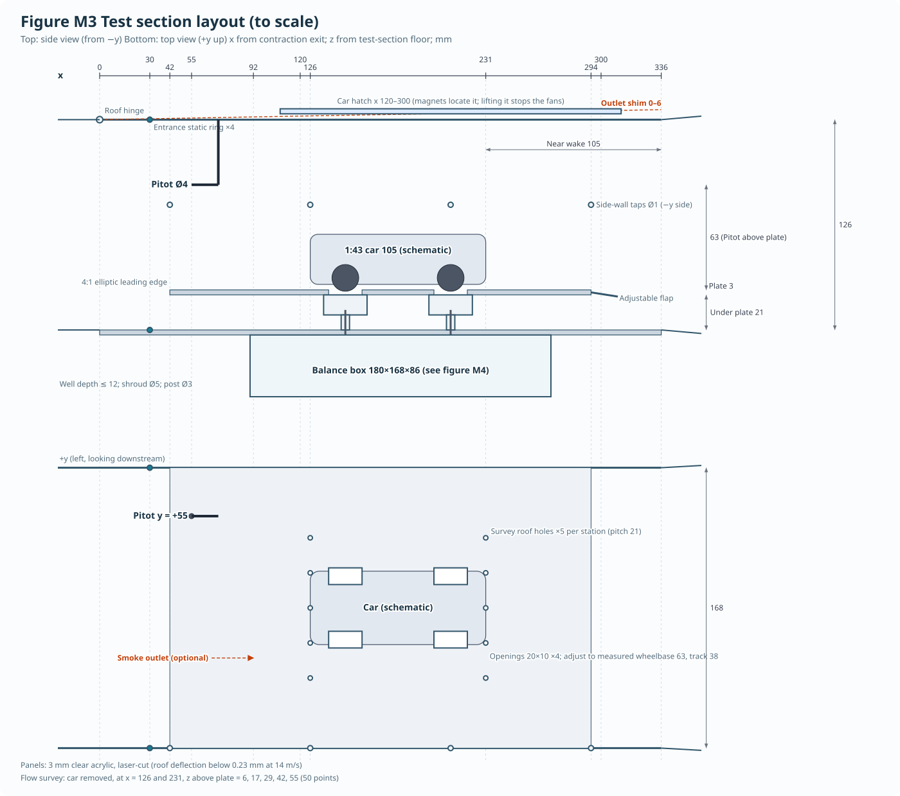
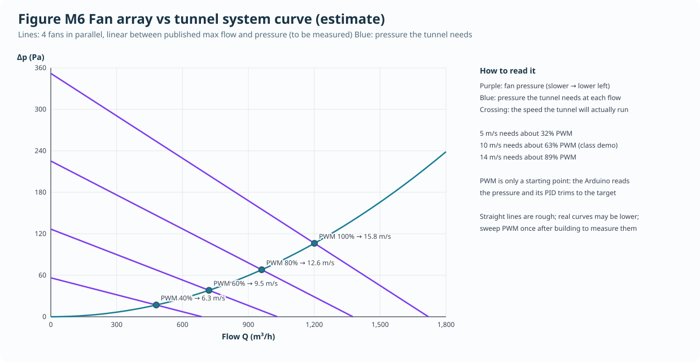
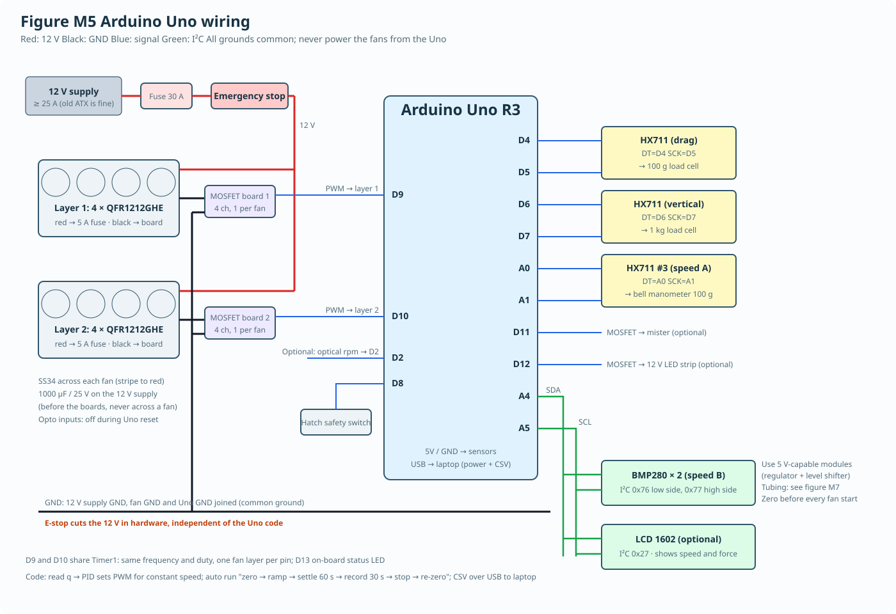

# Mini Wind Tunnel — Class Project Version (1:43, Arduino Uno, budget NT$5,000)

**A desk-top suction wind tunnel that measures drag and downforce on a 1:43 model car to about 1 mN (0.1 gram-force) at 12–14 m/s, built for NT$5,000 or less.**

The duct is about 1.8 m long and splits into three modules that one person can carry to a classroom and set up on desks. An Arduino Uno runs everything: eight 12 V computer fans, the force balance, two home-made speed sensors and the data log. It is the full 1:18 design scaled down by 0.42, with the same principles: suction (fan downstream), a 6:1 contraction, a sealed balance with a drag stage, and zeroing before and after every measurement.

Related files:

- Full 1:18 design (reference only): [archive/full_1to18/build_plan.md](archive/full_1to18/build_plan.md)
- Research method (paper format): [model.md](model.md)
- Parts list and prices: [shopping_list.md](shopping_list.md)
- Exact numbers: [spec/mini.json](spec/mini.json); recompute with `python3 tools/mini_calc.py`, check with `python3 tools/test_mini.py` (23 checks)
- 3D model: [cad/mini_tunnel.fs](cad/mini_tunnel.fs) (Onshape FeatureScript)
- Earlier Traditional Chinese plan (frozen): [build_plan_mini.zh-TW.md](build_plan_mini.zh-TW.md)

## How big are the forces?

The forces on a 1:43 car are tens of millinewtons, so a 1 mN error is only small at the higher speeds.

$$
F = C\,q\,A_m,\qquad q = \tfrac12\rho U^2
$$

Here $F$ is the force, $C$ its coefficient ($C_D$ for drag, $C_L$ for lift or downforce), $q$ the dynamic pressure, $A_m$ the car's frontal area, $\rho$ the air density (about 1.2 kg/m³) and $U$ the air speed. Estimates for a 1:43 car: $A_m = 0.00114\ \mathrm{m^2}$, $C_D = 0.35$, $|C_L| = 0.30$.

| Speed (m/s) | $q$ (Pa) | Drag (mN) | Vertical force (mN) | 1 mN as share of drag | Use |
| --- | --- | --- | --- | --- | --- |
| 5 | 15 | 6 | 5 | 17% | Trends only |
| 10 | 60 | 24 | 21 | 4.2% | Class demonstration |
| 12 | 86 | 34 | 30 | 2.9% | Lowest speed for coefficient-grade data |
| 14 | 118 | 47 | 40 | 2.1% | Top target |

**Only data at 12 m/s and above count as coefficient-grade**, because that is where 1 mN falls below 3% of the drag. Class demos run at 10 m/s and show differences, such as adding a wing or changing ride height. The air speed does not need to be scaled with the model; the full version's [design notes](archive/full_1to18/airflow_design.zh-TW.md) explain why.

## Layout

The air path runs in a straight line from the inlet bell to the fan box, as figures M1–M8 show to scale.

The duct is 1,782 mm long from the front of the inlet bell to the fan-box outlet. With 0.4 m clear in front of the inlet and 0.8 m behind the exhaust, it needs about 3.1 m of straight space. Never point the exhaust at people. The tunnel splits into three modules (see H).

Coordinates are the same in this plan, the spec and the CAD: x runs downstream, y to the left looking downstream, z up. x = 0 is the contraction exit and z = 0 is the inside of the test-section floor. Every CAD part is named with this plan's section code (for example "A2 Spine top"), so the Onshape parts list maps directly onto this document.

## Components

### A. Air path

The air path straightens the incoming air, speeds it up 6×, passes it over the car, slows it down again and exhausts it through the fans.

**A1. Flow conditioning.** A honeycomb and two screens remove swirl and even out the air before the contraction. The honeycomb can be 6 mm drinking straws cut to 40 mm and glued side by side into one panel (about 4,000 straws), or hexagonal cells printed in tiles on the school 3D printer. The two screens are polyester voile or stainless mesh with 60–70% open area. Mount them in pull-out frames with foam-tape seals.

**A2. Contraction.** The contraction uses the full version's curve, scaled down. The widths and heights in figure M2 are the **inside** (air passage) dimensions at each station.

Build it from a 0.5–1 mm PET sheet bent over 7 plywood ribs, held in place by four plywood spines.

- **Ribs:** 6 mm plywood frames at s = 0, 76, 151, 189, 227, 302 and 378 mm, where s is measured from the contraction inlet. Make each **rib hole the figure-M2 size plus 2 × the sheet thickness**, with a 25 mm border. In the middle of each side, cut a half-lap slot 6 mm wide and 12.5 mm deep from the outer edge.
- **Spines (4, 6 mm plywood):** one on top and one underneath standing on the centreline, and one on each side lying flat at axis height. The inner edge follows the outside of the sheet; the outer edge is straight. At every rib, cut a 12.5 mm half-lap slot from the inner edge so spine and rib interlock like an egg crate.
- **Spine ends:** run the spines 15 mm past the first rib and 8 mm past the last, so the end ribs also sit in closed slots. The upstream extension steps out over the settling-chamber wall; the downstream one steps out over sleeve 1.
- **Why spines:** the ribs drop into slots that are already evenly spaced and square, so nothing has to be aligned by hand.
- **Assembly:** lay the bottom spine's straight edge on a flat board as the datum and push the ribs into its slots. Fit the side spines, then the top spine. Glue on the four sheets in the order bottom, sides, top, with hot glue along the rib-hole edges and spine edges. Seal the four corners from outside with tape or hot glue.
- **Saving wood:** the spines are about 116 mm deep near the exit. You can cut large lightening holes in the middle, as long as both edges and all slots stay intact.

Cut each wall from a flat sheet, because each wall bends in only one direction. Along the bend the sheet is longer than 378 mm, so leave 10 mm extra and trim at the end.

| x from contraction inlet (mm) | Top/bottom sheet: distance along sheet | Top/bottom sheet: width | Side sheet: distance along sheet | Side sheet: height |
| --- | --- | --- | --- | --- |
| 0 | 0 | 412 | 0 | 309 |
| 75.6 | 75.9 | 397.9 | 76.1 | 298.4 |
| 151.2 | 155.3 | 334.5 | 158.4 | 250.9 |
| 226.8 | 238.0 | 245.5 | 246.1 | 184.1 |
| 302.4 | 317.4 | 182.1 | 328.3 | 136.6 |
| 378 | 393.3 | 168 | 404.5 | 126 |

The top and bottom sheets fit between the side sheets. Add 2 × the sheet thickness to the side-sheet height so the side sheets cover their edges. Mark the points and join them with a thin flexible ruler or wood strip bent into a curve.

The step from the contraction exit into the test section must be **≤ 0.3 mm and backward-facing only**. The downstream wall may sit slightly outward, never into the flow.

**A3. Test section.** The test section is a 3 mm solid clear polycarbonate box (not twin-wall), CNC-cut by the seller; do not laser-cut it. The roof is hinged or taped at the inlet end and can be shimmed up 0–6 mm at the outlet end to flatten the streamwise pressure gradient. The inlet end slides 20 mm into sleeve 1 on the contraction; the outlet end slides 20 mm into sleeve 2 on the diffuser (see H1). The entrance pressure taps (D2) therefore sit at x = 30 mm, just clear of sleeve 1.

**A4. Diffuser.** The diffuser slows the air from 168 × 126 to 240 × 240, exactly the size of the 2 × 2 fan array. It is four flat trapezoid panels, so nothing needs bending. Its equivalent cone half-angle is 4.7°, below the 5° limit where flow starts to separate. A safety mesh with 5–10 mm openings sits at the exit (7 mm in the CAD).

**A5. Fans.** The tunnel uses **eight Delta QFR1212GHE fans** (120 × 120 × 38 mm, 12 V, 2-wire), in a 2 × 2 array stacked two deep. The fan box is 240 × 240 inside and 98 mm long. The first layer sits at x = 998–1036 and the second directly behind it at x = 1036–1074.

- **Datasheet ([Delta QFR1212GHE](https://www.delta-fan.com/Download/Spec/QFR1212GHE.pdf)), per fan:** 357 m³/h at zero pressure, 286 Pa at zero flow, 1.80 A rated (2.70 A max), 6,000 rpm, 64 dBA, 330 g. It starts slowly and reaches full speed after 10 s.
- **Top speed:** from the datasheet P–Q curve, about **16.0 m/s** at full power (16.4 m/s if the two layers give the ideal double pressure). That is 14% above the 14 m/s the measurements need. One layer of four would give only about 14.8 m/s, which is why both layers are filled.
- **Why not more:** at this operating point each fan runs near its free-flow end, where stacking adds little; the second layer buys about 1.2–1.6 m/s. The 1.6× stacking gain used for the design value is an assumption, so measure the real curve after building.
- **Speed control:** the QFR has no PWM wire, so the Uno switches the fans' 12 V on and off with two 4-channel MOSFET boards (YYNMOS-4 type), one board per layer and one channel per fan (see D). The duty needed is about 31% for 5 m/s, 63% for 10 m/s and 88% for 14 m/s.
- **PWM frequency:** the board switches at 1 kHz at most (some listings say 200 Hz), so the choice is 1 kHz, 122 Hz or 30 Hz. The fan's control chip loses power in every off gap (0.7 ms at 1 kHz and 31% duty, 23 ms at 30 Hz). If a gap is too long, the chip resets and the fan falls back to its 10 s slow start. The datasheet says nothing about switched power, so the frequency is chosen by test.
- **Weight:** the eight fans weigh about 2.6 kg, most of module 3's weight.
- **Before buying all eight:** buy one fan and one board, and run [arduino/fan_pwm_test](arduino/fan_pwm_test/fan_pwm_test.ino) through that board. It passes if, at 1 kHz, 122 Hz or 30 Hz, the speed rises smoothly from 30% to 100% duty and never drops back to the slow start; 5 m/s needs about 31% of full fan speed. A whine or buzz at the PWM frequency is not a failure. If it fails, see "Why it could fail".

### B. Ground plate and wheel supports

The car stands on a flat ground plate, with each wheel resting in a saddle on a post that passes through the plate to the balance.

- **Ground plate:** 3 mm sheet with the leading edge sanded to a 4:1 ellipse and an adjustable flap at the trailing edge. It must be flat to within 0.15 mm under the car.
- **Wheel wells and shrouds:** a small closed-bottom box hangs under each wheel opening. Each post passes through a thin tube fixed to the tunnel, so the air under the plate cannot blow on the posts.
- **V-saddles:** the wheels sit directly in V grooves; rollers are too small at this scale. Pushing a wheel out takes a horizontal force of 0.38 × the car's weight, far more than the drag. The saddles can be 3D-printed.

### C. Balance

The balance splits the force on the car into a drag reading and a vertical reading, using the same load path as the full version (its [figure A6](archive/full_1to18/figures/zh-TW/A6-drag-path.svg), with V-saddles in place of rollers).

1. The four saddles are fixed to a common frame, so the whole frame moves together.
2. The frame sits on the drag stage. Four feeler-gauge steel blades (0.1 × 10 × 20 mm) let the upper plate move only fore and aft, so all fore-aft force goes to the 100 g drag load cell.
3. The drag stage sits on the 1 kg vertical load cell, which reads weight plus downforce.
4. Everything sits inside a sealed plenum. A thin tube joins the plenum to a side-wall tap at mid-car (x = 178 mm), so the plenum pressure matches the test section.
5. The balance base stands on a pedestal on the desk, weighed down with about 5 kg of bricks or books. It never stands on the tunnel, so fan vibration cannot reach it (setup in H4).

Keep the moving mass (car, saddles, frame and drag stage) under 0.6 kg. The blades (1,000 N/m) and the drag cell (4,905 N/m) act as springs side by side, so the cell always carries about 83% of the drag. The force calibration after assembly takes this fixed share out.

**Why the many contacts do not spoil the reading.** The car, the four saddles, the four posts and the common frame form **one rigid body**, the "measured body". Its parts are glued or bolted together, so forces between them cancel, like a bag held in your hand while you stand on a bathroom scale. The tyre-to-saddle contacts are inside this body, so they do not matter as long as the car does not slide. Only two things connect the measured body to the outside:

| Connection | Why it is acceptable |
| --- | --- |
| 4 feeler-gauge blades (0.1 mm) | They **bend** rather than slide, so there is no friction or stick-slip. They are stiff up/down and sideways, holding the frame in place, but soft fore-aft. |
| Drag load cell | Measures the fore-aft force. It must be **bolted** to the frame's push tab, not just touching it, so it works in both directions and cannot rock or open a gap. |

At maximum drag the frame moves only about 8 µm, too little to change the 83% share. Calibrating with weights on a thread over a pulley measures the whole chain, blades included.

**The real risk is an accidental contact.** The posts pass through the floor and wheel wells inside shroud tubes with about 0.75 mm clearance on each side. If a post rubs a tube, a cable or the vent hose touches the frame, or dust jams a gap, part of the force bypasses the load cell. The acceptance tests (load and unload weights, return to zero, drift) catch this.

### D. Arduino control and measurement

The Arduino Uno holds the speed, runs each force measurement, cuts the fans when needed and logs everything to a laptop.

- **Constant speed:** the Uno reads the pressure difference from speed sensor A, computes $q$ and $U$, and adjusts the PWM duty with a PID loop to hold the set speed. D9 drives the four inputs of the layer 1 board and D10 those of the layer 2 board. Both pins run on Timer1, so they share one frequency and get the same duty. Two pins are needed because each board input lights an optocoupler LED (about 4–8 mA): eight inputs on one pin would exceed the Uno's 20 mA per pin. Measure one input's current; if four exceed 20 mA, add a transistor buffer. The PWM frequency is the one that passed fan_pwm_test.
- **Automatic force run:** one button runs "zero 30 s → ramp up → settle 60 s → record 30 s → stop → re-zero within two minutes". If the zero shifts by more than 1 mN, the run is flagged as invalid.
- **Safety:** the board inputs are opto-isolated, so a resetting Uno (pins floating) cannot light them and the fans stay off. If a board without optocouplers is used instead, it needs a pull-down on each input. Opening the hatch switch makes the sketch turn the boards off at once. A hardware emergency stop cuts the 12 V directly, without the Uno.
- **Logging:** every sample goes over USB to a laptop as CSV: time, raw readings, $q$, $U$, drag, vertical force, PWM duty and zero values. Plot it in Excel or Python.

**Sensors:**

- **Speed:** two home-made sensors on the same pressure taps (D2): A, a bell manometer (primary, third HX711 on A0/A1), and B, two BMP280s (backup and cross-check, I²C 0x76/0x77). Both are zeroed before every fan start.
- **Force:** two HX711s at 10 samples/s. The 100 g cell measures drag and the 1 kg cell vertical force.
- **Optional:** an LCD 1602 showing speed and force. B's BMP280s also give room temperature and pressure for the air density, so no separate BME280 is needed.

### D2. Home-made speed sensors (A primary, B backup, C last resort)

Two cheap home-made sensors on the same pressure taps replace a bought differential-pressure sensor, and check each other.

At 5–14 m/s the dynamic pressure is only 15–118 Pa. A bought digital sensor (ABP2, SDP810) costs NT$1,100–1,600 with shipping. The two home-made sensors together cost about NT$430–800, and A is more accurate than the bought ones at low speed. If one fails, the other takes over.

**A, bell manometer (primary).** An upside-down straight-walled cup (the bell) dips mouth-down into oil and hangs from a 100 g load cell. The inside of the bell connects to the low pressure and the air in the box to the high pressure, so the pressure difference × bell area pulls the bell down. The oil seals the bell's mouth, so there is no friction and no rubber-diaphragm spring.

| Item | Value |
| --- | --- |
| Bell | 3D-printed PETG straight cylinder, 60 mm inside diameter, 80 mm tall, 1.2 mm wall, about 28 g |
| Liquid | Baby oil, 45 mm deep; bell dips 35 mm, rim 10 mm above the dish floor |
| Force | 15 Pa ≈ 4.5 g; maximum about 47 g; load cell maximum about 69 g of 100 g |
| Resolution | 1 mN ÷ bell area ≈ 0.34 Pa → speed error about ±1.1% at 5 m/s, ±0.2% at 12 m/s |
| Oil inside the bell at maximum pressure | Rises about 19 mm; the vent-tube tip is 35 mm above the oil, so it stays dry |
| Box | Airtight food container of about 1.5–2 L, at least 12–13 cm tall inside (the CAD shows a larger 200 × 130 × 150 box) |

How to build A:

1. Print the bell straight-walled, with a hanging loop on top. Never use a tapered cup, because its area changes as the oil rises.
2. Put the dish (inside diameter ≥ 100 mm) in the middle of the container floor. Glue a rigid bracket to the floor and fix the 100 g load cell to it, with the free end directly above the dish. **Do not mount it on the lid**, which flexes under pressure.
3. Bend a 4 mm brass tube into a U. One end goes out through the box wall as the low-pressure port. The other goes under the bell's rim and up inside the bell, with its tip 35 mm above the resting oil level.
4. Make a second port in the box wall as the high-pressure port, open only to the air in the box. Seal all wire and tube holes with hot glue.
5. Pour baby oil to 45 mm and hang the bell on a thin thread. Check that the bell touches neither the dish nor the vent tube.
6. Connect HX711 #3 to A0 (DT) and A1 (SCK). Put the box on the desk, not on the tunnel, to keep out fan vibration.

**B, two BMP280s (backup).** Two barometers, one on each side of the taps, give the pressure difference by subtraction. Use 5 V-capable BMP280 modules, each sealed in a film canister or small airtight box with one tube barb. Set SDO to GND for 0x76 (low side) and to VCC for 0x77 (high side). Tape the two canisters together and wrap them in foam so they stay at the same temperature. They differ by about ±12 Pa from the factory; **after zeroing** the error is about ±0.7 Pa, or ±0.4% in speed at 12 m/s and ±2.5% at 5 m/s.

**Tubing.** Each side has a ring of four wall taps joined by a loop of silicone tube, then a tee that feeds both sensors.

- **High side (red tube):** four static taps around the settling chamber at x = −420 mm → loop → tee on the electronics board → the air inside A's box, and B's high-side canister.
- **Low side (blue tube):** four static taps around the test-section entrance at x = 30 mm → loop → tee → A's low-side port (continuing inside the box as the brass U-tube into the bell), and B's low-side canister.
- Each line has a quick-connect at the edge of the electronics board, unplugged for carrying. To find the conversion factor $k$ between the wall-tap reading and the true $q$, connect A to the wall rings and B to the Pitot tube and read both at once.

Why it is connected this way:

| Choice | Reason |
| --- | --- |
| Wall taps, not the Pitot tube, for speed control | The Pitot tube sits in the flow just in front of the car and disturbs it; wall taps do not. The pressure drop from the settling chamber to the test-section entrance is about 0.97 $q$, because the air speeds up 6×. The Pitot tube is used only to calibrate $k$. |
| Taps square to the wall | Static pressure must be measured at right angles to the flow; a hole facing the flow reads total pressure. Drill about 1 mm, square to the wall, and deburr the inner edge flush. Put taps only in straight sections, never on curved walls. Any remaining fixed error goes into $k$; recalibrate $k$ after a tap is damaged or cleaned. |
| Four taps joined in a ring | A single hole can read off because of a burr or local flow; averaging four reduces that error. |
| High side to the box, low side inside the bell | Lower pressure inside the bell pulls it down, so the reading rises with speed. Swapped, the bell is pushed up; at top speed the push (about 47 g) exceeds its 28 g weight, the thread goes slack and the reading is lost. |
| Low-side tube enters under the rim, tip 35 mm above the oil | The oil seals the mouth, so the only way in is from below. At top speed the oil inside rises about 19 mm, so the tip stays dry. |
| A and B on the same taps through tees | Both see the same pressure, so they can be compared directly (agree within 1 Pa or 2%). If one fails, the other takes over without re-plumbing. |
| Sensors on the desk, not on the tunnel | Keeps fan vibration out of A's load cell. Tube length does not change the steady reading, only the response time: about 1 s per metre of 4 mm tube, because the oil in the bell acts as an air cushion. Keep tubes to about 0.5 m and tune the PID to respond slowly. |

**Bench calibration (fans off, figure M8).** A syringe and a home-made inclined water manometer give known pressures to calibrate both sensors before they go on the tunnel.

1. Make a 1:10 inclined water manometer: clear tube fixed to a board ≥ 300 mm long, one end raised to a 1:10 slope, water with food colouring. 1 mm along the tube ≈ 0.98 Pa.
2. Connect the syringe, the manometer, the inside of A's bell and B's low-side canister with tees. Leave A's box air and B's high-side canister open to the room.
3. **Leak test:** pull the syringe slightly and pinch the tube for 60 s; the reading must change by less than 0.5 Pa.
4. Step the vertical water height 0 → 2 → 5 → 10 → 15 → 20 mm (0–200 mm along the tube), 10 s per point, recording the manometer, A and B. Step back to 0. Repeat 3 times.
5. A's slope is its effective area. Write it back to [spec/mini.json](spec/mini.json).

**Which sensor to use:**

| Situation | Use |
| --- | --- |
| A passes bench calibration (linearity ≤ 0.5 Pa or 1%, hysteresis ≤ 0.5 Pa, no leak), and A and B agree in the tunnel within 1 Pa or 2% | **A controls the speed**; B is logged every run as a check |
| A leaks and cannot be fixed, its hysteresis is too large, or fan vibration makes its noise > 0.5 Pa | **Switch to B** (less accurate at 5 m/s; note it in the report) |
| B also fails (drifts > 2 Pa within 2 minutes of zeroing) | **C:** buy a Honeywell ABP2MRRN001ND2A3XX (option C in the [shopping list](shopping_list.md)), or calibrate a "PWM → speed" table with the water manometer |
| A and B disagree beyond the limit | Leak-test first, check for kinked tubes or oil in a tube, then redo the bench calibration |

### E. Flow visualization

Tufts show where the flow separates for almost no cost; smoke is an optional extra.

**Tufts.** Tape short pieces of fine wool or sewing thread to the car or the diffuser walls. They show separation as soon as the air runs, which makes them good for class demos.

**Smoke (optional; skip if the budget is short).** The tunnel sucks smoke from a jar on the desk through a thin wand that ends just in front of the car.

- **Wand:** a Ø4 mm brass tube pushed down through a rubber grommet in the roof at x = 100 mm to the height you want to see (for example the windscreen, z ≈ 47 mm). Bend it to point downstream, with the tip just in front of the car's nose (x ≈ 114 mm). Keep it clear of the Pitot tube (y = 55 mm).
- **Source:** a glass jar holding an incense stick or an ultrasonic mister. The lid has one smoke outlet barb and one small air-inlet hole. A hose runs to the wand, with a pinch clamp to set the amount. The test section is below room pressure, so **no blower is needed**.
- **Not at the inlet bell:** the honeycomb and screens would spread the smoke into a haze with no visible streaks.
- **Run at 3–5 m/s:** at 10 m/s the smoke lines blur quickly.
- **For force runs, pull the wand out and plug the hole.** Force data from smoke runs are never used, because droplets can wet the car. Point the exhaust out of a window, and check the school's rules on incense first.

### F. Calibration

Every measured quantity is calibrated against something known: weights for force, the water manometer for the speed sensors, and the Pitot tube for speed.

- **Force:** weigh coins or small nuts on a 0.01 g pocket scale and use them as weights. For vertical force, place them directly at the car position. For drag, pull with a thread over a low-friction pulley, once in each direction, and average.
- **Speed sensors:** bench-calibrate with the syringe and the 1:10 manometer (D2, figure M8) to get A's effective area and B's conversion.
- **Speed:** read A on the wall rings and B on the Pitot tube at the same time to find $k$, once with the car and once without.

### G. Safety

The main hazards are high current, spinning fans, noise and loose parts blown into the fans.

- **Electrical:** 12 V is low voltage, but the eight fans draw 14.4 A rated and up to 21.6 A (datasheet maximum). Use a supply of at least 25 A, a 30 A fuse at its output, 12 AWG for the main run, 16 AWG to each layer, and an emergency stop rated ≥ 25 A DC (or have it switch a 30 A automotive relay). Put a 1000 µF / 25 V capacitor across 12 V+ and GND on the supply side, after the emergency stop and near the boards; Delta asks for more than 4.7 µF when fans run in parallel. It supplies the quick current pulses so the long supply wires do not have to. Never put it across a fan's own leads: there it would refill through the MOSFET on every pulse, with large current spikes. Mind its polarity (stripe = −).
- **Per-fan fuses and diodes:** each fan's red lead goes through its own 5 A blade fuse (a 6-way fuse box with negative bus per layer, or inline holders). The 30 A main fuse protects only the thick main wire; a short in one fan's thin 22 AWG lead could carry 15–20 A without blowing it. 5 A sits above the fan's 2.7 A maximum and below what 22 AWG carries. A jammed fan does not blow it (the fan cuts its own current when the rotor locks); it is there for wiring faults. Clamp an SS34 Schottky diode across each fan in the board's output terminal, stripe to the red lead.
- **Fans:** fit a metal guard at the outlet. Press the emergency stop before reaching into the duct.
- **Noise:** eight fans at full power give about 73 dBA (64 dBA each). Class demos run at 10 m/s (about 60% duty) for short periods.
- **Loose parts:** before every start, check the test section for tools or bits of the car.

### H. Carrying and setup (three modules)

The tunnel splits into three modules that each stand on their own feet, carry by one person, and join with slip-on sleeves that align them by shape. The joints are at the two ends of the test section. The test section and balance travel as their own small, careful-to-carry module, between two large, sturdy ones. Everything delicate is locked, emptied or unplugged before carrying, so nothing is measured or aligned in the classroom.

| Module | From → to (x, mm) | Contents | Size L × W × H (mm, incl. feet) |
| --- | --- | --- | --- |
| 1 Inlet | −696 → 20 | Inlet bell, settling chamber, honeycomb, screens, contraction, ribs, spines, sleeve 1 | 716 × 502 × 413 (the widest; fits through a door) |
| 2 Test section | 0 → 336 | Test section, ground plate, wheel wells, saddles, plenum, balance (transport lock on) | 336 × 190 × 300 |
| 3 Fan end | 316 → 1086 | Sleeve 2, diffuser, safety mesh, fan box, fans | 770 × 252 × 336 |

#### H1. Sleeves (the joints)

Each sleeve is a rectangular collar of four 3 mm plywood strips glued into a frame, which the test section slides into.

| | Sleeve 1 | Sleeve 2 |
| --- | --- | --- |
| Glued to | Face of the contraction's last rib | Diffuser inlet |
| Length | 20 mm | 28 mm (20 over the test section + 8 glued onto the diffuser) |
| Inside size | 174.6 × 132.6 mm | 174.6 × 132.6 mm |
| Takes | Test-section inlet | Test-section outlet |

The test section is 174 × 132 mm outside, leaving 0.3 mm clearance on each side. Build the sleeves so the joint lines up:

1. Make the test section first.
2. Slide it into sleeve 1 and hold the contraction against it.
3. Feel inside the duct for a step where the contraction meets the test section. Any unavoidable step must be backward-facing (A2).
4. Glue the sleeve to the rib **while the test section is in it**, so the alignment is fixed permanently.
5. Do sleeve 2 the same way with the diffuser.

In use, push the test section 20 mm into each sleeve, then wrap the seam with masking or aluminium tape. The tunnel runs below room pressure, so any gap sucks air in. If the fit is loose, put one layer of masking tape around each end of the test section.

#### H2. Levelling feet (4 per module, 12 in total)

Each module stands on four M6 levelling feet with rubber pads, so it can match desks of slightly different height. Screw the feet into T-nuts pressed into the plywood, or into nuts glued underneath.

| Module | Feet (x, y in mm) |
| --- | --- |
| 1 | Two wooden cradles under the settling chamber (x −600 and −480), feet at y ±165 |
| 2 | The four corners of the plenum floor (x 93 / 267, y ±75); the floor is PC, so use a nut and washer inside |
| 3 | A wedge cradle under the middle of the diffuser (x 615, y ±85) and the fan-box cradle (x 1037, y ±110) |

Level in this order:

1. Level module 1; it is the reference.
2. Adjust module 2's feet until the test section slides into sleeve 1 without pushing up or down.
3. Adjust module 3 until sleeve 2 slides on freely.

If a sleeve needs force, the heights are wrong; forcing it bends the joint.

#### H3. Balance transport lock

Four M4 thumb screws clamp the balance so the 0.1 mm blades and the load cells cannot move while module 2 is carried. The screws pass through the plenum walls at x = 200 mm, two on each side, into nuts or threaded inserts glued to the outside of the wall.

- **Upper pair (z = −37.5 mm):** press on both sides of the common frame.
- **Lower pair (z = −88 mm):** press on both sides of the balance base plate.
- **Locking:** lower pair first, then upper pair. Tighten each pair evenly and finger-tight only; tightening one side harder pushes the frame sideways and bends the blades.
- **Unlocking:** upper pair first, then lower pair. Back all four screws fully out and look to confirm they touch nothing. Tap the car lightly; the reading must return to zero.

The CAD shows the screws tightened (transport position).

#### H4. Pedestal (stays in the classroom)

The pedestal that carries the balance stays in the classroom, because it must stand on the desk and not on the tunnel. It is the base plate on the desk, a column up through the plenum floor, and the ballast.

- **Column:** bolts to the underside of the balance base; unbolt it before moving module 2.
- **Base plate and ballast:** can stay in the classroom. The ballast (books or bricks) sits on the base plate outside the plenum's footprint.
- **Rubber skirt:** seals the gap between the column and the plenum floor; refit it each time with a rubber band.
- **Height adjuster:** the column top must meet the balance base at exactly the right height each time, or bolting it would lift or press on the balance. Put an M8 bolt with a lock nut at the top of the column. With the transport lock still on, screw it up until it just touches the base, lock the nut, then bolt through the plenum's access cover.

#### H5. Electronics board

All the electronics travel on one 200 × 140 mm plywood board, and every wire that leaves it ends in a plug. The board carries the Uno on standoffs, 3 × HX711, the two sensor-B canisters, the red and blue tees, a connector strip and two pressure quick-connects at the edge.

| Connection | Plug |
| --- | --- |
| Drag and vertical load cells (inside the plenum) | Short leads out through a hot-glued hole, ending in 4-pin plugs |
| Sensor A load cell | 4-pin plug |
| Fan MOSFET signal (to the MOSFET module at the fan box) | 2-pin plug |
| Fan 12 V | XT60, power supply to fan box (not through the board) |
| Hatch switch | 2-pin plug |
| Laptop | USB |

Use different plug sizes or colours and label them so they cannot be swapped. Keep a photo of the board fully plugged in. The red tube loop stays on module 1 and the blue loop on module 2; for carrying, pull them off the quick-connects, coil them and tape them to their modules.

#### H6. Sensor A and smoke parts

Sensor A and the smoke parts are packed separately because they hold liquid or are fragile.

- **Oil:** pour it back into its bottle through a funnel; it would slosh onto the load cell in transit. Mark a 45 mm line on the dish for quick refilling.
- **Bell:** carry it separately in something padded; the PETG wall is thin.
- **Smoke:** remove the wand, plug the roof hole and carry the jar separately.

#### H7. Carrying

Hold each module by its sturdy parts and cover its open ends.

| Module | Hold by | Never hold by | Protect |
| --- | --- | --- | --- |
| 1 | Settling chamber and cradles | The thin PET contraction sheet | Cardboard over both open ends (screens, sleeve) |
| 2 | The plenum, kept upright and level | The clear walls or the Pitot tube | Remove the car (padded box); wrap the PC walls against scratches |
| 3 | Fan box and cradles | Diffuser panels near the mesh | Cardboard over the mesh |

Weigh each module after building and note it here.

#### H8. Setup in the classroom (about 20–30 minutes plus warm-up)

Setup puts the modules down from the reference end outward, then frees the balance, then checks it before any measurement.

1. Put the pedestal base plate and ballast on the desk.
2. Place module 1 and level it.
3. Lower module 2 into place with the column through the plenum-floor hole. Push the test section into sleeve 1, adjust the feet and tape the seam.
4. Slide module 3's sleeve 2 onto the test section, adjust its feet and tape the seam.
5. Raise the column adjuster until it touches the base, lock the nut, bolt it and fit the skirt.
6. Unlock the balance (H3) and check that it moves freely.
7. Plug in the electronics board, the 12 V and the two pressure tubes.
8. Fill oil to the 45 mm line, hang the bell and seat the car on the saddles.
9. Let the load cells warm up for 15 minutes.
10. **Check before measuring:**
    - Hang one known weight and check the force reading.
    - Zero both speed sensors and the balance.
    - Run at 10 m/s holding a tuft next to each taped seam; it must not be pulled in.
    - Do a 1-minute Pitot check at 10 m/s. The joints and taps have been taken apart, so $k$ may have shifted; if it is off by more than 1%, recalibrate $k$.

**Packing up** is the reverse: stop the fans and unplug everything; lock the balance (lower pair, then upper pair); unbolt the column; remove the tape and pull the modules apart; empty the oil and take out the car.

## Budget

The low estimate fits NT$5,000 and the high one does not, so the low-cost route is required. Items, specifications, Shopee search terms and the reasons behind the high estimate are in [shopping_list.md](shopping_list.md).

| Item | Estimate NT$ | Basis |
| --- | --- | --- |
| 8 × QFR1212GHE fans | 2,000–3,000 | Placeholder carried over from the 4 × PFC1212DE price; re-price |
| 2 × 4-channel MOSFET boards (YYNMOS-4 type) + 1 spare | 150–450 | Estimate |
| Fan fusing: 8 × 5 A blade fuses in inline holders (low) or 2 × 6-way fuse boxes (high), 8 × SS34 | 150–550 | Estimate |
| Speed sensor A: 100 g load cell + HX711, food container, baby oil, fittings (bell printed at school) | 230–350 | Estimate |
| Speed sensor B: 2 × BMP280 (5 V modules), film canisters | 120–300 | Estimate |
| Calibration: inclined-manometer tube and board, 60 mL syringe, tees | 80–150 | Estimate |
| 12 V ≥ 25 A power supply | 0–900 | Old ATX supply free; retail estimate |
| 100 g and 1 kg load cells + 2 × HX711 | 250–400 | Estimate |
| Pitot tube, brass U-tube for the bell, silicone tubing, tees | 150–300 | Estimate |
| 3 mm clear PC sheet (about 3.7 cai) | 300–500 | Checked: NT$60–75 per cai + cutting fee |
| Plywood/MDF ribs and spines, PET sheet, diffuser panels | 300–600 | Estimate |
| Straws or printed honeycomb, screens | 100–200 | Estimate |
| 1:43 diecast car | 80–450 | Checked: SHEIN Taiwan NT$77–445 |
| 12/16 AWG wire, main fuse holder, emergency stop, 1000 µF capacitor, connectors, screws, hot glue | 200–400 | Estimate |
| Feeler gauge, rubber skirt, misc. | 100–200 | Estimate |
| Portability: 12 × M6 levelling feet, 4 transport-lock thumb screws, 2 pressure quick-connects (sleeves and spines from plywood offcuts) | 150–300 | Estimate |
| **Total** | **4,360–9,050** | |

To stay at NT$5,000, use an old PC power supply, a cheap car, and school tools and scrap wherever possible. If the order is still over budget, **cut speed sensor B first**: it saves NT$120–300 but loses the backup and cross-check. Speed sensor A and the calibration manometer cannot be cut.

## Operating procedure

Every session starts with the setup in H8 and every measurement is one of two kinds of run.

**Force run.** Check that the smoke wand is out and its hole plugged, the test section is free of loose parts, and the car sits firmly. Select the speed on the Arduino and press start; the sketch zeros, settles, records and re-zeros by itself. Save the file on the laptop.

**Visualization run.** Fit the tufts or the smoke wand, set the speed, and take photos or video. Force data from visualization runs are never used.

## Acceptance tests

The tunnel is ready for class data only when it passes every test below.

| Measure | Method | Pass |
| --- | --- | --- |
| Force drift | No wind, car fitted, record 30 minutes | Successive 30 s means within 1 mN |
| Force repeatability | Load and unload weights ten times; re-seat the car five times | Within 1 mN; report re-seating separately |
| Fan interference | Slide module 3 back so sleeve 2 is off, cap the test-section outlet, run the fans at full power | Force noise the same as with fans off |
| Speed sensor calibration | Bench syringe + 1:10 manometer (figure M8) | A linearity ≤ 0.5 Pa or 1%; hysteresis ≤ 0.5 Pa; leak < 0.5 Pa in 60 s |
| A vs B | In the tunnel at 5, 10, 14 m/s, A and B on the same taps | Agree within 1 Pa or 2% |
| Speed stability | 30 s means over 10 minutes | Within ±1% |
| Speed uniformity | Pitot survey at 10 m/s over the 50 points in figure M3 | Within ±2% of the mean; if not, record the actual values |
| Support tare | Saddles only, wind at each speed | Recorded as a function of $q$ |
| Joint seal (after each setup) | Tuft at each taped seam at 10 m/s | Not drawn in |

## Why it works, and why it could fail

The 1 mN target holds as long as the measured body touches the outside world only through the four blades and the drag load cell, and the zero is checked around every run. The physics in C shows that contacts inside the measured body cancel and that the 83% drag share is fixed. The automatic zero-record-re-zero run catches slow drift. What remains are practical failure modes, each with a test that catches it:

| Failure mode | What happens | Caught by | Response |
| --- | --- | --- | --- |
| Accidental contact (post rubs a shroud, cable or hose touches the frame, dust) | Part of the force bypasses the load cell | Force repeatability; return to zero after tapping the car | Find and clear the contact |
| Zero drift (temperature, creep) | Readings shift by more than 1 mN during a run | Automatic re-zero flag; force drift test | Longer warm-up; discard flagged runs |
| Fan vibration reaching the balance or sensor A | Noisy force or speed readings | Fan interference test; A's noise at full fan power with no tubes | Move the pedestal or sensor A; switch speed control to B |
| Leaks at the taped seams | Room air enters, speed and uniformity change | Tuft check at every seam during setup | Re-tape; tape-wrap a loose test-section end |
| Bell manometer fails calibration | Speed control is inaccurate | Bench calibration; A vs B test | Switch to B, then C (D2) |
| QFR fans will not run smoothly at low duty | Low speeds cannot be held | fan_pwm_test on one fan before buying eight | Fall back to 4 × PFC1212DE (4-wire PWM), or run only 10–16 m/s |
| Fans fall short of the estimate (stacking gain below 1.6×) | 14 m/s not reached | Measured fan curve during the trial | Even one layer reaches about 14.8 m/s on paper; 12 m/s is the minimum for coefficient-grade data |
| Desk joint under the balance | Desk movement shifts the balance | Force drift test | Put the pedestal and module 2 on one desk |
| Carrying damage (bent blades, overloaded drag cell) | Calibration changes after a move | Weight check in H8 step 10 | Always use the transport lock; recalibrate force |

## Build order

The build goes electronics first, because the balance and speed sensors decide whether the tunnel is worth building. Durations are estimates; dates depend on the class deadlines.

| Phase | Work | Depends on | Gate before the next phase | Duration |
| --- | --- | --- | --- | --- |
| 1. Measure and order | Measure the car (length, wheelbase, track, wheel diameter, ride height, mass) and update [spec/mini.json](spec/mini.json); buy one QFR1212GHE and one 4-channel MOSFET board and run fan_pwm_test through it; order the rest | Car and one fan delivered | Fan test passes (A5) | 1–2 weeks |
| 2. Electronics on the bench | Wire the Uno, HX711s and load cells; overnight drift test; build speed sensors A and B; bench calibration (figure M8); fan MOSFET control | Phase 1 parts | **Balance reaches 1 mN on the bench**; A passes calibration | 2 weeks |
| 3. Tunnel body | Settling chamber; contraction (ribs and spines first, then sheets, A2); test section; diffuser; fan box; sleeves glued with the test section in place (H1); cradles and levelling feet | Car dimensions (phase 1) | Sleeves slide on freely; no forward-facing steps | 2 weeks (can overlap phase 2) |
| 4. Balance and plenum | Saddles, frame, drag stage, plenum with transport-lock holes and access cover, height-adjustable column; electronics board and quick-connects | Phase 2 gate | Balance unlocks and returns to zero | 1–2 weeks |
| 5. Trial and calibration | Raise speed slowly; tuft leak check; vibration check; measure the fan curve; calibrate $k$ and force | Phases 3 and 4 | Speed held within ±1% | 1 week |
| 6. Acceptance and demo | Acceptance tests; one full pack-up, carry and setup rehearsal; prepare the class demo | Phase 5 | All acceptance tests pass | 1 week |

## Open items

### Still open

| Item | Status |
| --- | --- |
| Fan price | The budget line still uses the old 4 × PFC1212DE price; re-price 8 × QFR1212GHE. |
| MOSFET board specs | YYNMOS-4 specs come from listings, not a datasheet. On the board bought, check the PWM limit (1 kHz or 200 Hz), the size of the common DC−/GND terminal (it carries 7.2 A rated, 10.8 A max; if small, use 2 fans per board on 4 boards), whether flyback diodes are fitted, and one input's current. |
| Stacking gain | The design assumes two stacked fans give 1.6× one fan's pressure (2.0× ideal); measure the fan curve after building. |
| CAD | The CAD shows the drag push tab only touching the load cell (it must be bolted, see C) and does not show the column height adjuster (H4). |
| Desk size and joint | The model assumes two 900 × 600 mm desks with the joint at x = 185 mm, right under the plenum and pedestal. Taiwanese classroom desks are often only about 60 × 45 cm, so three may be needed. Measure the desks and place the pedestal and module 2 on one desk. |
| Bell effective area | 0.00294 m² is a design estimate; replace it with the bench-calibration slope. |
| Vibration on sensor A | Record A at full fan power with no tubes connected; if its noise exceeds 0.5 Pa, move it or switch to B. |
| Car dimensions | Currently estimates for a typical 1:43 hatchback; measure the purchased car and update. |
| Module weights | Weigh each module after building (H7). |

### Decided (kept for reference)

| Item | Decision |
| --- | --- |
| Fan model | 8 × QFR1212GHE, 2 × 2 stacked two deep, one 4-channel MOSFET board per layer and one channel per fan (2.7 A max on a 10 A channel); about 16.0 m/s (16.4 ideal) from the datasheet curve. The 4 × PFC1212DE option (about 17.1 m/s, 4-wire PWM, 19 A) is the fallback if the fan test fails; the 25 A supply covers it too. |
| Fan box | Holds two layers (x = 998–1074); no change needed. |
| Stopping the fans | Safety never relies on the Uno: the boards' opto-isolated inputs keep the fans off during a reset, and the emergency stop cuts 12 V in hardware. |
| Power | Supply ≥ 25 A, 30 A fuse, 12 AWG main wire, sized for the 21.6 A datasheet maximum; a 5 A fuse and an SS34 diode on each fan; 1000 µF on the supply side only (G). |
| Portability | Three modules joined by two sleeves (H), so the balance travels in its own module, away from the fan vibration. |
| Ride height | Each V-saddle holds its tyre at two side points, so the bottom of the tyre sits about 0.53 mm below those contacts. That costs about 18% of a typical 3 mm ride height; record the actual ride height in every report. |
