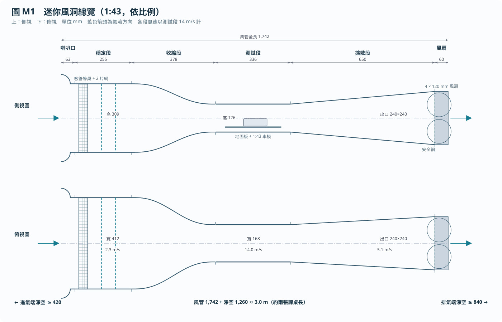
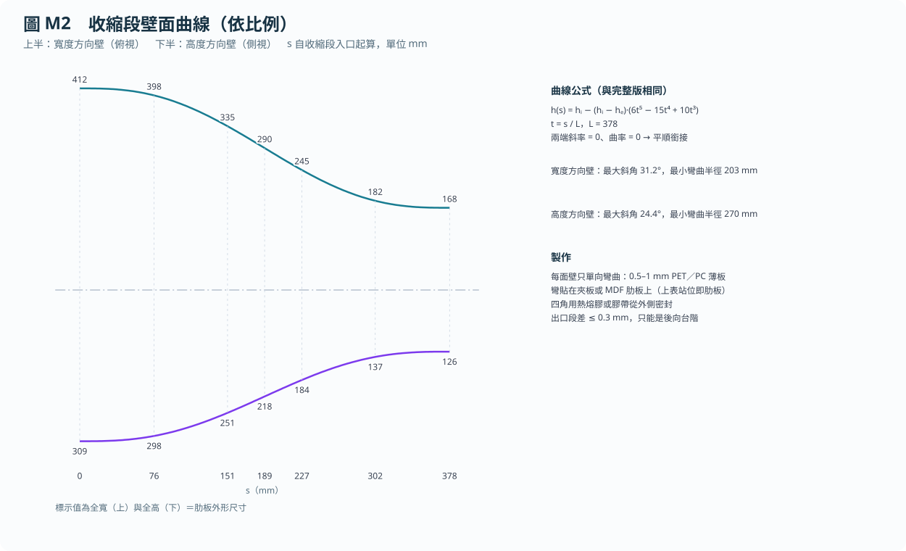
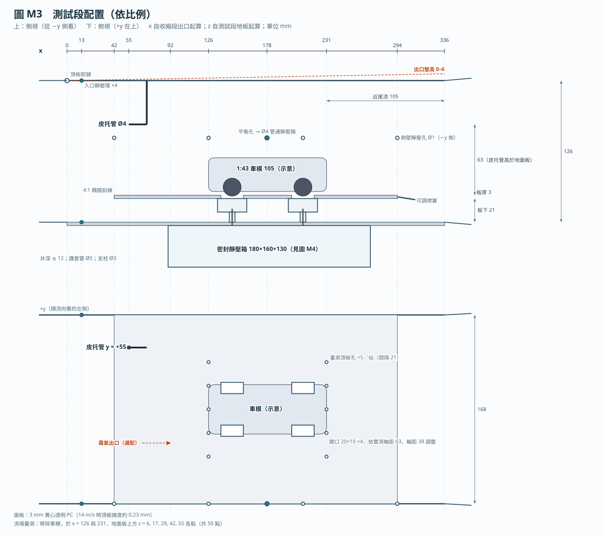
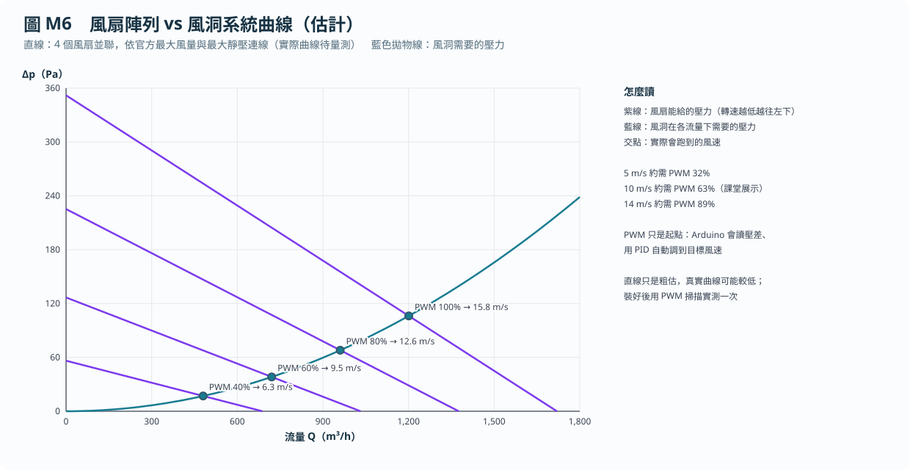
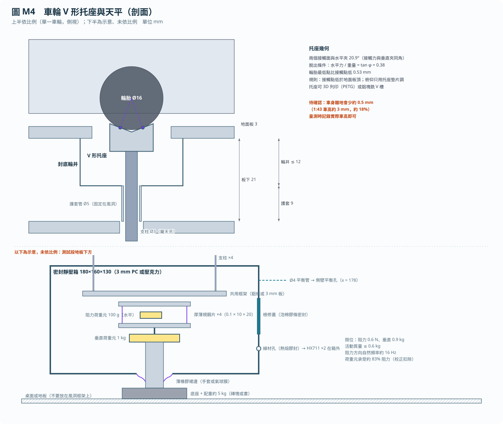
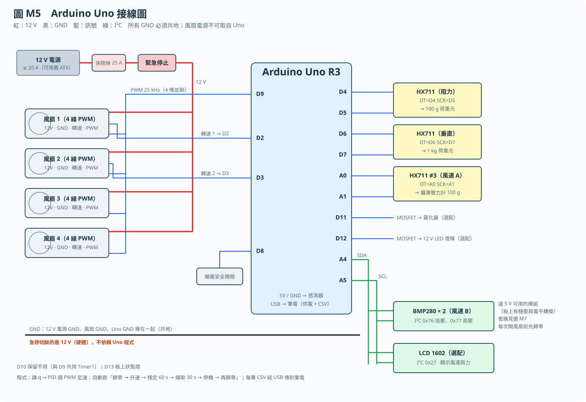
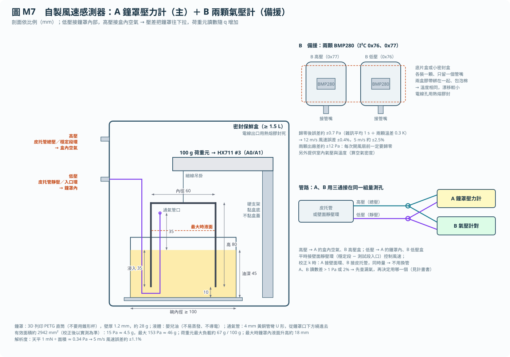
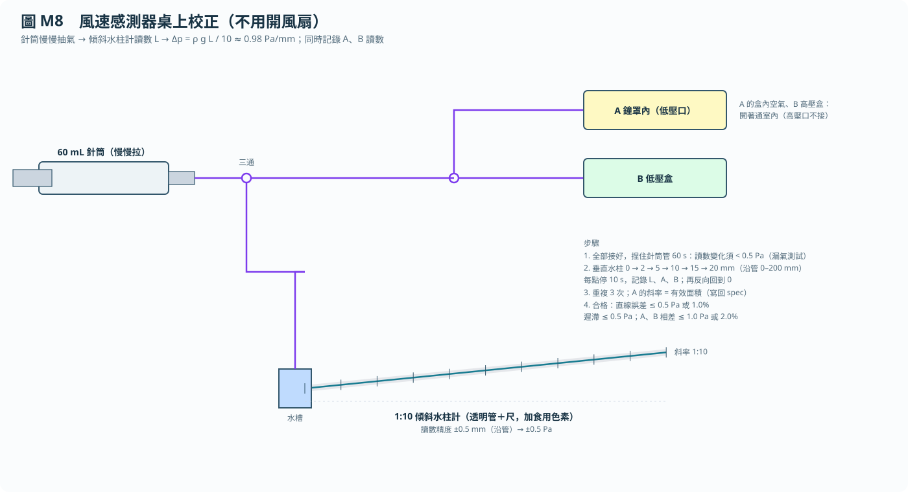

# 迷你風洞——課程專題版（1:43、Arduino Uno、預算 NT$5,000）

> 這是通識課期末專題採用的版本。它把完整版（[archive/full_1to18/build_plan.zh-TW.md](archive/full_1to18/build_plan.zh-TW.md)，1:18，僅供參考）的設計整體縮小為 0.42 倍，並改用 12 V 電腦風扇與 Arduino Uno 控制。設計原則不變：吸氣式風洞、6:1 收縮、密封天平、阻力平台與量測前後歸零。
>
> 研究方法（論文格式）見 [model.md](model.md)；購物清單見 [shopping_list.zh-TW.md](shopping_list.zh-TW.md)。
>
> 幾何以圖表示（圖 M1–M6，依比例）；精確數值在 [spec/mini.json](spec/mini.json)，計算可用 `python3 tools/mini_calc.py` 重算，一致性用 `python3 tools/test_mini.py` 檢查（20 項全部通過）。

**建造一座全長約 1.7 m、可放在兩張課桌上的吸氣式風洞：以 Arduino Uno 控制 4 個 12 V 風扇，風速 5–14 m/s，量測 1:43 車模的阻力與下壓力，解析度約 1 mN（0.1 公克重），材料費不超過 NT$5,000。**

## 要量的力有多大

$$
F = C\,q\,A_m,\qquad q = \tfrac12\rho U^2
$$

以 1:43 車模估計：$A_m = 0.00114\ \mathrm{m^2}$、$C_D = 0.35$、$|C_L| = 0.30$。

| 風速 (m/s) | $q$ (Pa) | 阻力 (mN) | 垂直力 (mN) | 1 mN 佔阻力 | 用途 |
| --- | --- | --- | --- | --- | --- |
| 5 | 15 | 6 | 5 | 17% | 只看趨勢 |
| 10 | 60 | 24 | 21 | 4.2% | 課堂展示 |
| 12 | 86 | 34 | 30 | 2.9% | 係數等級起點 |
| 14 | 118 | 47 | 40 | 2.1% | 最高目標 |

**12 m/s 以上的數據才算係數等級；課堂展示用 10 m/s，展示「差異」（例如加尾翼、改車高）即可。** 風速不需要乘縮尺比例，原因見完整版的[設計說明](archive/full_1to18/airflow_design.zh-TW.md)。

## 設備配置

全長約 1.7 m，加上進氣端 0.4 m、排氣端 0.8 m 的淨空，約需 3 m 的直線空間。排氣端不要對著人。

## 組件

### A. 氣流通道

**A1. 整流。** 蜂巢可用 6 mm 吸管剪成 40 mm 長、整齊黏成一面（約 4,000 支），或用學校的 3D 印表機分塊印六角格。兩片網用聚酯紗（voile）或不鏽鋼網，開孔率須在 60–70%，裝在可抽出、加泡棉膠條的框裡。

**A2. 收縮段。** 曲線與完整版相同，只是縮小。圖中每個站位的全寬與全高，就是肋板的外形尺寸。

**A3. 測試段。** 用 3 mm 實心透明 PC 板（不是中空板），請賣家 CNC 裁切，不要雷射切。頂板在入口端用鉸鏈或膠帶固定，出口端可墊高 0–6 mm，用來把沿流向的壓力梯度調平。

**A4. 擴散段。** 由 168 × 126 擴大到 240 × 240（正好放 2 × 2 個風扇），可用四片平的梯形板做成，不需要彎曲。等效圓錐半角 4.7°，低於 5° 的分離界限。出口放一片 5–10 mm 網目的安全網。

**A5. 風扇。** 4 個 120 × 120 × 38 mm 的 12 V 四線 PWM 高靜壓風扇（Delta PFC1212DE 或同級），排成 2 × 2。依官方最大風量與最大靜壓估計，全速約可到 15.8 m/s；這是粗估，裝好後要實測。

### B. 地面板與車輪支撐

- **地面板：** 3 mm 板，前緣磨成 4:1 橢圓，後緣加可調襟翼；車模區域平面度 0.15 mm 以內。
- **輪井與護套：** 每個車輪開口下方掛一個封底小盒；支柱穿過固定在風洞上的細管，不讓板下的風吹到支柱。
- **V 形托座：** 車輪直接坐在 V 形槽上（不用滾輪，這個尺寸滾輪太小）。水平力要達到車重的 0.38 倍車輪才會被推出，遠大於阻力。托座可 3D 列印。

### C. 天平

載重路徑與完整版相同（概念見完整版[圖 A6](archive/full_1to18/figures/zh-TW/A6-drag-path.svg)，只是滾輪換成 V 形托座）：

1. 四個托座鎖在共用框架上，整個框架一起動。
2. 框架坐在阻力平台上：四片厚薄規鋼片（0.1 × 10 × 20 mm）讓上板只能前後動，前後的力全部推向 100 g 阻力荷重元。
3. 阻力平台再坐在 1 kg 垂直荷重元上，讀重量 + 下壓力。
4. 全部放在密封靜壓箱裡，靜壓箱用細管接到車身中段的側壁孔，讓箱內外壓力相同。
5. 底座放在桌面或地板上，加約 5 kg 配重（磚塊或書），不要放在風洞框架上，以免風扇振動傳進天平。

活動質量（車模 + 托座 + 框架 + 阻力平台）須在 0.6 kg 以內。荷重元與鋼片並聯，荷重元約承受 83% 的阻力；這個比例固定，組裝後的力校正會一併扣除。

### D. Arduino 控制與量測

**Arduino 負責全部控制：**

- **定速：** 讀風速感測器 A（鐘罩壓力計）的壓差算出 $q$ 與風速，用 PID 自動調 PWM，把風速穩在設定值（風扇轉速只當參考）。
- **自動測力流程：** 按一個鍵，依序執行「歸零 30 s → 升速 → 穩定 60 s → 擷取 30 s → 停機 → 兩分鐘內再歸零」，零點偏移超過 1 mN 就自動標記作廢。
- **安全：** 艙蓋開關一打開，程式立即切斷風扇 12 V（只把 PWM 設為 0 風扇不會停，見待確認事項）；另有硬體急停直接切斷 12 V。
- **紀錄：** 每筆資料（時間、原始讀數、$q$、$U$、阻力、垂直力、PWM、轉速、歸零值）以 CSV 經 USB 傳到筆電，用 Excel 或 Python 畫圖。

**感測器：**

- **風速：** 自製兩套，接在同一組量測孔（見下方「D2. 自製風速感測器」）：A 鐘罩壓力計（主，第三組 HX711 接 A0/A1）、B 兩顆 BMP280（備援與互相比對，I²C 0x76/0x77）。平時接壁面靜壓環（穩定段 − 測試段入口），校正時接皮托管，求出換算係數 $k$。**每次開風扇前兩套都要歸零。**
- **力：** 兩組 HX711（每秒 10 筆）。100 g 荷重元量阻力，1 kg 荷重元量垂直力。
- **選配：** LCD 1602 顯示風速與力。室溫與氣壓由 B 的 BMP280 順便量（算空氣密度），不必另買 BME280。

### D2. 自製風速感測器（A 主、B 備援、C 最後手段）

**為什麼自製：** 風速 5–14 m/s 的動壓只有 15–118 Pa。現成的數位差壓感測器（ABP2、SDP810）含運費要 NT$1,100–1,600；自製兩套合計約 NT$430–800，而且 A 在低速比現成品更準。兩套接同一組管子，一套出問題時另一套直接接手，也能互相檢查。

**A 鐘罩壓力計（主）：** 一個倒放的直筒杯（鐘罩）口朝下泡在油裡，吊在 100 g 荷重元下。鐘罩內接低壓、盒內空氣接高壓，壓差 × 鐘罩面積 = 往下拉的力。油把杯口封住，所以沒有摩擦、也沒有橡膠膜的彈力。

| 項目 | 數值 |
| --- | --- |
| 鐘罩 | 3D 列印 PETG 直筒，內徑 60 mm、高 80 mm、壁厚 1.2 mm，約 28 g |
| 液體 | 嬰兒油，深 45 mm；鐘罩浸入 35 mm、口離碗底 10 mm |
| 力 | 15 Pa ≈ 4.5 g；最大約 46 g；荷重元最大負載約 67 g / 100 g |
| 解析度 | 天平 1 mN ÷ 面積 ≈ 0.34 Pa → 5 m/s 風速誤差約 ±1.1%、12 m/s 約 ±0.2% |
| 最大壓差時鐘罩內液面 | 升高約 18 mm（通氣管口高於液面 35 mm，不會淹到） |

**做法：**

1. 列印鐘罩（直筒，不可用錐形杯，否則液面一升面積就變），頂部做吊環。
2. 碗（內徑 ≥ 100 mm）放在保鮮盒底部中央；硬支架黏在盒底，100 g 荷重元固定在支架上，自由端在碗正上方。**不要裝在盒蓋上**（盒蓋受壓會變形）。
3. 4 mm 黃銅管彎成 U 形：一端穿出盒壁當低壓口，另一端從鐘罩口下方繞進鐘罩，管口高於靜止液面 35 mm。
4. 盒壁再開一個高壓口（只通盒內空氣）。電線孔、管孔全部用熱熔膠封死。
5. 倒入嬰兒油到 45 mm，用細線把鐘罩吊上，確認鐘罩不碰碗、不碰通氣管。
6. HX711 #3 接 A0（DT）、A1（SCK）。盒子放桌上，不要放在風洞框架上（避免風扇振動）。

**B 兩顆 BMP280（備援）：** 兩顆 5 V 可用的 BMP280 模組，各封在一個底片盒或小密封盒裡，只留一個管嘴：一顆接高壓、一顆接低壓，相減得到壓差。兩盒用膠帶綁在一起、包泡棉，讓溫度相同。SDO 接 GND 的是 0x76（低壓）、接 VCC 的是 0x77（高壓）。兩顆出廠差約 ±12 Pa，**每次歸零後**誤差約 ±0.7 Pa：12 m/s 風速誤差約 ±0.4%，5 m/s 約 ±2.5%。

**管路：** 高壓和低壓各用一個三通，同時接到 A 和 B（圖 M7 右下）。量 $k$ 時把 A 接壁面靜壓環、B 接皮托管，同時讀，不用換管。

**桌上校正（不開風扇，圖 M8）：**

1. 做 1:10 傾斜水柱計：透明管固定在 ≥ 300 mm 的板子上，一端抬高到斜率 1:10，水加食用色素。沿管讀 1 mm ≈ 0.98 Pa。
2. 針筒、水柱計、A 的鐘罩內、B 的低壓盒用三通接在一起；A 的盒內與 B 的高壓盒開著通室內。
3. **漏氣測試：** 拉一點針筒後捏住管子 60 s，讀數變化須 < 0.5 Pa。
4. 垂直水柱 0 → 2 → 5 → 10 → 15 → 20 mm（沿管 0–200 mm），每點停 10 s，記錄水柱讀數、A、B；再反向回到 0。重複 3 次。
5. A 的斜率就是有效面積，寫回 [spec/mini.json](spec/mini.json)。

**用哪一套（決定規則）：**

| 情況 | 用哪一套 |
| --- | --- |
| A 通過桌上校正（直線誤差 ≤ 0.5 Pa 或 1%、遲滯 ≤ 0.5 Pa、不漏氣），且風洞裡 A、B 相差 ≤ 1 Pa 或 2% | **A 控制風速**，B 每次一起記錄當檢查 |
| A 漏氣修不好、遲滯太大，或風扇振動讓 A 雜訊 > 0.5 Pa | **改用 B**（5 m/s 準度較差，報告中註明） |
| B 也不行（歸零後 2 分鐘內漂移 > 2 Pa） | **C：** 買 Honeywell ABP2MRRN001ND2A3XX（見[購物清單](shopping_list.zh-TW.md)的備案 C），或用水柱計校正「PWM → 風速」對照表 |
| A、B 相差超過標準 | 先做漏氣測試、檢查管子有沒有折到或進油，再重新桌上校正 |

### E. 流場可視化

用細毛線或縫紉線做絲線（tufts），貼在車模或擴散段壁面上，風一吹就看得到哪裡氣流分離；成本幾乎為零，適合課堂展示。霧氣為選配，預算不夠就不做。

### F. 校正

- **力：** 用 0.01 g 口袋秤量好幾枚硬幣或小螺帽當砝碼。垂直方向直接放在車位上；阻力方向用細線繞過低摩擦滑輪，兩個方向各拉一次取平均。
- **風速感測器本身：** 先在桌上用針筒與 1:10 傾斜水柱計校正（圖 M8），得到 A 的有效面積與 B 的換算。
- **風速：** A 接壁面靜壓環、B 接皮托管同時讀，求出 $k$；有車模與無車模各做一次。

### G. 安全

- **電：** 12 V 雖是低壓，但 4 個風扇合計可達約 19 A。主幹用 14 AWG 線、每個風扇用 18 AWG，電源出口加 25 A 保險絲。
- **風扇：** 出口加金屬護網；接觸風管內部前先按急停。
- **噪音：** 4 個風扇全速約 70 dBA 以上。課堂展示用 10 m/s（約 60% PWM）並縮短運轉時間。
- **鬆脫零件：** 每次啟動前檢查測試段內有無工具或車模零件。

## 預算

品項、規格、蝦皮搜尋關鍵字與「為什麼會到 7,000–8,000」的說明見 [shopping_list.zh-TW.md](shopping_list.zh-TW.md)。

| 項目 | 估計 NT$ | 依據 |
| --- | --- | --- |
| 4 × 12038 PWM 風扇 | 2,000–3,000 | 已查：每個 US$16–24 |
| 風速感測器 A：100 g 荷重元 + HX711、保鮮盒、嬰兒油、接頭（鐘罩學校列印） | 230–350 | 估計 |
| 風速感測器 B：2 × BMP280（5 V 模組）、底片盒 | 120–300 | 估計 |
| 校正：傾斜水柱計透明管與板、60 mL 針筒、三通 | 80–150 | 估計 |
| 12 V ≥ 20 A 電源 | 0–900 | 舊 ATX 電源免費；零售估計 |
| 100 g、1 kg 荷重元 + 2 × HX711 | 250–400 | 估計 |
| 皮托管、鐘罩通氣用黃銅 U 管、矽膠管、三通 | 150–300 | 估計 |
| 3 mm 透明 PC 板（約 3.7 才） | 300–500 | 已查：每才 60–75 元 + 裁切費 |
| 夾板／MDF 肋板、PET 薄板、擴散段板 | 300–600 | 估計 |
| 吸管或列印蜂巢、紗網 | 100–200 | 估計 |
| 1:43 合金車模 | 80–450 | 已查：SHEIN 台灣 NT$77–445 |
| 電線、保險絲座、急停、接頭、螺絲、熱熔膠 | 200–400 | 估計 |
| 厚薄規、橡膠膜、雜項 | 100–200 | 估計 |
| **合計** | **3,910–7,750** | |

**要守住 NT$5,000，必須走低價路線：** 用舊電腦電源、找最便宜的同級風扇、挑便宜的車模，並盡量用學校的工具與廢料。若下單前發現超過，**第一個刪的是風速感測器 B**（省 NT$120–300，但失去備援與比對）；風速感測器 A 和校正用水柱計不能刪。

## 操作程序

**測力：** 檢查測試段內無鬆脫物、車模坐穩 → 在 Arduino 選定風速 → 按開始，程式自動完成歸零、穩定、擷取、再歸零 → 筆電存檔。

**可視化：** 貼好絲線 → 設定風速 → 拍照或錄影。可視化時的力數據不使用。

## 驗收測試

| 指標 | 方法 | 合格標準 |
| --- | --- | --- |
| 力漂移 | 無風、裝上車模，記錄 30 分鐘 | 相鄰 30 s 平均差在 1 mN 以內 |
| 力重複性 | 加卸砝碼十次；車模重新放五次 | 1 mN 以內，重放另行報告 |
| 風扇干擾 | 風扇全速但拆開軟接，天平不受風 | 力雜訊與風扇關閉時相同 |
| 風速感測器校正 | 桌上針筒 + 1:10 水柱計（圖 M8） | A 直線誤差 ≤ 0.5 Pa 或 1%；遲滯 ≤ 0.5 Pa；60 s 漏氣 < 0.5 Pa |
| A、B 比對 | 風洞 5、10、14 m/s，A、B 接同一組孔 | 相差 ≤ 1 Pa 或 2% |
| 風速穩定 | 10 分鐘內各 30 s 平均 | ±1% 以內 |
| 風速均勻 | 50 點量測（10 m/s） | 平均值的 ±2% 以內；達不到就記錄實際值 |
| 支撐件皮重 | 只有托座、各風速下有風 | 以 $q$ 的函數記錄 |

## 建造順序

1. **量測與訂購：** 買到車模後量長度、軸距、輪距、輪徑、車高與重量，更新 [spec/mini.json](spec/mini.json) 再訂料。
2. **電子先行：** 先在桌上接好 Uno、HX711、荷重元，跑整夜漂移測試；**做好風速感測器 A、B 並完成桌上校正（圖 M8）**；風扇接上後測 PWM 與轉速。**買齊風扇前，先買 1 個 QFR1212GHE 跑 [arduino/fan_pwm_test](arduino/fan_pwm_test/fan_pwm_test.ino)，決定風扇型號（見待確認事項）。****天平在桌上達不到 1 mN 就先不要做風洞本體。**
3. **風洞本體：** 穩定段、收縮段、測試段、擴散段、風扇座；用熱熔膠與泡棉膠條密封。
4. **天平與靜壓箱：** 托座、框架、阻力平台、靜壓箱、底座。
5. **試車與校正：** 慢慢升速，檢查漏氣（絲線貼在縫隙旁）、振動；校正 $k$ 與力。
6. **驗收與展示：** 跑驗收測試，準備課堂展示。

## 待確認事項

| 項目 | 狀況 |
| --- | --- |
| 風扇型號 | 用官方 P-Q 曲線重算：4 × PFC1212DE 全速約 17.1 m/s；8 × QFR1212GHE 兩兩疊放約 16.0–16.5 m/s（較便宜）。QFR 只有 2 線，要用 MOSFET 切 12 V 調速；先買 1 個用 fan_pwm_test 測：30–100% 能平順調速就買 QFR，否則改 PFC1212DE 或只跑 10–16 m/s |
| 風扇停機 | 4 線風扇 PWM 0% 仍以約 1,550 rpm 轉（約 4.8 m/s），PWM 線斷開或 Uno 重開機時會全速；艙蓋開關與停機必須切斷風扇 12 V（MOSFET 或繼電器，預設關閉），不能只靠 PWM 0 |
| 車身變低 | V 形托座讓輪胎最低點比接觸點低約 0.53 mm，1:43 車高約 3 mm，約少 18%；量測時記錄實際車高 |
| 預算上限 | 估計上限 NT$8,455 超過 NT$5,000；需走低價路線或刪壓差感測器（見[購物清單](shopping_list.zh-TW.md)） |
| 鐘罩有效面積 | 0.00294 m² 是設計估計；以桌上校正的斜率為準，寫回 spec |
| 風速感測器 A 的振動 | 盒子若放在會振動的桌上，A 的雜訊可能變大；先在風扇全速時記錄無風管的 A 讀數，雜訊 > 0.5 Pa 就換位置或改用 B |
| 車模尺寸 | 目前是一般 1:43 掀背車的估計值，買到後實測更新 |
